# Comparison with other unit libraries

Generated by `benchmarks/tools/report.py` from the raw files in `benchmarks/results/`. Do not edit by hand. Method and rules: [`docs/benchmarking.md`](../benchmarking.md).

## Runs included

| Library | Kind | Runtime | OS / CPU | Date (UTC) | Lockfile | Corpus |
|---|---|---|---|---|---|---|
| astropy 8.0.2 | library | CPython 3.13.18 | Linux 6.18.44-fc-v310; Intel(R) Xeon(R) Processor @ 2.30GHz; 4 cores; governor unknown | 2026-11-08T22:36:11Z | requirements.lock.txt+package-lock.json+Cargo.lock | 60d7ca04ff45cf8d |
| convert-units 2.3.4 | library | node v22.23.4 | Linux 6.18.44-fc-v310; Intel(R) Xeon(R) Processor @ 2.30GHz; 4 cores; governor unknown | 2026-11-08T22:43:32Z | requirements.lock.txt+package-lock.json+Cargo.lock | 60d7ca04ff45cf8d |
| dimvexa 0.1.0+6f3d437-dirty | library | rustc rustc 1.97.0 (2d8144b78 2026-07-07) | Linux 6.18.44-fc-v310; Intel(R) Xeon(R) Processor @ 2.30GHz; 4 cores; governor unknown | 2026-11-08T22:31:21Z | requirements.lock.txt+package-lock.json+Cargo.lock | 60d7ca04ff45cf8d |
| dimvexa-py 0.1.0+v9+fnv1a64:70613d89e0c2758d | library | CPython 3.13.18 | Linux 6.18.44-fc-v310; Intel(R) Xeon(R) Processor @ 2.30GHz; 4 cores; governor unknown | 2026-11-08T22:33:18Z | requirements.lock.txt+package-lock.json+Cargo.lock | 60d7ca04ff45cf8d |
| dimvexa-wasm 0.1.0+v9+fnv1a64:70613d89e0c2758d | library | node v22.23.4 | Linux 6.18.44-fc-v310; Intel(R) Xeon(R) Processor @ 2.30GHz; 4 cores; governor unknown | 2026-11-08T22:45:25Z | requirements.lock.txt+package-lock.json+Cargo.lock | 60d7ca04ff45cf8d |
| js-float-ceiling 22.23.4 [ceiling] | ceiling | node v22.23.4 | Linux 6.18.44-fc-v310; Intel(R) Xeon(R) Processor @ 2.30GHz; 4 cores; governor unknown | 2026-11-08T22:36:54Z | requirements.lock.txt+package-lock.json+Cargo.lock | 60d7ca04ff45cf8d |
| js-quantities 1.8.0 | library | node v22.23.4 | Linux 6.18.44-fc-v310; Intel(R) Xeon(R) Processor @ 2.30GHz; 4 cores; governor unknown | 2026-11-08T22:40:19Z | requirements.lock.txt+package-lock.json+Cargo.lock | 60d7ca04ff45cf8d |
| mathjs 13.2.0 | library | node v22.23.4 | Linux 6.18.44-fc-v310; Intel(R) Xeon(R) Processor @ 2.30GHz; 4 cores; governor unknown | 2026-11-08T22:37:12Z | requirements.lock.txt+package-lock.json+Cargo.lock | 60d7ca04ff45cf8d |
| numpy-ceiling 2.5.4 [ceiling] | ceiling | CPython 3.13.18 | Linux 6.18.44-fc-v310; Intel(R) Xeon(R) Processor @ 2.30GHz; 4 cores; governor unknown | 2026-11-08T22:33:02Z | requirements.lock.txt+package-lock.json+Cargo.lock | 60d7ca04ff45cf8d |
| pint 0.26.2 | library | CPython 3.13.18 | Linux 6.18.44-fc-v310; Intel(R) Xeon(R) Processor @ 2.30GHz; 4 cores; governor unknown | 2026-11-08T22:34:00Z | requirements.lock.txt+package-lock.json+Cargo.lock | 60d7ca04ff45cf8d |
| rust-ceiling 1.97.0 [ceiling] | ceiling | rustc rustc 1.97.0 (2d8144b78 2026-07-07) | Linux 6.18.44-fc-v310; Intel(R) Xeon(R) Processor @ 2.30GHz; 4 cores; governor unknown | 2026-11-08T22:32:33Z | requirements.lock.txt+package-lock.json+Cargo.lock | 60d7ca04ff45cf8d |
| unyt 3.2.0 | library | CPython 3.13.18 | Linux 6.18.44-fc-v310; Intel(R) Xeon(R) Processor @ 2.30GHz; 4 cores; governor unknown | 2026-11-08T22:35:10Z | requirements.lock.txt+package-lock.json+Cargo.lock | 60d7ca04ff45cf8d |
| uom 0.36.0 | library | rustc rustc 1.97.0 (2d8144b78 2026-07-07) | Linux 6.18.44-fc-v310; Intel(R) Xeon(R) Processor @ 2.30GHz; 4 cores; governor unknown | 2026-11-08T22:33:02Z | requirements.lock.txt+package-lock.json+Cargo.lock | 60d7ca04ff45cf8d |

> **These results are older than the committed corpus (`dcb9eaeed026e66b`).** Cases added since then (for example the independent ones) have no result yet; rerun `benchmarks/run_all.sh` to refresh every table.

> Some library versions were not installed from a lockfile (`lockfile` column). Treat those rows as indicative only.

GitHub-hosted runners are noisy. Python and JavaScript wall-clock figures are indicative; read the MAD (median absolute deviation) next to each median, and the raw samples in the JSON.

## Speed

Median ns per conversion (MAD in brackets). **Scalar**: prepared conversion applied to one value, including the loop iteration of the host language (see the loop overhead rows). **One-shot**: parse a string such as `10 m/s` and convert it. **Batch**: ns per element for N values. Rows marked [ceiling] do no unit handling; they show what the language itself costs. `n/a` means the library has no such API or the runner could not run it (see the JSON `errors`).

### affine_temperature

| Library / mode | Scalar | Loop overhead | One-shot parse+convert | Batch 1,000 | Batch 100,000 | Batch 1,000,000 |
|---|---|---|---|---|---|---|
| astropy 8.0.2 / plain | 41.5 us (MAD 1.61 us) | 20.8 ns (MAD 0.298 ns) | 49.1 us (MAD 280 ns) | 57.9 ns (MAD 1.65 ns) | 3.07 ns (MAD 0.147 ns) | 3.7 ns (MAD 0.0151 ns) |
| astropy 8.0.2 / unit_to | 33.5 us (MAD 84.9 ns) | 19.9 ns (MAD 0.092 ns) | 49.3 us (MAD 150 ns) | 35.9 ns (MAD 0.545 ns) | 2.41 ns (MAD 0.273 ns) | 2.92 ns (MAD 0.0139 ns) |
| convert-units 2.3.4 / plain | 2.39 us (MAD 10.7 ns) | 2.22 ns (MAD 0.00348 ns) | n/a | 2.39 us (MAD 42.4 ns) | 2.37 us (MAD 16.2 ns) | 2.57 us (MAD 41.6 ns) |
| dimvexa 0.1.0+6f3d437-dirty / cli | n/a | n/a | 1.27 ms (MAD 26.7 us) | n/a | n/a | n/a |
| dimvexa 0.1.0+6f3d437-dirty / exact | 87 ns (MAD 0.642 ns) | 0.266 ns (MAD 0.00383 ns) | 1.63 us (MAD 14.5 ns) | 488 ns (MAD 19 ns) | 441 ns (MAD 4.29 ns) | 450 ns (MAD 1.33 ns) |
| dimvexa 0.1.0+6f3d437-dirty / prepared | 0.426 ns (MAD 0.00348 ns) | 0.261 ns (MAD 0.00208 ns) | 1.43 us (MAD 14.1 ns) | 0.169 ns (MAD 0.001 ns) | 0.193 ns (MAD 0.00131 ns) | 0.567 ns (MAD 0.0127 ns) |
| dimvexa-py 0.1.0+v9+fnv1a64:70613d89e0c2758d / conv | 59.7 ns (MAD 0.487 ns) | 19.8 ns (MAD 0.0389 ns) | 2.16 us (MAD 24.1 ns) | 1.84 ns (MAD 0.077 ns) | 1.23 ns (MAD 0.0128 ns) | 1.8 ns (MAD 0.0447 ns) |
| dimvexa-py 0.1.0+v9+fnv1a64:70613d89e0c2758d / plain | 1.64 us (MAD 7.48 ns) | 26.8 ns (MAD 2.84 ns) | 2.08 us (MAD 28.6 ns) | 3.36 ns (MAD 0.073 ns) | 1.28 ns (MAD 0.0238 ns) | 1.84 ns (MAD 0.0116 ns) |
| dimvexa-wasm 0.1.0+v9+fnv1a64:70613d89e0c2758d / batch | 7.26 ns (MAD 0.0501 ns) | 2.21 ns (MAD 0.0267 ns) | 3.51 us (MAD 155 ns) | 12.3 ns (MAD 9.22 ns) | 3.03 ns (MAD 0.406 ns) | 6.54 ns (MAD 0.122 ns) |
| dimvexa-wasm 0.1.0+v9+fnv1a64:70613d89e0c2758d / conv | 8.1 ns (MAD 0.285 ns) | 2.22 ns (MAD 0.0241 ns) | 3.41 us (MAD 32.5 ns) | 5.01 ns (MAD 0.078 ns) | 5.3 ns (MAD 0.167 ns) | 5.4 ns (MAD 0.114 ns) |
| dimvexa-wasm 0.1.0+v9+fnv1a64:70613d89e0c2758d / plain | 2.59 us (MAD 4.81 ns) | 2.22 ns (MAD 0.00422 ns) | 3.42 us (MAD 6.78 ns) | 4.02 us (MAD 34.4 ns) | 2.6 us (MAD 24.6 ns) | 2.61 us (MAD 20.1 ns) |
| js-float-ceiling 22.23.4 [ceiling] / loop | 9.38 ns (MAD 0.0399 ns) | 2.22 ns (MAD 0.00143 ns) | n/a | 1.4 ns (MAD 0.089 ns) | 0.799 ns (MAD 0.00608 ns) | 1.22 ns (MAD 0.318 ns) |
| js-quantities 1.8.0 / plain | 4.72 us (MAD 86.3 ns) | 2.24 ns (MAD 0.00762 ns) | 4.7 us (MAD 34.8 ns) | 4.62 us (MAD 70.1 ns) | 4.55 us (MAD 161 ns) | 4.57 us (MAD 261 ns) |
| js-quantities 1.8.0 / swift | 4.37 us (MAD 187 ns) | 2.35 ns (MAD 0.0934 ns) | 4.6 us (MAD 78.7 ns) | 4.64 us (MAD 93.2 ns) | 4.59 us (MAD 178 ns) | 4.45 us (MAD 37.3 ns) |
| mathjs 13.2.0 / factor | 5.99 ns (MAD 0.119 ns) | 2.29 ns (MAD 0.0747 ns) | 5.2 us (MAD 465 ns) | 0.836 ns (MAD 0.001 ns) | 0.787 ns (MAD 0.00249 ns) | 0.867 ns (MAD 0.0021 ns) |
| mathjs 13.2.0 / plain | 4.18 us (MAD 30.2 ns) | 2.25 ns (MAD 0.0243 ns) | 4.38 us (MAD 17.2 ns) | 4.09 us (MAD 68.8 ns) | 4.34 us (MAD 256 ns) | 4.32 us (MAD 94.3 ns) |
| numpy-ceiling 2.5.4 [ceiling] / multiply | 84.9 ns (MAD 0.995 ns) | 20.1 ns (MAD 0.153 ns) | n/a | 1.3 ns (MAD 0.013 ns) | 0.326 ns (MAD 0.00142 ns) | 0.85 ns (MAD 0.00195 ns) |
| pint 0.26.2 / factor | 35.8 ns (MAD 0.314 ns) | 21.7 ns (MAD 0.776 ns) | 55.5 us (MAD 84.2 ns) | 1.32 ns (MAD 0.055 ns) | 0.317 ns (MAD 0.00189 ns) | 1.11 ns (MAD 0.00938 ns) |
| pint 0.26.2 / plain | 16.2 us (MAD 182 ns) | 20.4 ns (MAD 0.118 ns) | 58.6 us (MAD 167 ns) | 21.6 ns (MAD 0.799 ns) | 2.8 ns (MAD 0.17 ns) | 4.06 ns (MAD 0.115 ns) |
| pint 0.26.2 / wraps | 20.4 us (MAD 719 ns) | 20.6 ns (MAD 0.209 ns) | 58 us (MAD 1.35 us) | 22.6 ns (MAD 0.395 ns) | 2.5 ns (MAD 0.243 ns) | 3.39 ns (MAD 0.0381 ns) |
| rust-ceiling 1.97.0 [ceiling] / memcpy | n/a | 0.261 ns (MAD 0.0021 ns) | n/a | 0.072 ns (MAD 0.001 ns) | 0.192 ns (MAD 0.00129 ns) | 0.563 ns (MAD 0.0324 ns) |
| rust-ceiling 1.97.0 [ceiling] / plain_loop | 0.345 ns (MAD 0.000507 ns) | 0.261 ns (MAD 0.000148 ns) | n/a | 0.136 ns (MAD 0.001 ns) | 0.181 ns (MAD 0.00066 ns) | 0.532 ns (MAD 0.00694 ns) |
| unyt 3.2.0 / factor | unsupported |  |  |  |  |  |
| unyt 3.2.0 / plain | 14.7 us (MAD 132 ns) | 20.8 ns (MAD 0.549 ns) | 65.8 us (MAD 242 ns) | 13.5 ns (MAD 0.492 ns) | 1.09 ns (MAD 0.034 ns) | 1.85 ns (MAD 0.0189 ns) |
| unyt 3.2.0 / to_value | 14.4 us (MAD 30.6 ns) | 20.2 ns (MAD 0.113 ns) | 64.8 us (MAD 93.9 ns) | 13.5 ns (MAD 0.266 ns) | 0.855 ns (MAD 0.0197 ns) | 1.46 ns (MAD 0.0198 ns) |
| uom 0.36.0 / typed | 0.4 ns (MAD 0.0122 ns) | 0.262 ns (MAD 0.000602 ns) | n/a | 0.161 ns (MAD 0.001 ns) | 0.196 ns (MAD 0.00062 ns) | 0.564 ns (MAD 0.0277 ns) |

### compound_cp

| Library / mode | Scalar | Loop overhead | One-shot parse+convert | Batch 1,000 | Batch 100,000 | Batch 1,000,000 |
|---|---|---|---|---|---|---|
| astropy 8.0.2 / plain | 5.11 us (MAD 25.7 ns) | 20.1 ns (MAD 0.316 ns) | 122 us (MAD 534 ns) | 5.76 ns (MAD 0.375 ns) | 0.599 ns (MAD 0.00586 ns) | 1.14 ns (MAD 0.000842 ns) |
| astropy 8.0.2 / unit_to | 902 ns (MAD 2.23 ns) | 20.2 ns (MAD 0.139 ns) | 123 us (MAD 727 ns) | 1.91 ns (MAD 0.07 ns) | 0.259 ns (MAD 0.0113 ns) | 0.939 ns (MAD 0.00562 ns) |
| convert-units 2.3.4 / plain | unsupported |  |  |  |  |  |
| dimvexa 0.1.0+6f3d437-dirty / cli | n/a | n/a | 1.24 ms (MAD 44.2 us) | n/a | n/a | n/a |
| dimvexa 0.1.0+6f3d437-dirty / exact | 327 ns (MAD 3.56 ns) | 0.257 ns (MAD 0.00277 ns) | 3.91 us (MAD 50.1 ns) | 658 ns (MAD 7.88 ns) | 661 ns (MAD 5.46 ns) | 680 ns (MAD 9.91 ns) |
| dimvexa 0.1.0+6f3d437-dirty / prepared | 0.504 ns (MAD 0.0106 ns) | 0.26 ns (MAD 0.00185 ns) | 3.37 us (MAD 64.1 ns) | 0.109 ns (MAD 0.001 ns) | 0.178 ns (MAD 0.00057 ns) | 0.57 ns (MAD 0.0229 ns) |
| dimvexa-py 0.1.0+v9+fnv1a64:70613d89e0c2758d / conv | 61.6 ns (MAD 1.04 ns) | 20.7 ns (MAD 0.592 ns) | 5.17 us (MAD 41.4 ns) | 1.56 ns (MAD 0.043 ns) | 0.999 ns (MAD 0.00521 ns) | 2.03 ns (MAD 0.111 ns) |
| dimvexa-py 0.1.0+v9+fnv1a64:70613d89e0c2758d / plain | 4.26 us (MAD 7.57 ns) | 20.5 ns (MAD 0.287 ns) | 5.11 us (MAD 36.3 ns) | 6.1 ns (MAD 0.091 ns) | 1.05 ns (MAD 0.00373 ns) | 1.28 ns (MAD 0.0276 ns) |
| dimvexa-wasm 0.1.0+v9+fnv1a64:70613d89e0c2758d / batch | 8.53 ns (MAD 0.112 ns) | 2.22 ns (MAD 0.00108 ns) | 7.89 us (MAD 60.6 ns) | 2.23 ns (MAD 0.391 ns) | 1.81 ns (MAD 0.00717 ns) | 4.97 ns (MAD 0.115 ns) |
| dimvexa-wasm 0.1.0+v9+fnv1a64:70613d89e0c2758d / conv | 9.12 ns (MAD 0.289 ns) | 2.23 ns (MAD 0.00537 ns) | 8.21 us (MAD 68.1 ns) | 4.69 ns (MAD 0.047 ns) | 4.81 ns (MAD 0.154 ns) | 4.89 ns (MAD 0.0212 ns) |
| dimvexa-wasm 0.1.0+v9+fnv1a64:70613d89e0c2758d / plain | 6.36 us (MAD 23.5 ns) | 2.23 ns (MAD 0.00581 ns) | 8.18 us (MAD 68 ns) | 6.54 us (MAD 172 ns) | 6.48 us (MAD 116 ns) | 6.61 us (MAD 76.5 ns) |
| js-float-ceiling 22.23.4 [ceiling] / loop | 10.6 ns (MAD 1.33 ns) | 2.23 ns (MAD 0.0109 ns) | n/a | 0.832 ns (MAD 0.001 ns) | 0.775 ns (MAD 0.00077 ns) | 0.86 ns (MAD 0.0177 ns) |
| js-quantities 1.8.0 / plain | unsupported |  |  |  |  |  |
| js-quantities 1.8.0 / swift | unsupported |  |  |  |  |  |
| mathjs 13.2.0 / factor | 6.36 ns (MAD 0.0635 ns) | 2.26 ns (MAD 0.0181 ns) | 5.62 us (MAD 9.21 ns) | 0.836 ns (MAD 0.002 ns) | 0.806 ns (MAD 0.00605 ns) | 0.963 ns (MAD 0.0133 ns) |
| mathjs 13.2.0 / plain | 5.12 us (MAD 58.9 ns) | 2.29 ns (MAD 0.0222 ns) | 5.46 us (MAD 78.6 ns) | 5.54 us (MAD 238 ns) | 5.26 us (MAD 92.8 ns) | 5.45 us (MAD 63.2 ns) |
| numpy-ceiling 2.5.4 [ceiling] / multiply | 84.3 ns (MAD 0.375 ns) | 21.2 ns (MAD 0.78 ns) | n/a | 1.3 ns (MAD 0.021 ns) | 0.32 ns (MAD 0.00212 ns) | 0.875 ns (MAD 0.000677 ns) |
| pint 0.26.2 / factor | 36 ns (MAD 0.91 ns) | 21.3 ns (MAD 0.64 ns) | 142 us (MAD 183 ns) | 1.42 ns (MAD 0.02 ns) | 0.335 ns (MAD 0.00067 ns) | 0.877 ns (MAD 0.0017 ns) |
| pint 0.26.2 / plain | 13.1 us (MAD 157 ns) | 21.2 ns (MAD 0.0585 ns) | 142 us (MAD 779 ns) | 14.1 ns (MAD 0.674 ns) | 0.482 ns (MAD 0.0216 ns) | 0.777 ns (MAD 0.0103 ns) |
| pint 0.26.2 / wraps | 13.5 us (MAD 134 ns) | 22 ns (MAD 1.17 ns) | 139 us (MAD 2.94 us) | 14.8 ns (MAD 0.542 ns) | 0.429 ns (MAD 0.0223 ns) | 0.625 ns (MAD 0.0388 ns) |
| rust-ceiling 1.97.0 [ceiling] / memcpy | n/a | 0.261 ns (MAD 0.000276 ns) | n/a | 0.072 ns (MAD 0.001 ns) | 0.192 ns (MAD 0.00133 ns) | 0.573 ns (MAD 0.0262 ns) |
| rust-ceiling 1.97.0 [ceiling] / plain_loop | 0.345 ns (MAD 0.000422 ns) | 0.262 ns (MAD 0.000613 ns) | n/a | 0.136 ns (MAD 0 ns) | 0.202 ns (MAD 0.00189 ns) | 0.565 ns (MAD 0.0237 ns) |
| unyt 3.2.0 / factor | 29.8 ns (MAD 0.112 ns) | 20.2 ns (MAD 0.0624 ns) | 104 us (MAD 105 ns) | 0.75 ns (MAD 0.023 ns) | 0.2 ns (MAD 0.00113 ns) | 0.615 ns (MAD 0.0293 ns) |
| unyt 3.2.0 / plain | 6.06 us (MAD 587 ns) | 20.6 ns (MAD 0.256 ns) | 102 us (MAD 335 ns) | 5.24 ns (MAD 0.233 ns) | 0.593 ns (MAD 0.0194 ns) | 1.26 ns (MAD 0.0283 ns) |
| unyt 3.2.0 / to_value | 5.84 us (MAD 33.9 ns) | 20.1 ns (MAD 0.0529 ns) | 102 us (MAD 1.22 us) | 5.82 ns (MAD 0.333 ns) | 0.602 ns (MAD 0.00496 ns) | 1.15 ns (MAD 0.0099 ns) |
| uom 0.36.0 / typed | unsupported |  |  |  |  |  |

### linear_pressure

| Library / mode | Scalar | Loop overhead | One-shot parse+convert | Batch 1,000 | Batch 100,000 | Batch 1,000,000 |
|---|---|---|---|---|---|---|
| astropy 8.0.2 / plain | 5.35 us (MAD 124 ns) | 20.5 ns (MAD 0.338 ns) | 12.1 us (MAD 313 ns) | 5.56 ns (MAD 0.195 ns) | 1.09 ns (MAD 0.0253 ns) | 1.87 ns (MAD 0.0233 ns) |
| astropy 8.0.2 / unit_to | 989 ns (MAD 8.62 ns) | 19.9 ns (MAD 0.0884 ns) | 11.5 us (MAD 144 ns) | 3.22 ns (MAD 0.13 ns) | 0.484 ns (MAD 0.0145 ns) | 0.942 ns (MAD 0.00176 ns) |
| convert-units 2.3.4 / plain | 4.64 us (MAD 23.9 ns) | 2.23 ns (MAD 0.00903 ns) | n/a | 5.12 us (MAD 233 ns) | 4.53 us (MAD 186 ns) | 4.88 us (MAD 124 ns) |
| dimvexa 0.1.0+6f3d437-dirty / cli | n/a | n/a | 1.2 ms (MAD 12.6 us) | n/a | n/a | n/a |
| dimvexa 0.1.0+6f3d437-dirty / exact | 424 ns (MAD 2.38 ns) | 0.261 ns (MAD 0.000189 ns) | 1.7 us (MAD 2.4 ns) | 823 ns (MAD 2.09 ns) | 830 ns (MAD 3.34 ns) | 834 ns (MAD 4.66 ns) |
| dimvexa 0.1.0+6f3d437-dirty / prepared | 0.474 ns (MAD 0.0187 ns) | 0.263 ns (MAD 0.00263 ns) | 1.16 us (MAD 18.8 ns) | 0.115 ns (MAD 0.002 ns) | 0.189 ns (MAD 0.00071 ns) | 0.538 ns (MAD 0.011 ns) |
| dimvexa-py 0.1.0+v9+fnv1a64:70613d89e0c2758d / conv | 61 ns (MAD 0.942 ns) | 20.1 ns (MAD 0.21 ns) | 2.12 us (MAD 2.92 ns) | 1.51 ns (MAD 0.021 ns) | 0.972 ns (MAD 0.00431 ns) | 1.29 ns (MAD 0.0205 ns) |
| dimvexa-py 0.1.0+v9+fnv1a64:70613d89e0c2758d / plain | 1.38 us (MAD 11.4 ns) | 20.3 ns (MAD 0.498 ns) | 2.1 us (MAD 23.7 ns) | 3.06 ns (MAD 0.089 ns) | 1.02 ns (MAD 0.00896 ns) | 1.24 ns (MAD 0.00559 ns) |
| dimvexa-wasm 0.1.0+v9+fnv1a64:70613d89e0c2758d / batch | 8.63 ns (MAD 0.167 ns) | 2.23 ns (MAD 0.00678 ns) | 3.57 us (MAD 16.6 ns) | 2.24 ns (MAD 0.129 ns) | 3.08 ns (MAD 0.17 ns) | 6.42 ns (MAD 0.318 ns) |
| dimvexa-wasm 0.1.0+v9+fnv1a64:70613d89e0c2758d / conv | 7.36 ns (MAD 0.0526 ns) | 2.22 ns (MAD 0.00686 ns) | 3.57 us (MAD 17 ns) | 4.7 ns (MAD 0.01 ns) | 4.56 ns (MAD 0.0339 ns) | 4.78 ns (MAD 0.0654 ns) |
| dimvexa-wasm 0.1.0+v9+fnv1a64:70613d89e0c2758d / plain | 2.24 us (MAD 15.8 ns) | 2.21 ns (MAD 0.0323 ns) | 3.67 us (MAD 8.7 ns) | 2.24 us (MAD 45.3 ns) | 2.25 us (MAD 22.3 ns) | 2.3 us (MAD 9.07 ns) |
| js-float-ceiling 22.23.4 [ceiling] / loop | 9.6 ns (MAD 0.21 ns) | 2.22 ns (MAD 0.0171 ns) | n/a | 1.58 ns (MAD 0.015 ns) | 1.36 ns (MAD 0.16 ns) | 1.16 ns (MAD 0.0148 ns) |
| js-quantities 1.8.0 / plain | 4.55 us (MAD 26.1 ns) | 2.24 ns (MAD 0.0179 ns) | 4.6 us (MAD 42.5 ns) | 4.69 us (MAD 28.1 ns) | 4.84 us (MAD 151 ns) | 5 us (MAD 24.1 ns) |
| js-quantities 1.8.0 / swift | 8.17 ns (MAD 0.053 ns) | 2.22 ns (MAD 0.00166 ns) | 4.71 us (MAD 49.4 ns) | 1.5 ns (MAD 0.058 ns) | 1.66 ns (MAD 0.11 ns) | 1.78 ns (MAD 0.0221 ns) |
| mathjs 13.2.0 / factor | 5.85 ns (MAD 0.0756 ns) | 2.22 ns (MAD 0.00337 ns) | 2.59 us (MAD 10.1 ns) | 0.835 ns (MAD 0.001 ns) | 0.777 ns (MAD 0.00079 ns) | 0.826 ns (MAD 0.00197 ns) |
| mathjs 13.2.0 / plain | 2.28 us (MAD 25.1 ns) | 2.22 ns (MAD 0.086 ns) | 2.59 us (MAD 102 ns) | 2.32 us (MAD 141 ns) | 2.22 us (MAD 35 ns) | 2.35 us (MAD 123 ns) |
| numpy-ceiling 2.5.4 [ceiling] / multiply | 85 ns (MAD 0.691 ns) | 19.7 ns (MAD 0.381 ns) | n/a | 1.39 ns (MAD 0.028 ns) | 0.339 ns (MAD 0.00264 ns) | 1.08 ns (MAD 0.00342 ns) |
| pint 0.26.2 / factor | 34.3 ns (MAD 0.642 ns) | 20.9 ns (MAD 0.268 ns) | 48.5 us (MAD 1.39 us) | 1.44 ns (MAD 0.037 ns) | 0.373 ns (MAD 0.00425 ns) | 1.07 ns (MAD 0.00188 ns) |
| pint 0.26.2 / plain | 10.4 us (MAD 155 ns) | 20.8 ns (MAD 0.138 ns) | 48.1 us (MAD 309 ns) | 10.9 ns (MAD 0.387 ns) | 0.293 ns (MAD 0.00588 ns) | 0.601 ns (MAD 0.00841 ns) |
| pint 0.26.2 / wraps | 11.8 us (MAD 140 ns) | 21.3 ns (MAD 0.318 ns) | 50.9 us (MAD 850 ns) | 12.5 ns (MAD 0.487 ns) | 0.729 ns (MAD 0.169 ns) | 1 ns (MAD 0.0175 ns) |
| rust-ceiling 1.97.0 [ceiling] / memcpy | n/a | 0.266 ns (MAD 0.00471 ns) | n/a | 0.072 ns (MAD 0.001 ns) | 0.233 ns (MAD 0.00127 ns) | 0.88 ns (MAD 0.0365 ns) |
| rust-ceiling 1.97.0 [ceiling] / plain_loop | 0.344 ns (MAD 0.000301 ns) | 0.259 ns (MAD 0.00457 ns) | n/a | 0.129 ns (MAD 0.001 ns) | 0.207 ns (MAD 0.00251 ns) | 0.685 ns (MAD 0.0225 ns) |
| unyt 3.2.0 / factor | 30.1 ns (MAD 0.0801 ns) | 20.2 ns (MAD 0.0971 ns) | 49.7 us (MAD 90.6 ns) | 0.709 ns (MAD 0.031 ns) | 0.185 ns (MAD 0.00203 ns) | 0.577 ns (MAD 0.0186 ns) |
| unyt 3.2.0 / plain | 6.12 us (MAD 263 ns) | 23.2 ns (MAD 2.38 ns) | 51.3 us (MAD 707 ns) | 5.42 ns (MAD 0.276 ns) | 1 ns (MAD 0.077 ns) | 1.71 ns (MAD 0.03 ns) |
| unyt 3.2.0 / to_value | 5.88 us (MAD 131 ns) | 20.1 ns (MAD 0.107 ns) | 49.5 us (MAD 48.6 ns) | 5.68 ns (MAD 0.129 ns) | 0.601 ns (MAD 0.0144 ns) | 1.15 ns (MAD 0.00828 ns) |
| uom 0.36.0 / typed | 1.04 ns (MAD 0.00495 ns) | 0.256 ns (MAD 0.00368 ns) | n/a | 0.525 ns (MAD 0.001 ns) | 0.488 ns (MAD 2e-05 ns) | 0.573 ns (MAD 0.0307 ns) |

### linear_speed

| Library / mode | Scalar | Loop overhead | One-shot parse+convert | Batch 1,000 | Batch 100,000 | Batch 1,000,000 |
|---|---|---|---|---|---|---|
| astropy 8.0.2 / plain | 5.11 us (MAD 49.1 ns) | 21 ns (MAD 0.258 ns) | 80.8 us (MAD 616 ns) | 5.59 ns (MAD 0.318 ns) | 4.49 ns (MAD 0.248 ns) | 2.62 ns (MAD 0.0226 ns) |
| astropy 8.0.2 / unit_to | 881 ns (MAD 12.7 ns) | 19.8 ns (MAD 0.0735 ns) | 81 us (MAD 103 ns) | 1.93 ns (MAD 0.087 ns) | 0.241 ns (MAD 0.00268 ns) | 0.577 ns (MAD 0.0267 ns) |
| convert-units 2.3.4 / plain | 4.09 us (MAD 85.3 ns) | 2.35 ns (MAD 0.0177 ns) | n/a | 4.21 us (MAD 42 ns) | 3.95 us (MAD 17.7 ns) | 4.13 us (MAD 82.7 ns) |
| dimvexa 0.1.0+6f3d437-dirty / cli | n/a | n/a | 1.22 ms (MAD 16.1 us) | n/a | n/a | n/a |
| dimvexa 0.1.0+6f3d437-dirty / exact | 72.3 ns (MAD 0.536 ns) | 0.261 ns (MAD 0.00103 ns) | 1.92 us (MAD 6.38 ns) | 431 ns (MAD 5.89 ns) | 441 ns (MAD 2.16 ns) | 454 ns (MAD 2.4 ns) |
| dimvexa 0.1.0+6f3d437-dirty / prepared | 0.492 ns (MAD 0.00802 ns) | 0.253 ns (MAD 0.00218 ns) | 1.64 us (MAD 11.7 ns) | 0.113 ns (MAD 0.002 ns) | 0.181 ns (MAD 0.00067 ns) | 0.545 ns (MAD 0.0145 ns) |
| dimvexa-py 0.1.0+v9+fnv1a64:70613d89e0c2758d / conv | 59.9 ns (MAD 0.747 ns) | 20.3 ns (MAD 0.277 ns) | 2.53 us (MAD 11.1 ns) | 1.53 ns (MAD 0.034 ns) | 0.989 ns (MAD 0.00531 ns) | 1.3 ns (MAD 0.00366 ns) |
| dimvexa-py 0.1.0+v9+fnv1a64:70613d89e0c2758d / plain | 1.99 us (MAD 18.9 ns) | 20.2 ns (MAD 0.262 ns) | 2.33 us (MAD 23.6 ns) | 3.99 ns (MAD 0.04 ns) | 1.03 ns (MAD 0.00508 ns) | 1.26 ns (MAD 0.00153 ns) |
| dimvexa-wasm 0.1.0+v9+fnv1a64:70613d89e0c2758d / batch | 7.19 ns (MAD 0.0553 ns) | 2.25 ns (MAD 0.0589 ns) | 4.22 us (MAD 16.5 ns) | 2.48 ns (MAD 0.616 ns) | 1.94 ns (MAD 0.173 ns) | 4.83 ns (MAD 0.0838 ns) |
| dimvexa-wasm 0.1.0+v9+fnv1a64:70613d89e0c2758d / conv | 6.1 ns (MAD 0.0692 ns) | 2.23 ns (MAD 0.00914 ns) | 4.29 us (MAD 14.2 ns) | 3.14 ns (MAD 0.03 ns) | 4.74 ns (MAD 0.146 ns) | 4.79 ns (MAD 0.0243 ns) |
| dimvexa-wasm 0.1.0+v9+fnv1a64:70613d89e0c2758d / plain | 3.34 us (MAD 13.6 ns) | 2.35 ns (MAD 0.0261 ns) | 4.32 us (MAD 35.9 ns) | 3.36 us (MAD 42.2 ns) | 3.35 us (MAD 57.5 ns) | 3.36 us (MAD 33.4 ns) |
| js-float-ceiling 22.23.4 [ceiling] / loop | 2.53 ns (MAD 0.0286 ns) | 2.26 ns (MAD 0.014 ns) | n/a | 0.574 ns (MAD 0.001 ns) | 0.809 ns (MAD 0.00178 ns) | 0.952 ns (MAD 0.00389 ns) |
| js-quantities 1.8.0 / plain | 3.83 us (MAD 72.2 ns) | 2.4 ns (MAD 0.0271 ns) | 4.06 us (MAD 32 ns) | 4.23 us (MAD 66.8 ns) | 4.27 us (MAD 96.6 ns) | 4.12 us (MAD 69.3 ns) |
| js-quantities 1.8.0 / swift | 4.91 ns (MAD 0.1 ns) | 2.32 ns (MAD 0.044 ns) | 4.27 us (MAD 45.7 ns) | 1.08 ns (MAD 0.001 ns) | 1.07 ns (MAD 0.0097 ns) | 1.2 ns (MAD 0.0126 ns) |
| mathjs 13.2.0 / factor | 2.22 ns (MAD 0.00546 ns) | 2.2 ns (MAD 0.0178 ns) | 3.57 us (MAD 23 ns) | 0.647 ns (MAD 0.03 ns) | 0.757 ns (MAD 0.00154 ns) | 0.828 ns (MAD 0.00304 ns) |
| mathjs 13.2.0 / plain | 3.43 us (MAD 54.6 ns) | 2.44 ns (MAD 0.0207 ns) | 3.86 us (MAD 57.2 ns) | 3.26 us (MAD 36.9 ns) | 3.48 us (MAD 56.9 ns) | 3.51 us (MAD 65.1 ns) |
| numpy-ceiling 2.5.4 [ceiling] / multiply | 86.3 ns (MAD 0.564 ns) | 20.2 ns (MAD 0.0507 ns) | n/a | 1.33 ns (MAD 0.024 ns) | 0.364 ns (MAD 0.00385 ns) | 1.37 ns (MAD 0.0047 ns) |
| pint 0.26.2 / factor | 35.2 ns (MAD 0.264 ns) | 20.7 ns (MAD 0.175 ns) | 69.8 us (MAD 2.67 us) | 1.41 ns (MAD 0.052 ns) | 0.364 ns (MAD 0.00166 ns) | 1.08 ns (MAD 0.0138 ns) |
| pint 0.26.2 / plain | 11.7 us (MAD 55.5 ns) | 20.6 ns (MAD 0.119 ns) | 71.9 us (MAD 467 ns) | 12.7 ns (MAD 0.509 ns) | 0.632 ns (MAD 0.0986 ns) | 0.981 ns (MAD 0.00307 ns) |
| pint 0.26.2 / wraps | 13 us (MAD 571 ns) | 21.5 ns (MAD 0.691 ns) | 71.5 us (MAD 836 ns) | 13.3 ns (MAD 0.497 ns) | 0.486 ns (MAD 0.0124 ns) | 0.944 ns (MAD 0.00988 ns) |
| rust-ceiling 1.97.0 [ceiling] / memcpy | n/a | 0.264 ns (MAD 0.00111 ns) | n/a | 0.073 ns (MAD 0.001 ns) | 0.231 ns (MAD 0.00103 ns) | 0.85 ns (MAD 0.0269 ns) |
| rust-ceiling 1.97.0 [ceiling] / plain_loop | 0.345 ns (MAD 0.00408 ns) | 0.261 ns (MAD 0.00035 ns) | n/a | 0.136 ns (MAD 0.001 ns) | 0.191 ns (MAD 0.00056 ns) | 0.564 ns (MAD 0.0234 ns) |
| unyt 3.2.0 / factor | 30.1 ns (MAD 0.103 ns) | 20.2 ns (MAD 0.0223 ns) | 80.5 us (MAD 116 ns) | 0.706 ns (MAD 0.019 ns) | 0.223 ns (MAD 0.00615 ns) | 0.577 ns (MAD 0.0222 ns) |
| unyt 3.2.0 / plain | 5.47 us (MAD 24.3 ns) | 20.4 ns (MAD 0.154 ns) | 79.7 us (MAD 606 ns) | 6.94 ns (MAD 0.284 ns) | 0.867 ns (MAD 0.0194 ns) | 2.69 ns (MAD 0.0199 ns) |
| unyt 3.2.0 / to_value | 5.89 us (MAD 56.5 ns) | 20.3 ns (MAD 0.0718 ns) | 82.2 us (MAD 745 ns) | 5.71 ns (MAD 0.285 ns) | 0.611 ns (MAD 0.00537 ns) | 1.16 ns (MAD 0.00866 ns) |
| uom 0.36.0 / typed | 0.321 ns (MAD 0.00289 ns) | 0.262 ns (MAD 0.000595 ns) | n/a | 0.116 ns (MAD 0.001 ns) | 0.189 ns (MAD 0.00063 ns) | 0.565 ns (MAD 0.00939 ns) |

### Charts

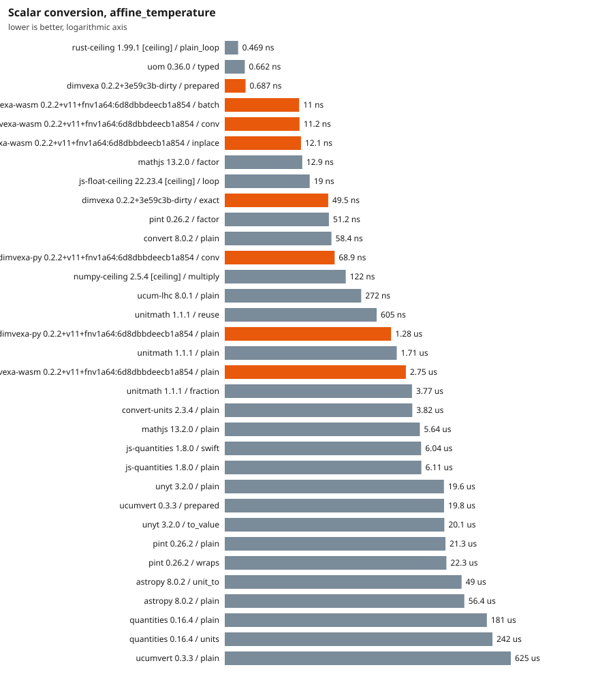

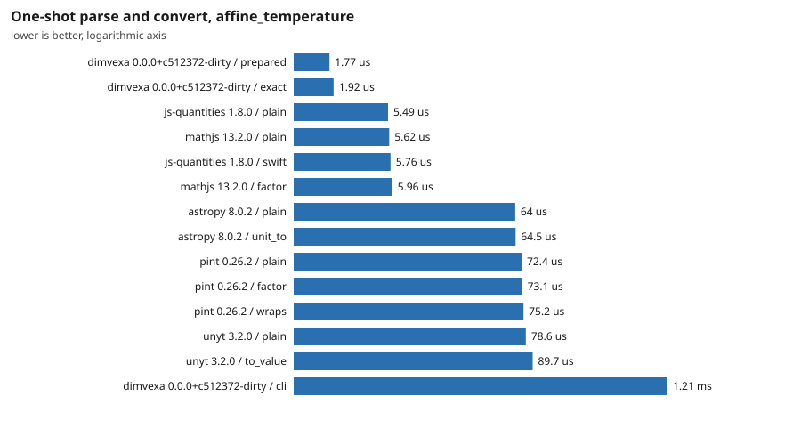

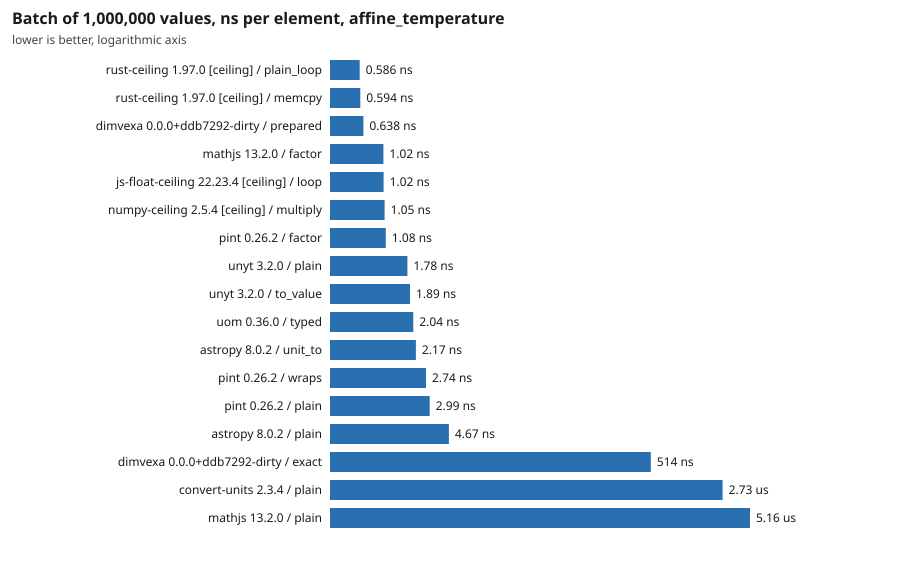

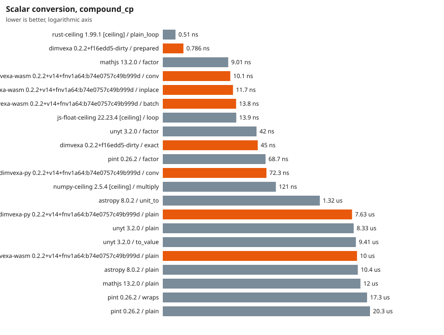

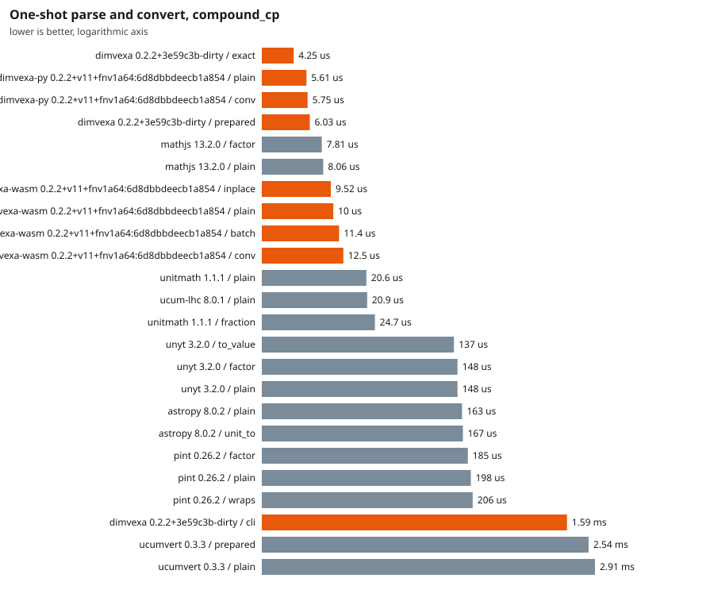

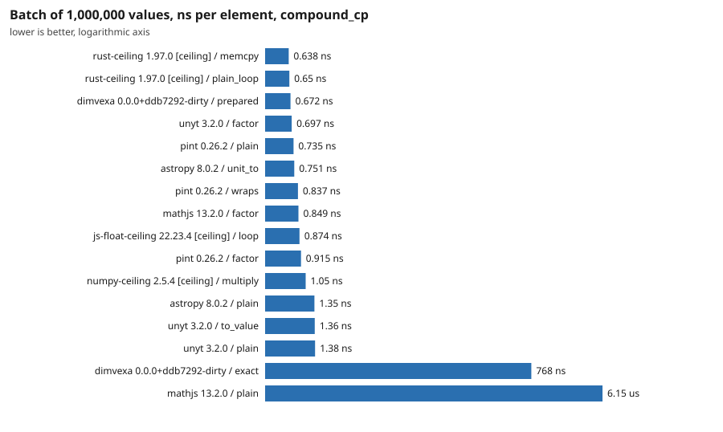

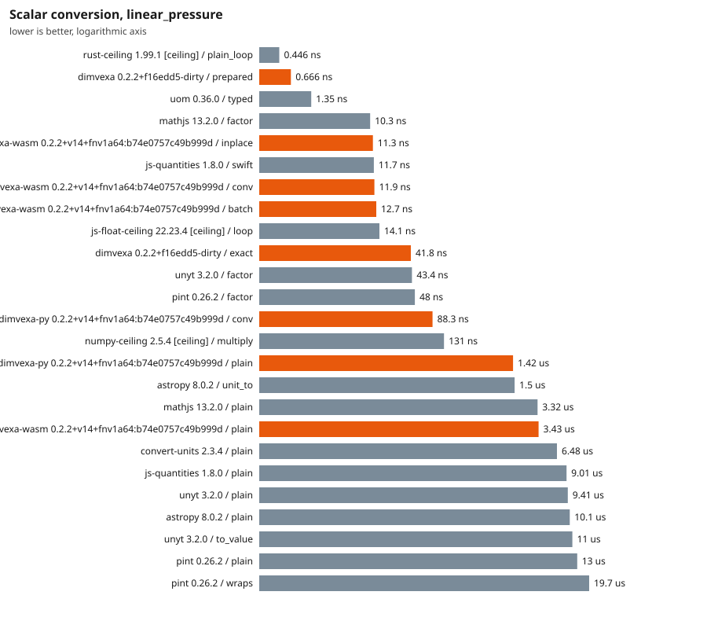

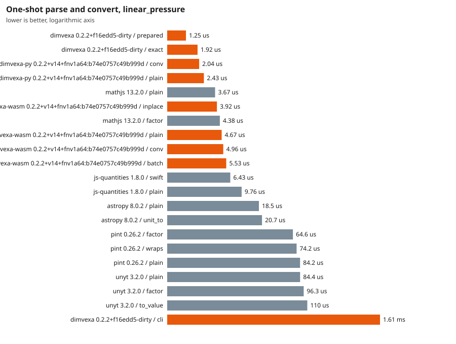

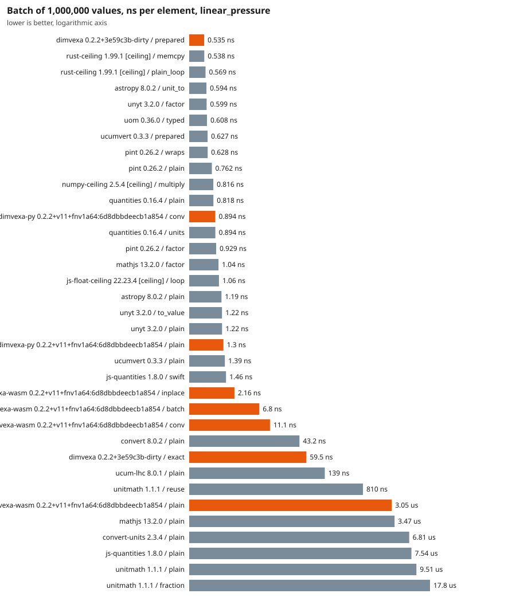

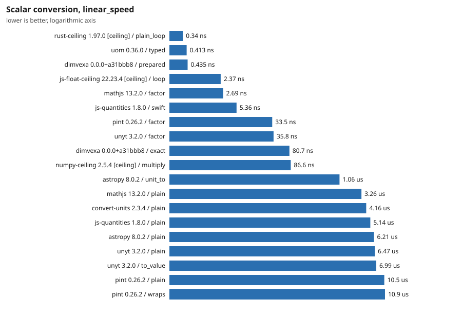

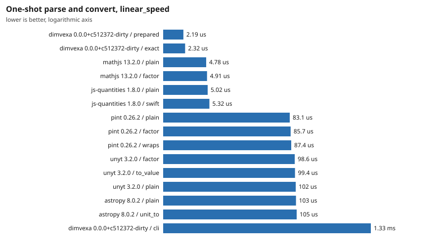

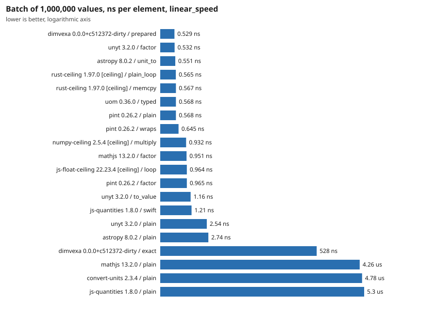

## Prepare, startup and size

| Library | Import (extra over empty interpreter) | Cold prepare (median over conversions) | Peak RSS of the runner process | Installed size |
|---|---|---|---|---|
| astropy 8.0.2 | 182 ms | 69.5 us | 123 MiB | 55.77 MB |
| convert-units 2.3.4 | 8.24 ms | 5.17 us | 122 MiB | 0.11 MB |
| dimvexa 0.1.0+6f3d437-dirty | 0.0747 ms | 2.56 us | 18 MiB | 4.77 MB |
| dimvexa-py 0.1.0+v9+fnv1a64:70613d89e0c2758d | 1.22 ms | 2.59 us | 92 MiB | 0.04 MB |
| dimvexa-wasm 0.1.0+v9+fnv1a64:70613d89e0c2758d | n/a | 5.37 us | 542 MiB | 0.27 MB |
| js-float-ceiling 22.23.4 [ceiling] | n/a | 165 ns | 75 MiB | n/a |
| js-quantities 1.8.0 | 4.3 ms | 25.8 us | 121 MiB | 0.59 MB |
| mathjs 13.2.0 | 310 ms | 10.4 ms | 229 MiB | 9.36 MB |
| numpy-ceiling 2.5.4 [ceiling] | 57.9 ms | 148 ns | 93 MiB | n/a |
| pint 0.26.2 | 156 ms | 303 us | 148 MiB | 3.14 MB |
| rust-ceiling 1.97.0 [ceiling] | n/a | n/a | 19 MiB | 4.77 MB |
| unyt 3.2.0 | 429 ms | 115 us | 141 MiB | 1.55 MB |
| uom 0.36.0 | n/a | n/a | 19 MiB | 3.88 MB |

Peak RSS covers the whole runner process including the corpus and all batch arrays, so compare it only between runs of the same language. For Rust, 'import' is the time to build the registry and 'installed size' is the runner executable.

## Accuracy (against the exact rational truth)

Every must-convert case has an exact rational expected result from an independent oracle. The error is the distance in ulp (steps between representable doubles) from the correctly rounded exact value. A result more than the tolerance away is counted as **wrong**. Cases a library cannot express are counted as **unsupported** and left out of the ulp statistics, so a library that answers few cases can look accurate: read the columns together.

| Library / semantic mode | Cases | Answered | Unsupported | Max ulp | Median ulp | Bit-identical | > 1 ulp | Wrong (> 4 ulp) |
|---|---|---|---|---|---|---|---|---|
| astropy 8.0.2 / plain | 194 | 139 | 55 | 124146008 | 0 | 100 | 24 | 22 |
| convert-units 2.3.4 / plain | 194 | 58 | 136 | 4409024035195715600 | 0 | 39 | 19 | 19 |
| dimvexa 0.1.0+6f3d437-dirty / exact_f64 | 194 | 185 | 9 | 1 | 0 | 183 | 0 | 0 |
| dimvexa 0.1.0+6f3d437-dirty / fast_f64 | 194 | 185 | 9 | 1 | 0 | 179 | 0 | 0 |
| dimvexa 0.1.0+6f3d437-dirty / text | 194 | 185 | 9 | 0 | 0 | 185 | 0 | 0 |
| dimvexa-py 0.1.0+v9+fnv1a64:70613d89e0c2758d / plain | 194 | 185 | 9 | 1 | 0 | 179 | 0 | 0 |
| dimvexa-wasm 0.1.0+v9+fnv1a64:70613d89e0c2758d / plain | 194 | 185 | 9 | 1 | 0 | 179 | 0 | 0 |
| js-quantities 1.8.0 / plain | 194 | 127 | 67 | 3535240928 | 0 | 89 | 33 | 27 |
| mathjs 13.2.0 / plain | 194 | 134 | 60 | 1839852893016390 | 0 | 96 | 21 | 19 |
| pint 0.26.2 / plain | 194 | 175 | 19 | 4409024035195715584 | 0 | 116 | 24 | 4 |
| unyt 3.2.0 / plain | 194 | 124 | 70 | 4405646335475187712 | 0.0 | 88 | 18 | 16 |
| uom 0.36.0 / typed | 194 | 20 | 174 | 4409024035195715600 | 5 | 8 | 11 | 10 |

Largest errors (up to 3 per library):

| Library / mode | Case | ulp | Got | Correctly rounded truth |
|---|---|---|---|---|
| astropy 8.0.2 / plain | hw-037 | 124146008 | 0.999739821292388 | 0.9997398075094124 |
| astropy 8.0.2 / plain | hw-038 | 112565889 | 14.503773573063734 | 14.50377377302092 |
| astropy 8.0.2 / plain | dv-common-008 | 104514083 | 6894.757388223366 | 6894.757293168362 |
| convert-units 2.3.4 / plain | hw-068 | 4409024035195715600 | 5.684341886080802e-14 | 0.0 |
| convert-units 2.3.4 / plain | dv-common-023 | 6509108837 | 453.592 | 453.59237 |
| convert-units 2.3.4 / plain | hw-018 | 6509108837 | 28.3495 | 28.349523125 |
| dimvexa 0.1.0+6f3d437-dirty / exact_f64 | dv-common-036 | 1 | 273.15000000000003 | 273.15 |
| dimvexa 0.1.0+6f3d437-dirty / exact_f64 | hw-067 | 1 | 273.15000000000003 | 273.15 |
| dimvexa 0.1.0+6f3d437-dirty / fast_f64 | dv-common-036 | 1 | 273.15000000000003 | 273.15 |
| dimvexa 0.1.0+6f3d437-dirty / fast_f64 | hw-037 | 1 | 0.9997398075094125 | 0.9997398075094124 |
| dimvexa 0.1.0+6f3d437-dirty / fast_f64 | hw-065 | 1 | 98.60000000000001 | 98.6 |
| dimvexa-py 0.1.0+v9+fnv1a64:70613d89e0c2758d / plain | dv-common-036 | 1 | 273.15000000000003 | 273.15 |
| dimvexa-py 0.1.0+v9+fnv1a64:70613d89e0c2758d / plain | hw-037 | 1 | 0.9997398075094125 | 0.9997398075094124 |
| dimvexa-py 0.1.0+v9+fnv1a64:70613d89e0c2758d / plain | hw-065 | 1 | 98.60000000000001 | 98.6 |
| dimvexa-wasm 0.1.0+v9+fnv1a64:70613d89e0c2758d / plain | dv-common-036 | 1 | 273.15000000000003 | 273.15 |
| dimvexa-wasm 0.1.0+v9+fnv1a64:70613d89e0c2758d / plain | hw-037 | 1 | 0.9997398075094125 | 0.9997398075094124 |
| dimvexa-wasm 0.1.0+v9+fnv1a64:70613d89e0c2758d / plain | hw-065 | 1 | 98.60000000000001 | 98.6 |
| js-quantities 1.8.0 / plain | hw-037 | 3535240928 | 0.9997402 | 0.9997398075094124 |
| js-quantities 1.8.0 / plain | hw-042 | 3247951291 | 14.695943005992959 | 14.695948775513449 |
| js-quantities 1.8.0 / plain | hw-038 | 3205478699 | 14.50376807894691 | 14.50377377302092 |
| mathjs 13.2.0 / plain | hw-059 | 1839852893016390 | 117.34776530399999 | 158.987294928 |
| mathjs 13.2.0 / plain | hw-060 | 1839852893016390 | 117.34776530399999 | 158.987294928 |
| mathjs 13.2.0 / plain | dv-common-004 | 24890360635 | 0.9999972366148532 | 1.0 |
| pint 0.26.2 / plain | dv-common-034 | 4409024035195715584 | 5.684341886080802e-14 | 0.0 |
| pint 0.26.2 / plain | hw-064 | 4409024035195715584 | 5.684341886080802e-14 | 0.0 |
| pint 0.26.2 / plain | hw-063 | 9 | -40.000000000000064 | -40.0 |
| unyt 3.2.0 / plain | dv-common-034 | 4405646335475187712 | 3.552713678800501e-14 | 0.0 |
| unyt 3.2.0 / plain | hw-064 | 4405646335475187712 | 3.552713678800501e-14 | 0.0 |
| unyt 3.2.0 / plain | hw-052 | 386444500 | 0.2388458859015064 | 0.23884589662749595 |

## Coverage and safety matrix

**Must convert** (correct / wrong value / error because unsupported) and **must refuse** (refused / accepted / not applicable). A request is *accepted* when the library returned a number for it. Any error counts as a refusal: the reason is not compared, except for Dimvexa (see below).

The refuse cases are scored in two groups, because they are not the same kind of failure. **Ambiguous name**: the name has several accepted meanings (`ton`, `gal`, `oz`, `pt`, `cal`, `Btu`, `hp`, `mile`, `foot`, bare `ppm`). A library that applies a documented default (for example pint reading `ton` as the short ton) made a policy choice; it is reported as *accepted with a default* and is not a bug, but Dimvexa's design goal is to refuse, so it is still counted and shown. **Other**: missing context, temperature-kind errors, dimension mismatches. Accepting one of these is a defect or a missing check. The corpus does not record whether a library documents its default, so the ambiguous column is not a judgement of the library.

| Library / mode | Convert cases | Correct | Wrong value | Unsupported | Ambiguous: cases | refused | accepted with default | n/a | Other: cases | refused | silently accepted | n/a |
|---|---|---|---|---|---|---|---|---|---|---|---|---|
| astropy 8.0.2 / plain | 194 | 117 | 22 | 55 | 10 | 4 | 6 | 0 | 20 | 16 | **4** | 0 |
| convert-units 2.3.4 / plain | 194 | 39 | 19 | 136 | 10 | 8 | 2 | 0 | 20 | 17 | 0 | 3 |
| dimvexa 0.1.0+6f3d437-dirty / exact_f64 | 194 | 185 | 0 | 9 | 10 | 10 | 0 | 0 | 20 | 20 | 0 | 0 |
| dimvexa 0.1.0+6f3d437-dirty / fast_f64 | 194 | 185 | 0 | 9 | 10 | 10 | 0 | 0 | 20 | 20 | 0 | 0 |
| dimvexa 0.1.0+6f3d437-dirty / text | 194 | 185 | 0 | 9 | 10 | 10 | 0 | 0 | 20 | 20 | 0 | 0 |
| dimvexa-py 0.1.0+v9+fnv1a64:70613d89e0c2758d / plain | 194 | 185 | 0 | 9 | 10 | 10 | 0 | 0 | 20 | 20 | 0 | 0 |
| dimvexa-wasm 0.1.0+v9+fnv1a64:70613d89e0c2758d / plain | 194 | 185 | 0 | 9 | 10 | 10 | 0 | 0 | 20 | 20 | 0 | 0 |
| js-quantities 1.8.0 / plain | 194 | 100 | 27 | 67 | 10 | 1 | 9 | 0 | 20 | 17 | **3** | 0 |
| mathjs 13.2.0 / plain | 194 | 115 | 19 | 60 | 10 | 3 | 7 | 0 | 20 | 15 | **5** | 0 |
| pint 0.26.2 / plain | 194 | 171 | 4 | 19 | 10 | 0 | 10 | 0 | 20 | 18 | **2** | 0 |
| unyt 3.2.0 / plain | 194 | 108 | 16 | 70 | 10 | 4 | 6 | 0 | 20 | 16 | **4** | 0 |
| uom 0.36.0 / typed | 194 | 10 | 10 | 174 | 10 | 0 | 0 | 10 | 20 | 0 | 0 | 20 |

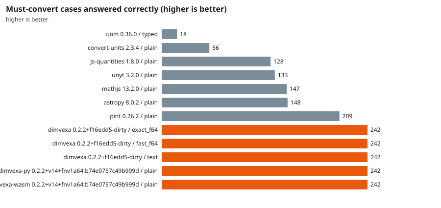

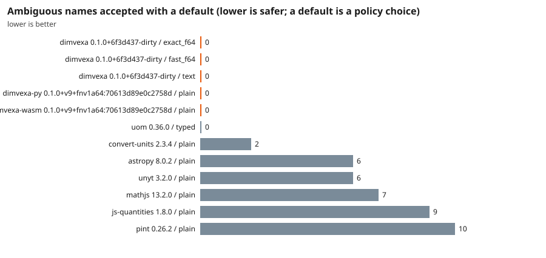

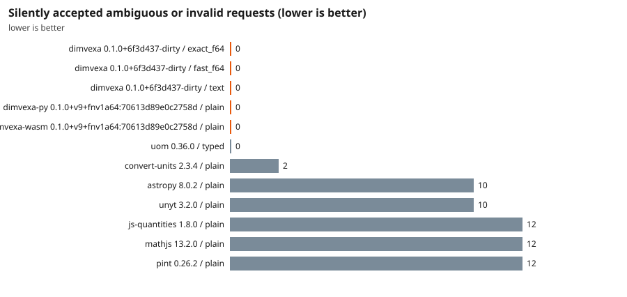

### Must-convert results by origin of the case

The corpus mixes cases taken from Dimvexa's own golden vectors, hand-written cases whose truth comes from the oracle in `corpus-src/truth.toml`, and *independent* cases whose expected value is the number published in a cited source (NIST, BIPM) and only cross-checked by the oracle. A library that does much better on the first group than on the independent one would show corpus bias. Cells are correct/total; a dash means the result file predates that group (its corpus is older).

| Origin | astropy 8.0.2 / plain | convert-units 2.3.4 / plain | dimvexa 0.1.0+6f3d437-dirty / exact_f64 | dimvexa 0.1.0+6f3d437-dirty / fast_f64 | dimvexa 0.1.0+6f3d437-dirty / text | dimvexa-py 0.1.0+v9+fnv1a64:70613d89e0c2758d / plain | dimvexa-wasm 0.1.0+v9+fnv1a64:70613d89e0c2758d / plain | js-quantities 1.8.0 / plain | mathjs 13.2.0 / plain | pint 0.26.2 / plain | unyt 3.2.0 / plain | uom 0.36.0 / typed |
|---|---|---|---|---|---|---|---|---|---|---|---|---|
| Dimvexa golden vectors | 73/111 | 25/111 | 111/111 | 111/111 | 111/111 | 111/111 | 111/111 | 62/111 | 67/111 | 97/111 | 63/111 | 4/111 |
| Hand-written (oracle truth) | 44/83 | 14/83 | 74/83 | 74/83 | 74/83 | 74/83 | 74/83 | 38/83 | 48/83 | 74/83 | 45/83 | 6/83 |
| Independent (published values) | - | - | - | - | - | - | - | - | - | - | - | - |

### Per-request outcome for the must-refuse cases

`ok` refused, `ACCEPTED` accepted (the number is shown), `-` not applicable. The group column is `ambiguous name` (an accepted number may be a documented default) or `other` (accepting it is a defect).

| Case | Category | Group | astropy 8.0.2 / plain | convert-units 2.3.4 / plain | dimvexa 0.1.0+6f3d437-dirty / exact_f64 | dimvexa 0.1.0+6f3d437-dirty / fast_f64 | dimvexa 0.1.0+6f3d437-dirty / text | dimvexa-py 0.1.0+v9+fnv1a64:70613d89e0c2758d / plain | dimvexa-wasm 0.1.0+v9+fnv1a64:70613d89e0c2758d / plain | js-quantities 1.8.0 / plain | mathjs 13.2.0 / plain | pint 0.26.2 / plain | unyt 3.2.0 / plain | uom 0.36.0 / typed |
|---|---|---|---|---|---|---|---|---|---|---|---|---|---|---|
| ref-001 | ambiguous_name | ambiguous name | ACCEPTED (np.float64(907) | ok | ok | ok | ok | ok | ok | ACCEPTED (907.18474) | ACCEPTED (907.18474) | ACCEPTED (907.1847400000) | ACCEPTED (array(907.1847) | - |
| ref-002 | ambiguous_name | ambiguous name | ok | ACCEPTED (3.785411795401) | ok | ok | ok | ok | ok | ACCEPTED (3.7854118) | ACCEPTED (3.785411784) | ACCEPTED (3.785411783999) | ok | - |
| ref-003 | ambiguous_name | ambiguous name | ACCEPTED (np.float64(28.) | ACCEPTED (28.3495) | ok | ok | ok | ok | ok | ACCEPTED (28.3495231) | ACCEPTED (28.349523125) | ACCEPTED (28.34952312500) | ACCEPTED (array(28.34952) | - |
| ref-004 | ambiguous_name | ambiguous name | ok | ok | ok | ok | ok | ok | ok | ACCEPTED (0.473176475) | ACCEPTED (0.473176473) | ACCEPTED (0.473176472999) | ok | - |
| ref-005 | ambiguous_name | ambiguous name | ACCEPTED (np.float64(4.1) | ok | ok | ok | ok | ok | ok | ACCEPTED (4.184) | ok | ACCEPTED (4.184) | ACCEPTED (array(4.184)) | - |
| ref-006 | ambiguous_name | ambiguous name | ok | ok | ok | ok | ok | ok | ok | ok | ok | ACCEPTED (1055.056) | ok | - |
| ref-007 | ambiguous_name | ambiguous name | ACCEPTED (np.float64(745) | ok | ok | ok | ok | ok | ok | ACCEPTED (745.699872) | ACCEPTED (745.6998715386) | ACCEPTED (745.6998715822) | ACCEPTED (array(745.6998) | - |
| ref-008 | ambiguous_name | ambiguous name | ACCEPTED (np.float64(1.6) | ok | ok | ok | ok | ok | ok | ACCEPTED (1.609344) | ACCEPTED (1.609344) | ACCEPTED (1.609344) | ACCEPTED (array(1.609344) | - |
| ref-009 | ambiguous_name | ambiguous name | ACCEPTED (np.float64(0.3) | ok | ok | ok | ok | ok | ok | ACCEPTED (0.3048) | ACCEPTED (0.3048) | ACCEPTED (0.304799999999) | ACCEPTED (array(0.3048)) | - |
| ref-010 | ambiguous_name | ambiguous name | ok | ok | ok | ok | ok | ok | ok | ACCEPTED (0.0001) | ok | ACCEPTED (9.999999999999) | ok | - |
| ref-011 | missing_context | other | ok | ok | ok | ok | ok | ok | ok | ok | ok | ok | ok | - |
| ref-012 | missing_context | other | ok | ok | ok | ok | ok | ok | ok | ok | ok | ok | ok | - |
| ref-013 | missing_context | other | ok | ok | ok | ok | ok | ok | ok | ok | ok | ok | ok | - |
| ref-014 | missing_context | other | ok | ok | ok | ok | ok | ok | ok | ok | ok | ok | ok | - |
| ref-015 | missing_context | other | ok | ok | ok | ok | ok | ok | ok | ok | ok | ok | ok | - |
| ref-016 | missing_context | other | ok | ok | ok | ok | ok | ok | ok | ok | ok | ok | ok | - |
| ref-017 | missing_context | other | ok | ok | ok | ok | ok | ok | ok | ok | ok | ok | ok | - |
| ref-018 | missing_context | other | ok | ok | ok | ok | ok | ok | ok | ok | ok | ok | ok | - |
| ref-019 | missing_context | other | ok | ok | ok | ok | ok | ok | ok | ok | ok | ok | ok | - |
| ref-020 | missing_context | other | ok | ok | ok | ok | ok | ok | ok | ok | ok | ACCEPTED (0.980665) | ok | - |
| ref-021 | kind | other | ACCEPTED (np.float64(50.) | - | ok | ok | ok | ok | ok | ok | ACCEPTED (50 degC) | ok | ACCEPTED (array(50.)) | - |
| ref-022 | kind | other | ok | - | ok | ok | ok | ok | ok | ACCEPTED (25 tempC) | ACCEPTED (25 degC) | ok | ACCEPTED (array(25.)) | - |
| ref-023 | kind | other | ACCEPTED (np.float64(30.) | - | ok | ok | ok | ok | ok | ok | ACCEPTED (29.99999999999) | ok | ACCEPTED (array(30.)) | - |
| ref-024 | kind | other | ACCEPTED (np.float64(283) | ok | ok | ok | ok | ok | ok | ACCEPTED (10) | ACCEPTED (283.15) | ACCEPTED (283.15) | ACCEPTED (array(283.15)) | - |
| ref-025 | kind | other | ACCEPTED (np.float64(-26) | ok | ok | ok | ok | ok | ok | ACCEPTED (-263.15) | ACCEPTED (-263.15) | ok | ok | - |
| ref-026 | dimension | other | ok | ok | ok | ok | ok | ok | ok | ok | ok | ok | ok | - |
| ref-027 | dimension | other | ok | ok | ok | ok | ok | ok | ok | ok | ok | ok | ok | - |
| ref-028 | dimension | other | ok | ok | ok | ok | ok | ok | ok | ok | ok | ok | ok | - |
| ref-029 | dimension | other | ok | ok | ok | ok | ok | ok | ok | ok | ok | ok | ok | - |
| ref-030 | dimension | other | ok | ok | ok | ok | ok | ok | ok | ok | ok | ok | ok | - |

### Unit coverage

Units a library can parse, out of the coverage lists in the corpus (Dimvexa spellings, translated per library; see `benchmarks/translations/`). Parsing a unit does not prove its factor is right; the accuracy section checks values.

| List | astropy 8.0.2 / plain | convert-units 2.3.4 / plain | dimvexa 0.1.0+6f3d437-dirty / exact_f64 | dimvexa 0.1.0+6f3d437-dirty / fast_f64 | dimvexa 0.1.0+6f3d437-dirty / text | dimvexa-py 0.1.0+v9+fnv1a64:70613d89e0c2758d / plain | dimvexa-wasm 0.1.0+v9+fnv1a64:70613d89e0c2758d / plain | js-quantities 1.8.0 / plain | mathjs 13.2.0 / plain | pint 0.26.2 / plain | unyt 3.2.0 / plain | uom 0.36.0 / typed |
|---|---|---|---|---|---|---|---|---|---|---|---|---|
| compound | 11/11 | 2/11 | 11/11 | 11/11 | 11/11 | 11/11 | 11/11 | 7/11 | 11/11 | 11/11 | 11/11 | 2/11 |
| dimvexa_seed_table | 66/96 | 40/96 | 96/96 | 96/96 | 96/96 | 96/96 | 96/96 | 70/96 | 60/96 | 83/96 | 61/96 | 10/96 |
| imperial_us | 14/24 | 8/24 | 23/24 | 23/24 | 23/24 | 23/24 | 23/24 | 14/24 | 13/24 | 24/24 | 12/24 | 4/24 |
| pressure | 3/10 | 3/10 | 6/10 | 6/10 | 6/10 | 6/10 | 6/10 | 6/10 | 6/10 | 8/10 | 3/10 | 1/10 |
| process | 13/19 | 1/19 | 12/19 | 12/19 | 12/19 | 12/19 | 12/19 | 9/19 | 11/19 | 14/19 | 10/19 | 0/19 |
| si | 25/25 | 17/25 | 25/25 | 25/25 | 25/25 | 25/25 | 25/25 | 25/25 | 24/25 | 25/25 | 24/25 | 4/25 |
| si_prefixed | 16/17 | 9/17 | 17/17 | 17/17 | 17/17 | 17/17 | 17/17 | 17/17 | 17/17 | 17/17 | 17/17 | 2/17 |
| temperature | 8/8 | 4/8 | 8/8 | 8/8 | 8/8 | 8/8 | 8/8 | 8/8 | 8/8 | 7/8 | 8/8 | 3/8 |

Dimvexa (exact_f64): 24 of 30 refusals carried the intended error code.

