# Comparison with other unit libraries

Generated by `benchmarks/tools/report.py` from the raw files in `benchmarks/results/`. Do not edit by hand. Method and rules: [`docs/benchmarking.md`](../../benchmarking.md).

## Runs included

| Library | Kind | Runtime | OS / CPU | Date (UTC) | Lockfile | Corpus |
|---|---|---|---|---|---|---|
| astropy 8.0.2 | library | CPython 3.13.18 | Linux 6.18.44-fc-v378; Intel(R) Xeon(R) Processor @ 2.10GHz; 4 cores; governor unknown | 2026-11-12T10:01:52Z | pinned | abf0a7cc771b2ed4 |
| convert-units 2.3.4 | library | node v22.23.4 | Linux 6.18.44-fc-v378; Intel(R) Xeon(R) Processor @ 2.10GHz; 4 cores; governor unknown | 2026-11-12T10:14:19Z | pinned | abf0a7cc771b2ed4 |
| dimvexa 0.5.0+772e31c | library | rustc rustc 1.99.1 (58cf8f9c3 2026-10-13) | Linux 6.18.44-fc-v378; Intel(R) Xeon(R) Processor @ 2.10GHz; 4 cores; governor unknown | 2026-11-12T09:57:03Z | pinned | abf0a7cc771b2ed4 |
| dimvexa-py 0.5.0+v19+fnv1a64:4650355d84607807 | library | CPython 3.13.18 | Linux 6.18.44-fc-v378; Intel(R) Xeon(R) Processor @ 2.10GHz; 4 cores; governor unknown | 2026-11-12T09:58:46Z | pinned | abf0a7cc771b2ed4 |
| dimvexa-wasm 0.5.0+v19+fnv1a64:4650355d84607807 | library | node v22.23.4 | Linux 6.18.44-fc-v378; Intel(R) Xeon(R) Processor @ 2.10GHz; 4 cores; governor unknown | 2026-11-12T10:17:39Z | pinned | abf0a7cc771b2ed4 |
| js-float-ceiling 22.23.4 [ceiling] | ceiling | node v22.23.4 | Linux 6.18.44-fc-v378; Intel(R) Xeon(R) Processor @ 2.10GHz; 4 cores; governor unknown | 2026-11-12T10:02:37Z | pinned | abf0a7cc771b2ed4 |
| js-quantities 1.8.0 | library | node v22.23.4 | Linux 6.18.44-fc-v378; Intel(R) Xeon(R) Processor @ 2.10GHz; 4 cores; governor unknown | 2026-11-12T10:08:07Z | pinned | abf0a7cc771b2ed4 |
| mathjs 13.2.0 | library | node v22.23.4 | Linux 6.18.44-fc-v378; Intel(R) Xeon(R) Processor @ 2.10GHz; 4 cores; governor unknown | 2026-11-12T10:02:58Z | pinned | abf0a7cc771b2ed4 |
| numpy-ceiling 2.5.4 [ceiling] | ceiling | CPython 3.13.18 | Linux 6.18.44-fc-v378; Intel(R) Xeon(R) Processor @ 2.10GHz; 4 cores; governor unknown | 2026-11-12T09:58:27Z | pinned | abf0a7cc771b2ed4 |
| pint 0.26.2 | library | CPython 3.13.18 | Linux 6.18.44-fc-v378; Intel(R) Xeon(R) Processor @ 2.10GHz; 4 cores; governor unknown | 2026-11-12T09:59:29Z | pinned | abf0a7cc771b2ed4 |
| rust-ceiling 1.99.1 [ceiling] | ceiling | rustc rustc 1.99.1 (58cf8f9c3 2026-10-13) | Linux 6.18.44-fc-v378; Intel(R) Xeon(R) Processor @ 2.10GHz; 4 cores; governor unknown | 2026-11-12T09:57:56Z | pinned | abf0a7cc771b2ed4 |
| unyt 3.2.0 | library | CPython 3.13.18 | Linux 6.18.44-fc-v378; Intel(R) Xeon(R) Processor @ 2.10GHz; 4 cores; governor unknown | 2026-11-12T10:00:47Z | pinned | abf0a7cc771b2ed4 |
| uom 0.36.0 | library | rustc rustc 1.99.1 (58cf8f9c3 2026-10-13) | Linux 6.18.44-fc-v378; Intel(R) Xeon(R) Processor @ 2.10GHz; 4 cores; governor unknown | 2026-11-12T09:58:26Z | pinned | abf0a7cc771b2ed4 |

GitHub-hosted runners are noisy. Python and JavaScript wall-clock figures are indicative; read the MAD (median absolute deviation) next to each median, and the raw samples in the JSON.

## Speed

Median ns per conversion (MAD in brackets). **Scalar**: prepared conversion applied to one value, including the loop iteration of the host language (see the loop overhead rows). **One-shot**: parse a string such as `10 m/s` and convert it. **Batch**: ns per element for N values. Rows marked [ceiling] do no unit handling; they show what the language itself costs. `n/a` means the library has no such API or the runner could not run it (see the JSON `errors`).

### affine_temperature

| Library / mode | Scalar | Loop overhead | One-shot parse+convert | Batch 1,000 | Batch 100,000 | Batch 1,000,000 |
|---|---|---|---|---|---|---|
| astropy 8.0.2 / plain | 83.9 us (MAD 7.19 us) | 26.4 ns (MAD 0.764 ns) | 95.5 us (MAD 1.38 us) | 66.4 ns (MAD 13.1 ns) | 3.79 ns (MAD 0.146 ns) | 4.43 ns (MAD 0.176 ns) |
| astropy 8.0.2 / unit_to | 44.3 us (MAD 1.61 us) | 47.7 ns (MAD 0.338 ns) | 69.2 us (MAD 6.48 us) | 45.4 ns (MAD 0.801 ns) | 2.05 ns (MAD 0.0984 ns) | 2.34 ns (MAD 0.106 ns) |
| convert-units 2.3.4 / plain | 6.45 us (MAD 51.8 ns) | 5.91 ns (MAD 0.0309 ns) | n/a | 6.6 us (MAD 91.7 ns) | 5.51 us (MAD 602 ns) | 5.31 us (MAD 423 ns) |
| dimvexa 0.5.0+772e31c / cli | n/a | n/a | 1.67 ms (MAD 55.7 us) | n/a | n/a | n/a |
| dimvexa 0.5.0+772e31c / exact | 54.6 ns (MAD 2.47 ns) | 0.337 ns (MAD 0.00367 ns) | 2.13 us (MAD 325 ns) | 58 ns (MAD 7.44 ns) | 75.3 ns (MAD 1.46 ns) | 72.2 ns (MAD 1.61 ns) |
| dimvexa 0.5.0+772e31c / prepared | 0.679 ns (MAD 0.00848 ns) | 0.351 ns (MAD 0.0163 ns) | 1.2 us (MAD 150 ns) | 0.401 ns (MAD 0.015 ns) | 0.338 ns (MAD 0.00998 ns) | 0.625 ns (MAD 0.0129 ns) |
| dimvexa-py 0.5.0+v19+fnv1a64:4650355d84607807 / conv | 97.8 ns (MAD 17.8 ns) | 43.7 ns (MAD 1.86 ns) | 1.9 us (MAD 56.2 ns) | 0.824 ns (MAD 0.04 ns) | 0.378 ns (MAD 0.00224 ns) | 0.869 ns (MAD 0.0329 ns) |
| dimvexa-py 0.5.0+v19+fnv1a64:4650355d84607807 / plain | 1.41 us (MAD 81.2 ns) | 31 ns (MAD 3.25 ns) | 2.35 us (MAD 350 ns) | 2.34 ns (MAD 0.07 ns) | 0.617 ns (MAD 0.0806 ns) | 1.02 ns (MAD 0.023 ns) |
| dimvexa-wasm 0.5.0+v19+fnv1a64:4650355d84607807 / batch | 17.7 ns (MAD 0.313 ns) | 3.85 ns (MAD 0.0288 ns) | 5.93 us (MAD 931 ns) | 3.08 ns (MAD 0.209 ns) | 1.67 ns (MAD 0.215 ns) | 7.57 ns (MAD 0.292 ns) |
| dimvexa-wasm 0.5.0+v19+fnv1a64:4650355d84607807 / conv | 15.9 ns (MAD 2.41 ns) | 3.81 ns (MAD 0.27 ns) | 4.92 us (MAD 599 ns) | 6.72 ns (MAD 0.008 ns) | 6.93 ns (MAD 0.154 ns) | 7.44 ns (MAD 0.265 ns) |
| dimvexa-wasm 0.5.0+v19+fnv1a64:4650355d84607807 / inplace | 13.2 ns (MAD 1.49 ns) | 3.7 ns (MAD 0.0645 ns) | 4.43 us (MAD 485 ns) | 1.47 ns (MAD 0.118 ns) | 1.63 ns (MAD 0.0757 ns) | 2.29 ns (MAD 0.00667 ns) |
| dimvexa-wasm 0.5.0+v19+fnv1a64:4650355d84607807 / plain | 4.78 us (MAD 335 ns) | 5.99 ns (MAD 0.116 ns) | 6.73 us (MAD 740 ns) | 5.14 us (MAD 22.2 ns) | 3.56 us (MAD 553 ns) | 4.43 us (MAD 523 ns) |
| js-float-ceiling 22.23.4 [ceiling] / loop | 16.2 ns (MAD 2.25 ns) | 3.98 ns (MAD 0.161 ns) | n/a | 1.09 ns (MAD 0.003 ns) | 0.982 ns (MAD 0.00483 ns) | 1.11 ns (MAD 0.0969 ns) |
| js-quantities 1.8.0 / plain | 9.73 us (MAD 1.42 us) | 6.12 ns (MAD 0.043 ns) | 12.3 us (MAD 94 ns) | 6.32 us (MAD 144 ns) | 11.2 us (MAD 94.9 ns) | 8.5 us (MAD 661 ns) |
| js-quantities 1.8.0 / swift | 10.5 us (MAD 317 ns) | 5.44 ns (MAD 0.292 ns) | 8.34 us (MAD 764 ns) | 7.19 us (MAD 416 ns) | 7.67 us (MAD 1.03 us) | 8.98 us (MAD 773 ns) |
| mathjs 13.2.0 / factor | 15.3 ns (MAD 1.35 ns) | 3.75 ns (MAD 0.0787 ns) | 6.99 us (MAD 241 ns) | 1.83 ns (MAD 0.216 ns) | 1.67 ns (MAD 0.0824 ns) | 1.83 ns (MAD 0.0348 ns) |
| mathjs 13.2.0 / plain | 9.6 us (MAD 93.3 ns) | 4.4 ns (MAD 0.782 ns) | 7.12 us (MAD 238 ns) | 6.3 us (MAD 414 ns) | 7.39 us (MAD 765 ns) | 8.29 us (MAD 507 ns) |
| numpy-ceiling 2.5.4 [ceiling] / multiply | 137 ns (MAD 14 ns) | 32.4 ns (MAD 3.86 ns) | n/a | 1.89 ns (MAD 0.114 ns) | 0.52 ns (MAD 0.0385 ns) | 0.918 ns (MAD 0.0121 ns) |
| pint 0.26.2 / factor | 70.5 ns (MAD 3.84 ns) | 26.8 ns (MAD 1.32 ns) | 82.9 us (MAD 2.84 us) | 2.07 ns (MAD 0.072 ns) | 0.463 ns (MAD 0.00151 ns) | 0.944 ns (MAD 0.00378 ns) |
| pint 0.26.2 / plain | 34.7 us (MAD 1.54 us) | 57.4 ns (MAD 1.67 ns) | 114 us (MAD 2.69 us) | 44.2 ns (MAD 1.82 ns) | 2.72 ns (MAD 0.25 ns) | 3.13 ns (MAD 0.13 ns) |
| pint 0.26.2 / wraps | 24 us (MAD 1.5 us) | 29.2 ns (MAD 1.6 ns) | 72.2 us (MAD 775 ns) | 28.7 ns (MAD 0.841 ns) | 2.19 ns (MAD 0.0972 ns) | 2.87 ns (MAD 0.00366 ns) |
| rust-ceiling 1.99.1 [ceiling] / memcpy | n/a | 0.496 ns (MAD 0.0405 ns) | n/a | 0.114 ns (MAD 0.006 ns) | 0.211 ns (MAD 0.00321 ns) | 0.671 ns (MAD 0.00974 ns) |
| rust-ceiling 1.99.1 [ceiling] / plain_loop | 0.468 ns (MAD 0.0181 ns) | 0.612 ns (MAD 0.00661 ns) | n/a | 0.369 ns (MAD 0.003 ns) | 0.35 ns (MAD 0.0113 ns) | 0.603 ns (MAD 0.0095 ns) |
| unyt 3.2.0 / factor | unsupported |  |  |  |  |  |
| unyt 3.2.0 / plain | 28.2 us (MAD 4.43 us) | 28.5 ns (MAD 3.85 ns) | 117 us (MAD 13.4 us) | 22.6 ns (MAD 0.545 ns) | 1.63 ns (MAD 0.16 ns) | 1.62 ns (MAD 0.02 ns) |
| unyt 3.2.0 / to_value | 39.3 us (MAD 1.3 us) | 26.8 ns (MAD 0.89 ns) | 104 us (MAD 11.8 us) | 18.1 ns (MAD 0.651 ns) | 1.18 ns (MAD 0.0671 ns) | 1.59 ns (MAD 0.00702 ns) |
| uom 0.36.0 / typed | 0.721 ns (MAD 0.0601 ns) | 0.415 ns (MAD 0.0476 ns) | n/a | 1.49 ns (MAD 0.021 ns) | 1.04 ns (MAD 0.035 ns) | 0.738 ns (MAD 0.0297 ns) |

### compound_cp

| Library / mode | Scalar | Loop overhead | One-shot parse+convert | Batch 1,000 | Batch 100,000 | Batch 1,000,000 |
|---|---|---|---|---|---|---|
| astropy 8.0.2 / plain | 6.67 us (MAD 62.8 ns) | 29.8 ns (MAD 3.19 ns) | 156 us (MAD 1.41 us) | 6.71 ns (MAD 0.192 ns) | 0.779 ns (MAD 0.0111 ns) | 1.21 ns (MAD 0.0113 ns) |
| astropy 8.0.2 / unit_to | 1.22 us (MAD 13.3 ns) | 35.4 ns (MAD 5.62 ns) | 166 us (MAD 3.4 us) | 4.34 ns (MAD 0.124 ns) | 0.322 ns (MAD 0.00618 ns) | 0.595 ns (MAD 0.0106 ns) |
| convert-units 2.3.4 / plain | unsupported |  |  |  |  |  |
| dimvexa 0.5.0+772e31c / cli | n/a | n/a | 1.77 ms (MAD 72.4 us) | n/a | n/a | n/a |
| dimvexa 0.5.0+772e31c / exact | 45 ns (MAD 1.04 ns) | 0.4 ns (MAD 0.0502 ns) | 4.61 us (MAD 126 ns) | 52.8 ns (MAD 0.267 ns) | 50.4 ns (MAD 1.03 ns) | 50.3 ns (MAD 0.468 ns) |
| dimvexa 0.5.0+772e31c / prepared | 0.702 ns (MAD 0.03 ns) | 0.43 ns (MAD 0.0437 ns) | 5.48 us (MAD 721 ns) | 0.146 ns (MAD 0.002 ns) | 0.273 ns (MAD 0.015 ns) | 0.584 ns (MAD 0.0101 ns) |
| dimvexa-py 0.5.0+v19+fnv1a64:4650355d84607807 / conv | 93.7 ns (MAD 22.4 ns) | 36.8 ns (MAD 7.46 ns) | 6.54 us (MAD 561 ns) | 1.57 ns (MAD 0.106 ns) | 0.385 ns (MAD 0.00275 ns) | 1.24 ns (MAD 0.00927 ns) |
| dimvexa-py 0.5.0+v19+fnv1a64:4650355d84607807 / plain | 5.91 us (MAD 1.06 us) | 26.5 ns (MAD 1.73 ns) | 6.14 us (MAD 263 ns) | 6.63 ns (MAD 0.134 ns) | 0.438 ns (MAD 0.00617 ns) | 0.943 ns (MAD 0.00716 ns) |
| dimvexa-wasm 0.5.0+v19+fnv1a64:4650355d84607807 / batch | 12.5 ns (MAD 0.352 ns) | 4.57 ns (MAD 0.688 ns) | 10.3 us (MAD 312 ns) | 2.57 ns (MAD 0.18 ns) | 1.44 ns (MAD 0.0649 ns) | 6.08 ns (MAD 0.636 ns) |
| dimvexa-wasm 0.5.0+v19+fnv1a64:4650355d84607807 / conv | 12.3 ns (MAD 0.175 ns) | 6.24 ns (MAD 0.0834 ns) | 14.4 us (MAD 411 ns) | 11.6 ns (MAD 0.174 ns) | 11.5 ns (MAD 0.0651 ns) | 12 ns (MAD 0.146 ns) |
| dimvexa-wasm 0.5.0+v19+fnv1a64:4650355d84607807 / inplace | 12.1 ns (MAD 0.209 ns) | 3.97 ns (MAD 0.345 ns) | 18 us (MAD 278 ns) | 1.35 ns (MAD 0.038 ns) | 1.6 ns (MAD 0.0479 ns) | 2.45 ns (MAD 0.0262 ns) |
| dimvexa-wasm 0.5.0+v19+fnv1a64:4650355d84607807 / plain | 11.8 us (MAD 1.27 us) | 5.14 ns (MAD 0.464 ns) | 12.2 us (MAD 2.04 us) | 15.2 us (MAD 846 ns) | 9.4 us (MAD 1.01 us) | 10.3 us (MAD 1.33 us) |
| js-float-ceiling 22.23.4 [ceiling] / loop | 13.1 ns (MAD 0.584 ns) | 4.62 ns (MAD 0.25 ns) | n/a | 1.06 ns (MAD 0.001 ns) | 1.75 ns (MAD 0.134 ns) | 1.7 ns (MAD 0.0521 ns) |
| js-quantities 1.8.0 / plain | unsupported |  |  |  |  |  |
| js-quantities 1.8.0 / swift | unsupported |  |  |  |  |  |
| mathjs 13.2.0 / factor | 12.8 ns (MAD 0.195 ns) | 4.66 ns (MAD 0.402 ns) | 9.54 us (MAD 1.19 us) | 1.13 ns (MAD 0.001 ns) | 1.04 ns (MAD 0.00132 ns) | 1.12 ns (MAD 0.0375 ns) |
| mathjs 13.2.0 / plain | 8.72 us (MAD 511 ns) | 4.88 ns (MAD 0.408 ns) | 14.3 us (MAD 671 ns) | 7.76 us (MAD 236 ns) | 9.24 us (MAD 797 ns) | 10.4 us (MAD 384 ns) |
| numpy-ceiling 2.5.4 [ceiling] / multiply | 162 ns (MAD 7.15 ns) | 46.2 ns (MAD 3.06 ns) | n/a | 1.98 ns (MAD 0.037 ns) | 0.465 ns (MAD 0.0349 ns) | 0.904 ns (MAD 0.0252 ns) |
| pint 0.26.2 / factor | 51.4 ns (MAD 3.17 ns) | 48 ns (MAD 3.3 ns) | 259 us (MAD 51.4 us) | 7.02 ns (MAD 0.36 ns) | 0.557 ns (MAD 0.0119 ns) | 0.941 ns (MAD 0.00472 ns) |
| pint 0.26.2 / plain | 17.9 us (MAD 994 ns) | 32.8 ns (MAD 3.56 ns) | 297 us (MAD 3.55 us) | 25.5 ns (MAD 0.817 ns) | 0.7 ns (MAD 0.0352 ns) | 0.83 ns (MAD 0.00479 ns) |
| pint 0.26.2 / wraps | 19.1 us (MAD 602 ns) | 31.5 ns (MAD 1.64 ns) | 205 us (MAD 9.29 us) | 18.4 ns (MAD 1.46 ns) | 0.47 ns (MAD 0.011 ns) | 0.635 ns (MAD 0.0236 ns) |
| rust-ceiling 1.99.1 [ceiling] / memcpy | n/a | 0.395 ns (MAD 0.0523 ns) | n/a | 0.093 ns (MAD 0 ns) | 0.207 ns (MAD 0.00485 ns) | 0.617 ns (MAD 0.01 ns) |
| rust-ceiling 1.99.1 [ceiling] / plain_loop | 0.516 ns (MAD 0.0431 ns) | 0.344 ns (MAD 0.0126 ns) | n/a | 0.26 ns (MAD 0.029 ns) | 0.239 ns (MAD 0.0052 ns) | 0.552 ns (MAD 0.0138 ns) |
| unyt 3.2.0 / factor | 63.7 ns (MAD 4.91 ns) | 26.5 ns (MAD 0.737 ns) | 178 us (MAD 12 us) | 2.42 ns (MAD 0.16 ns) | 0.436 ns (MAD 0.0409 ns) | 0.677 ns (MAD 0.017 ns) |
| unyt 3.2.0 / plain | 11.3 us (MAD 144 ns) | 36.5 ns (MAD 7.63 ns) | 161 us (MAD 15.2 us) | 10.9 ns (MAD 0.083 ns) | 0.998 ns (MAD 0.0223 ns) | 1.25 ns (MAD 0.0115 ns) |
| unyt 3.2.0 / to_value | 11.7 us (MAD 296 ns) | 25.8 ns (MAD 0.371 ns) | 138 us (MAD 1.64 us) | 7.65 ns (MAD 0.276 ns) | 0.794 ns (MAD 0.0262 ns) | 1.43 ns (MAD 0.222 ns) |
| uom 0.36.0 / typed | unsupported |  |  |  |  |  |

### linear_pressure

| Library / mode | Scalar | Loop overhead | One-shot parse+convert | Batch 1,000 | Batch 100,000 | Batch 1,000,000 |
|---|---|---|---|---|---|---|
| astropy 8.0.2 / plain | 7.45 us (MAD 443 ns) | 47.4 ns (MAD 0.782 ns) | 21.9 us (MAD 446 ns) | 11.9 ns (MAD 0.314 ns) | 0.97 ns (MAD 0.0218 ns) | 1.27 ns (MAD 0.0135 ns) |
| astropy 8.0.2 / unit_to | 2.23 us (MAD 340 ns) | 29.5 ns (MAD 0.68 ns) | 15 us (MAD 194 ns) | 2.71 ns (MAD 0.075 ns) | 0.297 ns (MAD 0.00394 ns) | 0.593 ns (MAD 0.00972 ns) |
| convert-units 2.3.4 / plain | 11.4 us (MAD 515 ns) | 5.93 ns (MAD 0.0454 ns) | n/a | 11.4 us (MAD 125 ns) | 9.9 us (MAD 1.36 us) | 8.46 us (MAD 673 ns) |
| dimvexa 0.5.0+772e31c / cli | n/a | n/a | 1.8 ms (MAD 64.2 us) | n/a | n/a | n/a |
| dimvexa 0.5.0+772e31c / exact | 45.6 ns (MAD 4.25 ns) | 0.358 ns (MAD 0.0116 ns) | 2.29 us (MAD 457 ns) | 55.2 ns (MAD 0.398 ns) | 60.1 ns (MAD 0.93 ns) | 75.2 ns (MAD 11 ns) |
| dimvexa 0.5.0+772e31c / prepared | 0.848 ns (MAD 0.0801 ns) | 0.333 ns (MAD 0.00558 ns) | 1.19 us (MAD 7.01 ns) | 0.144 ns (MAD 0.002 ns) | 0.199 ns (MAD 0.00054 ns) | 0.68 ns (MAD 0.011 ns) |
| dimvexa-py 0.5.0+v19+fnv1a64:4650355d84607807 / conv | 73 ns (MAD 3.28 ns) | 39.9 ns (MAD 3.03 ns) | 2.24 us (MAD 189 ns) | 5.42 ns (MAD 0.8 ns) | 0.39 ns (MAD 0.00529 ns) | 0.945 ns (MAD 0.0123 ns) |
| dimvexa-py 0.5.0+v19+fnv1a64:4650355d84607807 / plain | 2.55 us (MAD 58.4 ns) | 27.1 ns (MAD 1.45 ns) | 3.08 us (MAD 550 ns) | 4.19 ns (MAD 0.052 ns) | 0.542 ns (MAD 0.00413 ns) | 1.02 ns (MAD 0.00151 ns) |
| dimvexa-wasm 0.5.0+v19+fnv1a64:4650355d84607807 / batch | 13.7 ns (MAD 1.17 ns) | 4.19 ns (MAD 0.419 ns) | 7.01 us (MAD 756 ns) | 14 ns (MAD 5.48 ns) | 1.84 ns (MAD 0.15 ns) | 6.37 ns (MAD 0.523 ns) |
| dimvexa-wasm 0.5.0+v19+fnv1a64:4650355d84607807 / conv | 12.8 ns (MAD 0.764 ns) | 3.68 ns (MAD 0.119 ns) | 4.26 us (MAD 101 ns) | 6.2 ns (MAD 0.04 ns) | 6.26 ns (MAD 0.116 ns) | 11.9 ns (MAD 0.21 ns) |
| dimvexa-wasm 0.5.0+v19+fnv1a64:4650355d84607807 / inplace | 14.6 ns (MAD 1.58 ns) | 4.26 ns (MAD 0.384 ns) | 4.66 us (MAD 350 ns) | 0.648 ns (MAD 0.017 ns) | 1.75 ns (MAD 0.108 ns) | 2.5 ns (MAD 0.0111 ns) |
| dimvexa-wasm 0.5.0+v19+fnv1a64:4650355d84607807 / plain | 4.83 us (MAD 95.1 ns) | 5.65 ns (MAD 0.109 ns) | 7.45 us (MAD 248 ns) | 4.85 us (MAD 122 ns) | 4.63 us (MAD 219 ns) | 5.28 us (MAD 22.4 ns) |
| js-float-ceiling 22.23.4 [ceiling] / loop | 19.2 ns (MAD 1.61 ns) | 4.62 ns (MAD 0.458 ns) | n/a | 1.05 ns (MAD 0.001 ns) | 1 ns (MAD 0.00181 ns) | 1.84 ns (MAD 0.0133 ns) |
| js-quantities 1.8.0 / plain | 8.44 us (MAD 1.42 us) | 3.66 ns (MAD 0.179 ns) | 11.7 us (MAD 153 ns) | 11.6 us (MAD 274 ns) | 11.2 us (MAD 526 ns) | 10.4 us (MAD 767 ns) |
| js-quantities 1.8.0 / swift | 12.5 ns (MAD 1.17 ns) | 3.98 ns (MAD 0.285 ns) | 9.48 us (MAD 1.78 us) | 1.43 ns (MAD 0.007 ns) | 1.39 ns (MAD 0.00233 ns) | 1.44 ns (MAD 0.0147 ns) |
| mathjs 13.2.0 / factor | 11.3 ns (MAD 1.26 ns) | 3.72 ns (MAD 0.0845 ns) | 4.45 us (MAD 280 ns) | 1.16 ns (MAD 0.028 ns) | 1.82 ns (MAD 0.214 ns) | 1.85 ns (MAD 0.0272 ns) |
| mathjs 13.2.0 / plain | 5.69 us (MAD 274 ns) | 3.88 ns (MAD 0.288 ns) | 6.2 us (MAD 328 ns) | 5.77 us (MAD 155 ns) | 4.71 us (MAD 756 ns) | 4.24 us (MAD 59.9 ns) |
| numpy-ceiling 2.5.4 [ceiling] / multiply | 147 ns (MAD 9.12 ns) | 31 ns (MAD 3.32 ns) | n/a | 1.92 ns (MAD 0.037 ns) | 0.536 ns (MAD 0.0394 ns) | 0.974 ns (MAD 0.00448 ns) |
| pint 0.26.2 / factor | 79.6 ns (MAD 1.58 ns) | 50.4 ns (MAD 0.581 ns) | 102 us (MAD 1.75 us) | 3.48 ns (MAD 0.1 ns) | 0.609 ns (MAD 0.0229 ns) | 1 ns (MAD 0.0218 ns) |
| pint 0.26.2 / plain | 13.3 us (MAD 822 ns) | 32.7 ns (MAD 4.65 ns) | 64.7 us (MAD 3.05 us) | 13.3 ns (MAD 0.68 ns) | 0.644 ns (MAD 0.0285 ns) | 0.649 ns (MAD 0.0101 ns) |
| pint 0.26.2 / wraps | 13.4 us (MAD 269 ns) | 45.1 ns (MAD 5.43 ns) | 92.6 us (MAD 8.21 us) | 22.5 ns (MAD 1.36 ns) | 0.688 ns (MAD 0.0385 ns) | 0.744 ns (MAD 0.0281 ns) |
| rust-ceiling 1.99.1 [ceiling] / memcpy | n/a | 0.367 ns (MAD 0.0205 ns) | n/a | 0.12 ns (MAD 0.007 ns) | 0.247 ns (MAD 0.00296 ns) | 0.651 ns (MAD 0.0308 ns) |
| rust-ceiling 1.99.1 [ceiling] / plain_loop | 0.698 ns (MAD 0.0329 ns) | 0.336 ns (MAD 0.0037 ns) | n/a | 0.316 ns (MAD 0.024 ns) | 0.337 ns (MAD 0.0077 ns) | 0.641 ns (MAD 0.0141 ns) |
| unyt 3.2.0 / factor | 74.4 ns (MAD 0.879 ns) | 27.9 ns (MAD 1.2 ns) | 97 us (MAD 5.04 us) | 1.81 ns (MAD 0.052 ns) | 0.294 ns (MAD 0.00271 ns) | 0.636 ns (MAD 0.00981 ns) |
| unyt 3.2.0 / plain | 8.14 us (MAD 621 ns) | 43.6 ns (MAD 1.19 ns) | 94 us (MAD 3.14 us) | 10.3 ns (MAD 0.5 ns) | 0.909 ns (MAD 0.0213 ns) | 1.27 ns (MAD 0.0321 ns) |
| unyt 3.2.0 / to_value | 8.53 us (MAD 677 ns) | 45.7 ns (MAD 1.17 ns) | 95.9 us (MAD 1.81 us) | 10.8 ns (MAD 0.071 ns) | 0.871 ns (MAD 0.0222 ns) | 1.3 ns (MAD 0.021 ns) |
| uom 0.36.0 / typed | 1.39 ns (MAD 0.0144 ns) | 0.372 ns (MAD 0.0333 ns) | n/a | 0.702 ns (MAD 0.001 ns) | 0.715 ns (MAD 0.00134 ns) | 0.684 ns (MAD 0.000852 ns) |

### linear_speed

| Library / mode | Scalar | Loop overhead | One-shot parse+convert | Batch 1,000 | Batch 100,000 | Batch 1,000,000 |
|---|---|---|---|---|---|---|
| astropy 8.0.2 / plain | 10.7 us (MAD 335 ns) | 51 ns (MAD 4.88 ns) | 124 us (MAD 8.75 us) | 11.3 ns (MAD 0.243 ns) | 7.56 ns (MAD 0.2 ns) | 3.19 ns (MAD 0.0632 ns) |
| astropy 8.0.2 / unit_to | 1.18 us (MAD 19.9 ns) | 35.3 ns (MAD 6.22 ns) | 114 us (MAD 1.35 us) | 2.62 ns (MAD 0.127 ns) | 0.311 ns (MAD 0.00295 ns) | 0.591 ns (MAD 0.01 ns) |
| convert-units 2.3.4 / plain | 5.59 us (MAD 125 ns) | 3.68 ns (MAD 0.191 ns) | n/a | 5.76 us (MAD 244 ns) | 8.74 us (MAD 951 ns) | 6.55 us (MAD 485 ns) |
| dimvexa 0.5.0+772e31c / cli | n/a | n/a | 1.89 ms (MAD 65.6 us) | n/a | n/a | n/a |
| dimvexa 0.5.0+772e31c / exact | 28 ns (MAD 3.5 ns) | 0.52 ns (MAD 0.0842 ns) | 2.52 us (MAD 270 ns) | 54.2 ns (MAD 7.51 ns) | 41.3 ns (MAD 2.05 ns) | 48.1 ns (MAD 4.92 ns) |
| dimvexa 0.5.0+772e31c / prepared | 0.693 ns (MAD 0.0151 ns) | 0.403 ns (MAD 0.0646 ns) | 1.93 us (MAD 18.8 ns) | 0.145 ns (MAD 0.001 ns) | 0.212 ns (MAD 0.00087 ns) | 0.571 ns (MAD 0.00552 ns) |
| dimvexa-py 0.5.0+v19+fnv1a64:4650355d84607807 / conv | 87 ns (MAD 3.79 ns) | 26.4 ns (MAD 1.54 ns) | 3.09 us (MAD 108 ns) | 0.914 ns (MAD 0.038 ns) | 0.537 ns (MAD 0.00692 ns) | 0.886 ns (MAD 0.00844 ns) |
| dimvexa-py 0.5.0+v19+fnv1a64:4650355d84607807 / plain | 4.34 us (MAD 108 ns) | 43.9 ns (MAD 1.5 ns) | 2.84 us (MAD 170 ns) | 3.52 ns (MAD 0.032 ns) | 0.393 ns (MAD 0.0105 ns) | 0.881 ns (MAD 0.0168 ns) |
| dimvexa-wasm 0.5.0+v19+fnv1a64:4650355d84607807 / batch | 11.9 ns (MAD 0.209 ns) | 5.02 ns (MAD 0.272 ns) | 7.37 us (MAD 2.03 us) | 11.3 ns (MAD 6.41 ns) | 1.64 ns (MAD 0.196 ns) | 5.42 ns (MAD 0.2 ns) |
| dimvexa-wasm 0.5.0+v19+fnv1a64:4650355d84607807 / conv | 13 ns (MAD 0.206 ns) | 6.16 ns (MAD 0.0169 ns) | 9.75 us (MAD 1.7 us) | 4.94 ns (MAD 0.01 ns) | 6.21 ns (MAD 0.0907 ns) | 6.4 ns (MAD 0.0775 ns) |
| dimvexa-wasm 0.5.0+v19+fnv1a64:4650355d84607807 / inplace | 14.5 ns (MAD 2.8 ns) | 6.21 ns (MAD 0.0439 ns) | 9.41 us (MAD 422 ns) | 1.16 ns (MAD 0.103 ns) | 1.7 ns (MAD 0.0892 ns) | 2.52 ns (MAD 0.0299 ns) |
| dimvexa-wasm 0.5.0+v19+fnv1a64:4650355d84607807 / plain | 7.23 us (MAD 397 ns) | 4.7 ns (MAD 1.02 ns) | 9.28 us (MAD 1.24 us) | 4.51 us (MAD 97.7 ns) | 5.29 us (MAD 941 ns) | 5.76 us (MAD 110 ns) |
| js-float-ceiling 22.23.4 [ceiling] / loop | 6.58 ns (MAD 0.173 ns) | 3.89 ns (MAD 0.111 ns) | n/a | 1.44 ns (MAD 0.02 ns) | 1.8 ns (MAD 0.0456 ns) | 1.79 ns (MAD 0.0243 ns) |
| js-quantities 1.8.0 / plain | 5.83 us (MAD 486 ns) | 3.88 ns (MAD 0.284 ns) | 9.9 us (MAD 313 ns) | 10.6 us (MAD 88.6 ns) | 8.93 us (MAD 1.62 us) | 8.13 us (MAD 516 ns) |
| js-quantities 1.8.0 / swift | 7.76 ns (MAD 0.661 ns) | 5.8 ns (MAD 0.141 ns) | 9.94 us (MAD 307 ns) | 1.45 ns (MAD 0.001 ns) | 1.34 ns (MAD 0.00342 ns) | 2.18 ns (MAD 0.487 ns) |
| mathjs 13.2.0 / factor | 5.9 ns (MAD 0.0886 ns) | 3.76 ns (MAD 0.03 ns) | 6.67 us (MAD 1.29 us) | 1.47 ns (MAD 0.023 ns) | 2.05 ns (MAD 0.125 ns) | 2.05 ns (MAD 0.0245 ns) |
| mathjs 13.2.0 / plain | 8.21 us (MAD 294 ns) | 6.04 ns (MAD 0.0851 ns) | 5.62 us (MAD 274 ns) | 7.74 us (MAD 506 ns) | 5.3 us (MAD 278 ns) | 6.02 us (MAD 268 ns) |
| numpy-ceiling 2.5.4 [ceiling] / multiply | 186 ns (MAD 4.89 ns) | 37 ns (MAD 4.08 ns) | n/a | 3.65 ns (MAD 0.086 ns) | 0.596 ns (MAD 0.0436 ns) | 0.985 ns (MAD 0.0188 ns) |
| pint 0.26.2 / factor | 54 ns (MAD 5.63 ns) | 49.6 ns (MAD 1.41 ns) | 91.8 us (MAD 1.97 us) | 3.53 ns (MAD 0.073 ns) | 0.451 ns (MAD 0.00315 ns) | 0.904 ns (MAD 0.0227 ns) |
| pint 0.26.2 / plain | 14.2 us (MAD 301 ns) | 28.4 ns (MAD 1.75 ns) | 91.8 us (MAD 1.03 us) | 16.1 ns (MAD 1.37 ns) | 0.467 ns (MAD 0.0694 ns) | 0.625 ns (MAD 0.0142 ns) |
| pint 0.26.2 / wraps | 17.2 us (MAD 483 ns) | 26.2 ns (MAD 0.277 ns) | 104 us (MAD 11 us) | 16.1 ns (MAD 0.396 ns) | 0.444 ns (MAD 0.0177 ns) | 0.637 ns (MAD 0.0137 ns) |
| rust-ceiling 1.99.1 [ceiling] / memcpy | n/a | 0.394 ns (MAD 0.0438 ns) | n/a | 0.074 ns (MAD 0 ns) | 0.216 ns (MAD 0.0021 ns) | 0.585 ns (MAD 0.0156 ns) |
| rust-ceiling 1.99.1 [ceiling] / plain_loop | 0.462 ns (MAD 0.0114 ns) | 0.358 ns (MAD 0.0251 ns) | n/a | 0.21 ns (MAD 0.001 ns) | 0.404 ns (MAD 0.0107 ns) | 0.67 ns (MAD 0.0199 ns) |
| unyt 3.2.0 / factor | 39.8 ns (MAD 1.19 ns) | 26.5 ns (MAD 0.141 ns) | 110 us (MAD 2.72 us) | 1.74 ns (MAD 0.098 ns) | 0.275 ns (MAD 0.00164 ns) | 0.589 ns (MAD 0.0111 ns) |
| unyt 3.2.0 / plain | 8.4 us (MAD 867 ns) | 28.4 ns (MAD 1.8 ns) | 129 us (MAD 8.93 us) | 10.1 ns (MAD 0.493 ns) | 0.809 ns (MAD 0.0662 ns) | 2.51 ns (MAD 0.0318 ns) |
| unyt 3.2.0 / to_value | 8.67 us (MAD 1.03 us) | 26.9 ns (MAD 0.195 ns) | 136 us (MAD 19.7 us) | 11.6 ns (MAD 0.258 ns) | 0.984 ns (MAD 0.0778 ns) | 1.29 ns (MAD 0.0198 ns) |
| uom 0.36.0 / typed | 0.597 ns (MAD 0.124 ns) | 0.426 ns (MAD 0.0593 ns) | n/a | 0.204 ns (MAD 0.001 ns) | 0.205 ns (MAD 0.00227 ns) | 0.624 ns (MAD 0.0309 ns) |

### Charts

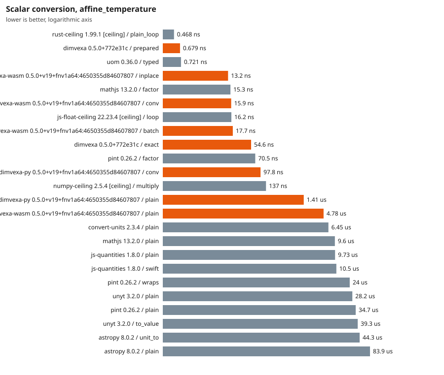

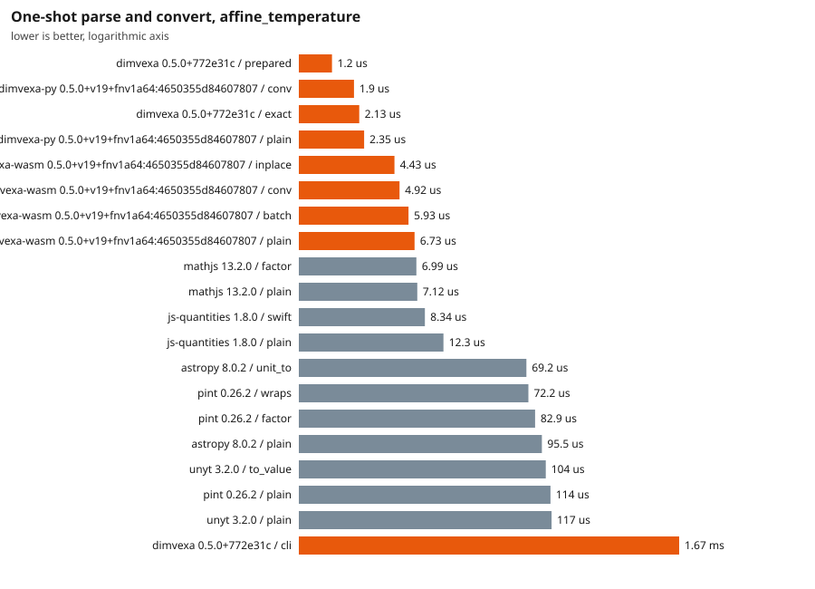

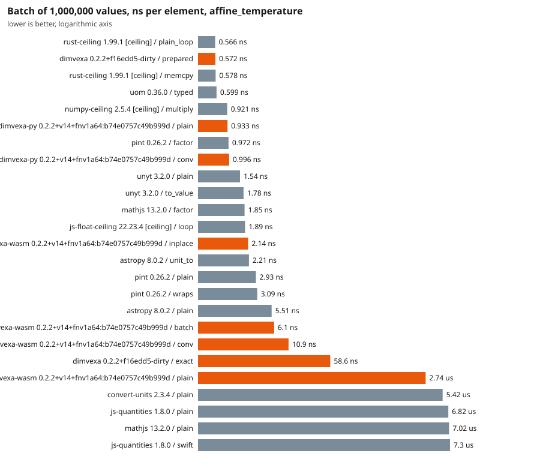

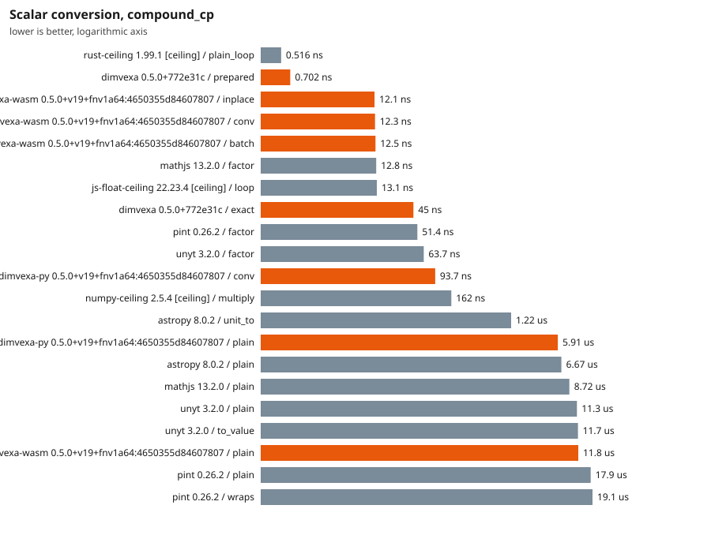

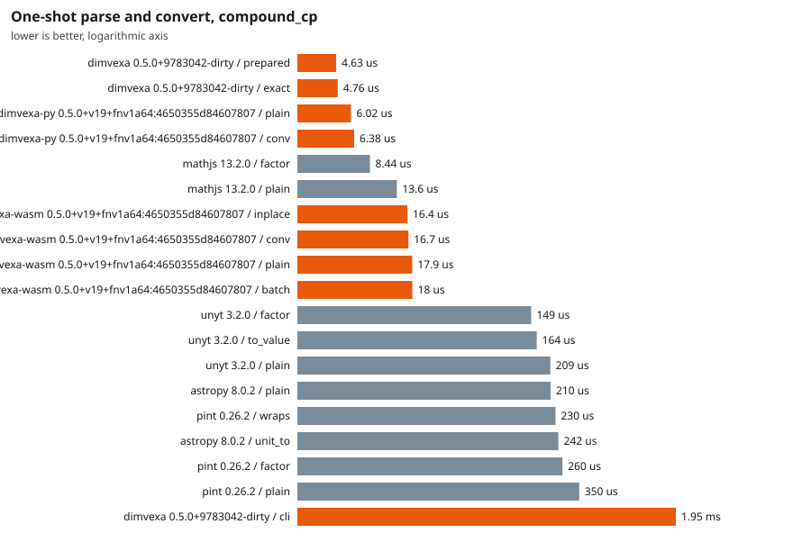

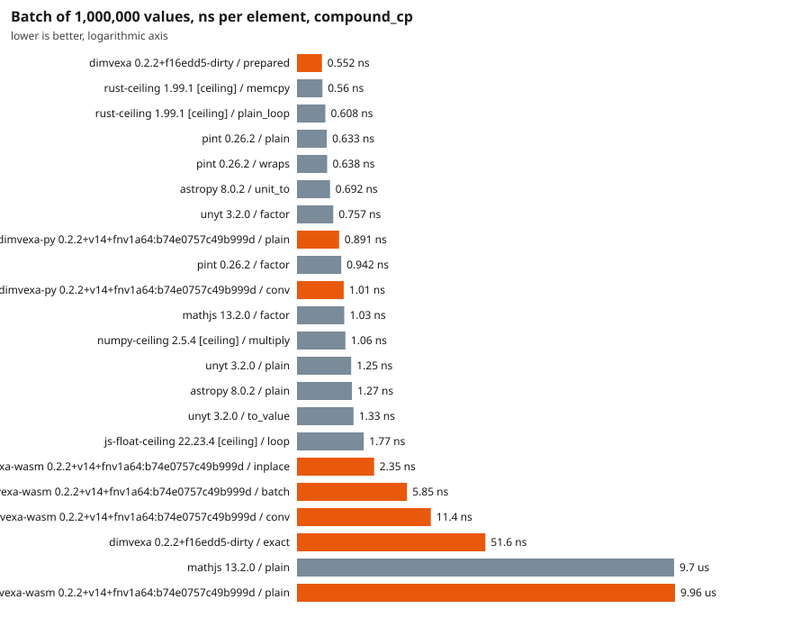

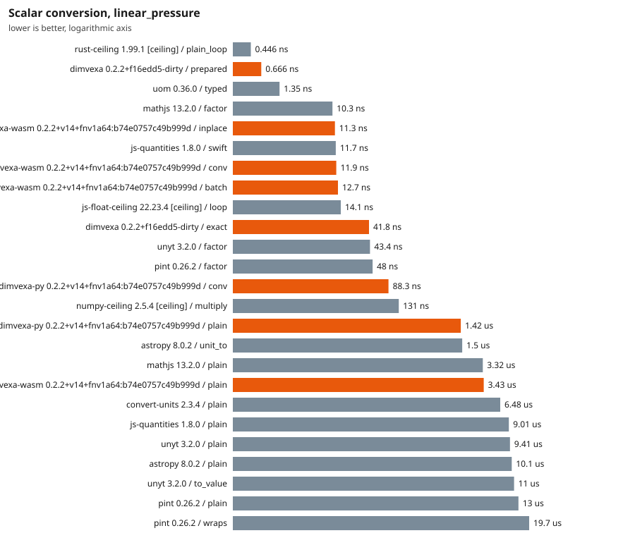

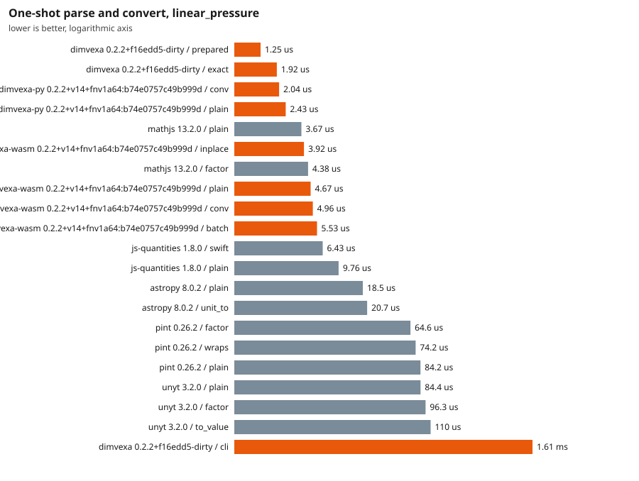

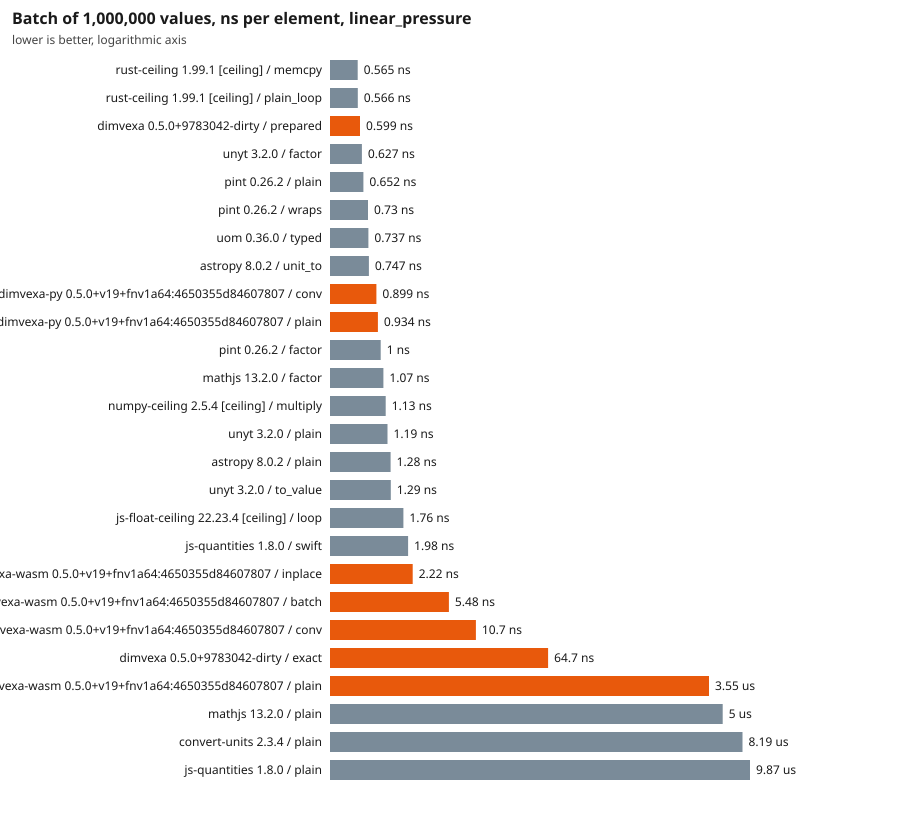

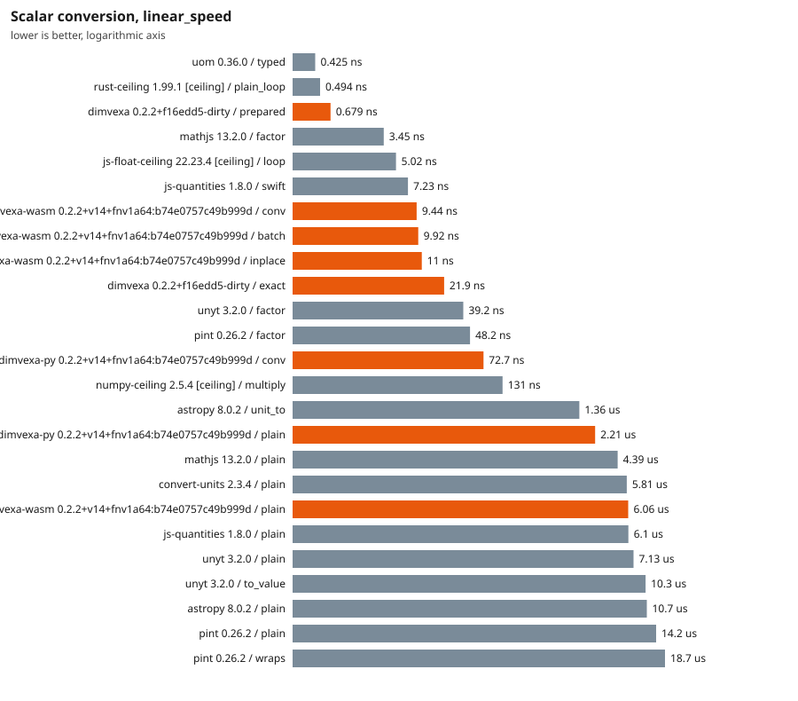

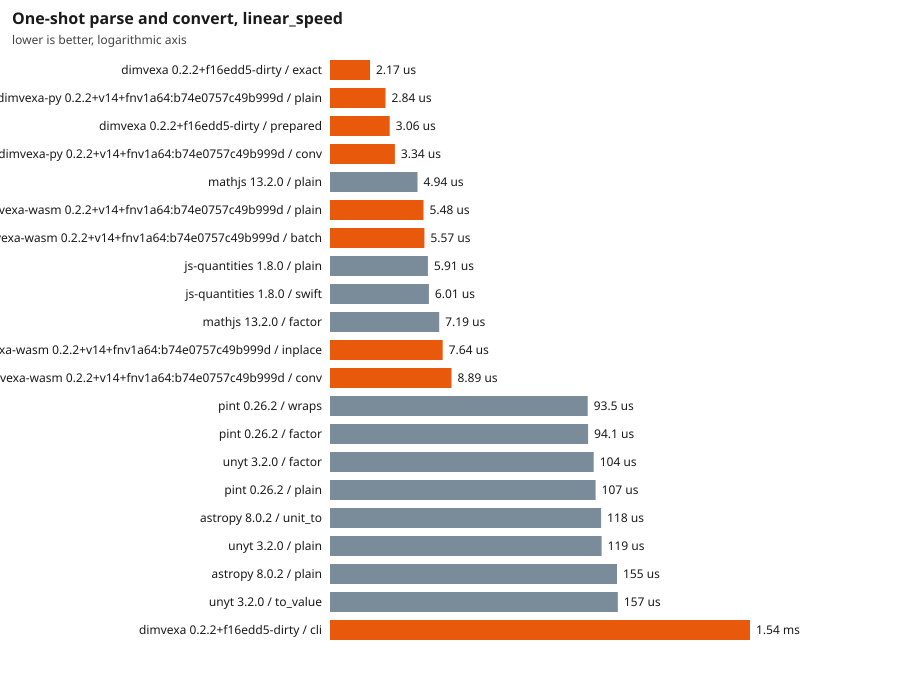

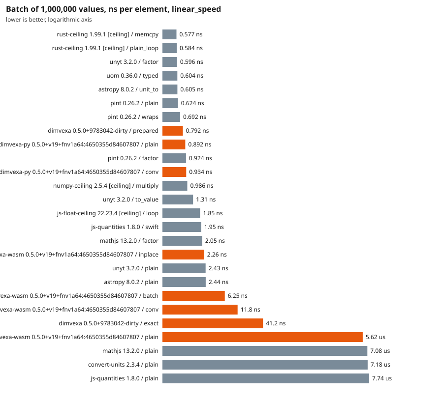

## Prepare, startup and size

| Library | Import (extra over empty interpreter) | Cold prepare (median over conversions) | Peak RSS of the runner process | Installed size |
|---|---|---|---|---|
| astropy 8.0.2 | 265 ms | 101 us | 115 MiB | 55.77 MB |
| convert-units 2.3.4 | 7.46 ms | 7.82 us | 116 MiB | 0.11 MB |
| dimvexa 0.5.0+772e31c | 0.205 ms | 4.15 us | 19 MiB | 4.74 MB |
| dimvexa-py 0.5.0+v19+fnv1a64:4650355d84607807 | 0 ms | 2.81 us | 85 MiB | 0.04 MB |
| dimvexa-wasm 0.5.0+v19+fnv1a64:4650355d84607807 | n/a | 6.48 us | 443 MiB | 0.36 MB |
| js-float-ceiling 22.23.4 [ceiling] | n/a | 315 ns | 74 MiB | n/a |
| js-quantities 1.8.0 | 3.53 ms | 31.2 us | 119 MiB | 0.59 MB |
| mathjs 13.2.0 | 500 ms | 19 ms | 264 MiB | 9.36 MB |
| numpy-ceiling 2.5.4 [ceiling] | 89.5 ms | 221 ns | 85 MiB | n/a |
| pint 0.26.2 | 235 ms | 531 us | 140 MiB | 3.14 MB |
| rust-ceiling 1.99.1 [ceiling] | n/a | n/a | 19 MiB | 4.74 MB |
| unyt 3.2.0 | 562 ms | 143 us | 132 MiB | 1.55 MB |
| uom 0.36.0 | n/a | n/a | 19 MiB | 3.83 MB |

Peak RSS covers the whole runner process including the corpus and all batch arrays, so compare it only between runs of the same language. For Rust, 'import' is the time to build the registry and 'installed size' is the runner executable.

## Accuracy (against the exact rational truth)

Every must-convert case has an exact rational expected result from an independent oracle. The error is the distance in ulp (steps between representable doubles) from the correctly rounded exact value. A result more than the tolerance away is counted as **wrong**. Cases a library cannot express are counted as **unsupported** and left out of the ulp statistics, so a library that answers few cases can look accurate: read the columns together.

| Library / semantic mode | Cases | Answered | Unsupported | Max ulp | Median ulp | Bit-identical | > 1 ulp | Wrong (> 4 ulp) |
|---|---|---|---|---|---|---|---|---|
| astropy 8.0.2 / plain | 245 | 177 | 68 | 124146008 | 0 | 127 | 30 | 28 |
| convert-units 2.3.4 / plain | 245 | 83 | 162 | 4409024035195715600 | 0 | 56 | 27 | 27 |
| dimvexa 0.5.0+772e31c / exact_f64 | 245 | 245 | 0 | 1 | 0 | 243 | 0 | 0 |
| dimvexa 0.5.0+772e31c / fast_f64 | 245 | 245 | 0 | 1 | 0 | 237 | 0 | 0 |
| dimvexa 0.5.0+772e31c / text | 245 | 245 | 0 | 0 | 0 | 245 | 0 | 0 |
| dimvexa-py 0.5.0+v19+fnv1a64:4650355d84607807 / plain | 245 | 245 | 0 | 1 | 0 | 237 | 0 | 0 |
| dimvexa-wasm 0.5.0+v19+fnv1a64:4650355d84607807 / plain | 245 | 245 | 0 | 1 | 0 | 237 | 0 | 0 |
| js-quantities 1.8.0 / plain | 245 | 165 | 80 | 3535240928 | 0 | 113 | 45 | 36 |
| mathjs 13.2.0 / plain | 245 | 168 | 77 | 1839852893016390 | 0 | 124 | 23 | 21 |
| pint 0.26.2 / plain | 245 | 220 | 25 | 4409024035195715584 | 0.0 | 143 | 36 | 10 |
| unyt 3.2.0 / plain | 245 | 157 | 88 | 4405646335475187712 | 0 | 110 | 27 | 24 |
| uom 0.36.0 / typed | 245 | 33 | 212 | 4409024035195715600 | 4 | 14 | 18 | 15 |

Largest errors (up to 3 per library):

| Library / mode | Case | ulp | Got | Correctly rounded truth |
|---|---|---|---|---|
| astropy 8.0.2 / plain | hw-037 | 124146008 | 0.999739821292388 | 0.9997398075094124 |
| astropy 8.0.2 / plain | hw-038 | 112565889 | 14.503773573063734 | 14.50377377302092 |
| astropy 8.0.2 / plain | dv-common-008 | 104514083 | 6894.757388223366 | 6894.757293168362 |
| convert-units 2.3.4 / plain | hw-068 | 4409024035195715600 | 5.684341886080802e-14 | 0.0 |
| convert-units 2.3.4 / plain | ind-006 | 6665327449 | 0.453592 | 0.45359237 |
| convert-units 2.3.4 / plain | dv-common-023 | 6509108837 | 453.592 | 453.59237 |
| dimvexa 0.5.0+772e31c / exact_f64 | dv-common-036 | 1 | 273.15000000000003 | 273.15 |
| dimvexa 0.5.0+772e31c / exact_f64 | hw-067 | 1 | 273.15000000000003 | 273.15 |
| dimvexa 0.5.0+772e31c / fast_f64 | dv-common-036 | 1 | 273.15000000000003 | 273.15 |
| dimvexa 0.5.0+772e31c / fast_f64 | dv-common-066 | 1 | 0.6894757293168362 | 0.6894757293168361 |
| dimvexa 0.5.0+772e31c / fast_f64 | hw-037 | 1 | 0.9997398075094125 | 0.9997398075094124 |
| dimvexa-py 0.5.0+v19+fnv1a64:4650355d84607807 / plain | dv-common-036 | 1 | 273.15000000000003 | 273.15 |
| dimvexa-py 0.5.0+v19+fnv1a64:4650355d84607807 / plain | dv-common-066 | 1 | 0.6894757293168362 | 0.6894757293168361 |
| dimvexa-py 0.5.0+v19+fnv1a64:4650355d84607807 / plain | hw-037 | 1 | 0.9997398075094125 | 0.9997398075094124 |
| dimvexa-wasm 0.5.0+v19+fnv1a64:4650355d84607807 / plain | dv-common-036 | 1 | 273.15000000000003 | 273.15 |
| dimvexa-wasm 0.5.0+v19+fnv1a64:4650355d84607807 / plain | dv-common-066 | 1 | 0.6894757293168362 | 0.6894757293168361 |
| dimvexa-wasm 0.5.0+v19+fnv1a64:4650355d84607807 / plain | hw-037 | 1 | 0.9997398075094125 | 0.9997398075094124 |
| js-quantities 1.8.0 / plain | hw-037 | 3535240928 | 0.9997402 | 0.9997398075094124 |
| js-quantities 1.8.0 / plain | hw-042 | 3247951291 | 14.695943005992959 | 14.695948775513449 |
| js-quantities 1.8.0 / plain | hw-038 | 3205478699 | 14.50376807894691 | 14.50377377302092 |
| mathjs 13.2.0 / plain | dv-common-065 | 1839852893016390 | 117.34776530399999 | 158.987294928 |
| mathjs 13.2.0 / plain | hw-059 | 1839852893016390 | 117.34776530399999 | 158.987294928 |
| mathjs 13.2.0 / plain | hw-060 | 1839852893016390 | 117.34776530399999 | 158.987294928 |
| pint 0.26.2 / plain | dv-common-034 | 4409024035195715584 | 5.684341886080802e-14 | 0.0 |
| pint 0.26.2 / plain | hw-064 | 4409024035195715584 | 5.684341886080802e-14 | 0.0 |
| pint 0.26.2 / plain | ind-021 | 4409024035195715584 | 5.684341886080802e-14 | 0.0 |
| unyt 3.2.0 / plain | dv-common-034 | 4405646335475187712 | 3.552713678800501e-14 | 0.0 |
| unyt 3.2.0 / plain | hw-064 | 4405646335475187712 | 3.552713678800501e-14 | 0.0 |
| unyt 3.2.0 / plain | ind-021 | 4405646335475187712 | 3.552713678800501e-14 | 0.0 |

## Coverage and safety matrix

**Must convert** (correct / wrong value / error because unsupported) and **must refuse** (refused / accepted / not applicable). A request is *accepted* when the library returned a number for it. Any error counts as a refusal: the reason is not compared, except for Dimvexa (see below).

The refuse cases are scored in two groups, because they are not the same kind of failure. **Ambiguous name**: the name has several accepted meanings (`ton`, `gal`, `oz`, `pt`, `cal`, `Btu`, `hp`, `mile`, `foot`, bare `ppm`). A library that applies a documented default (for example pint reading `ton` as the short ton) made a policy choice; it is reported as *accepted with a default* and is not a bug, but Dimvexa's design goal is to refuse, so it is still counted and shown. **Other**: missing context, temperature-kind errors, dimension mismatches. Accepting one of these is a defect or a missing check. The corpus does not record whether a library documents its default, so the ambiguous column is not a judgement of the library.

| Library / mode | Convert cases | Correct | Wrong value | Unsupported | Ambiguous: cases | refused | accepted with default | n/a | Other: cases | refused | silently accepted | n/a |
|---|---|---|---|---|---|---|---|---|---|---|---|---|
| astropy 8.0.2 / plain | 245 | 149 | 28 | 68 | 10 | 4 | 6 | 0 | 20 | 16 | **4** | 0 |
| convert-units 2.3.4 / plain | 245 | 56 | 27 | 162 | 10 | 8 | 2 | 0 | 20 | 17 | 0 | 3 |
| dimvexa 0.5.0+772e31c / exact_f64 | 245 | 245 | 0 | 0 | 10 | 10 | 0 | 0 | 20 | 17 | 0 | 3 |
| dimvexa 0.5.0+772e31c / fast_f64 | 245 | 245 | 0 | 0 | 10 | 10 | 0 | 0 | 20 | 17 | 0 | 3 |
| dimvexa 0.5.0+772e31c / text | 245 | 245 | 0 | 0 | 10 | 10 | 0 | 0 | 20 | 17 | 0 | 3 |
| dimvexa-py 0.5.0+v19+fnv1a64:4650355d84607807 / plain | 245 | 245 | 0 | 0 | 10 | 10 | 0 | 0 | 20 | 17 | 0 | 3 |
| dimvexa-wasm 0.5.0+v19+fnv1a64:4650355d84607807 / plain | 245 | 245 | 0 | 0 | 10 | 10 | 0 | 0 | 20 | 17 | 0 | 3 |
| js-quantities 1.8.0 / plain | 245 | 129 | 36 | 80 | 10 | 1 | 9 | 0 | 20 | 17 | **3** | 0 |
| mathjs 13.2.0 / plain | 245 | 147 | 21 | 77 | 10 | 3 | 7 | 0 | 20 | 15 | **5** | 0 |
| pint 0.26.2 / plain | 245 | 210 | 10 | 25 | 10 | 0 | 10 | 0 | 20 | 18 | **2** | 0 |
| unyt 3.2.0 / plain | 245 | 133 | 24 | 88 | 10 | 4 | 6 | 0 | 20 | 16 | **4** | 0 |
| uom 0.36.0 / typed | 245 | 18 | 15 | 212 | 10 | 0 | 0 | 10 | 20 | 0 | 0 | 20 |

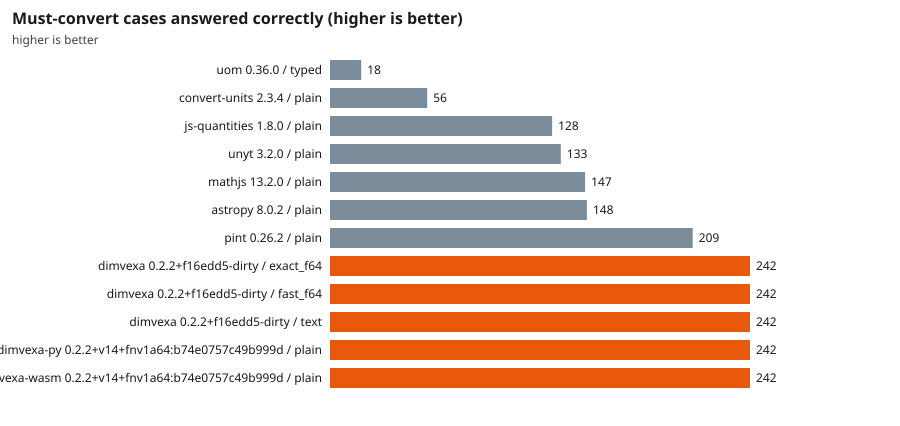

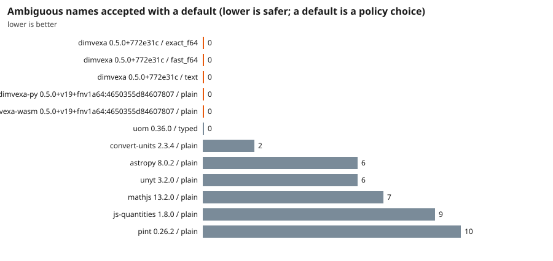

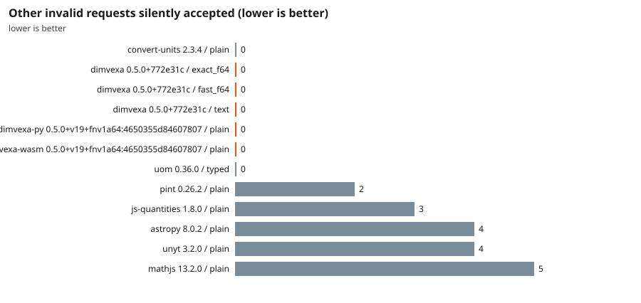

### Must-convert results by origin of the case

The corpus mixes cases taken from Dimvexa's own golden vectors, hand-written cases whose truth comes from the oracle in `corpus-src/truth.toml`, and *independent* cases whose expected value is the number published in a cited source (NIST, BIPM) and only cross-checked by the oracle. A library that does much better on the first group than on the independent one would show corpus bias. Cells are correct/total; a dash means the result file predates that group (its corpus is older).

| Origin | astropy 8.0.2 / plain | convert-units 2.3.4 / plain | dimvexa 0.5.0+772e31c / exact_f64 | dimvexa 0.5.0+772e31c / fast_f64 | dimvexa 0.5.0+772e31c / text | dimvexa-py 0.5.0+v19+fnv1a64:4650355d84607807 / plain | dimvexa-wasm 0.5.0+v19+fnv1a64:4650355d84607807 / plain | js-quantities 1.8.0 / plain | mathjs 13.2.0 / plain | pint 0.26.2 / plain | unyt 3.2.0 / plain | uom 0.36.0 / typed |
|---|---|---|---|---|---|---|---|---|---|---|---|---|
| Dimvexa golden vectors | 76/122 | 25/122 | 122/122 | 122/122 | 122/122 | 122/122 | 122/122 | 65/122 | 67/122 | 101/122 | 63/122 | 4/122 |
| Hand-written (oracle truth) | 44/83 | 14/83 | 83/83 | 83/83 | 83/83 | 83/83 | 83/83 | 38/83 | 48/83 | 74/83 | 45/83 | 6/83 |
| Independent (published values) | 29/40 | 17/40 | 40/40 | 40/40 | 40/40 | 40/40 | 40/40 | 26/40 | 32/40 | 35/40 | 25/40 | 8/40 |

### Per-request outcome for the must-refuse cases

`ok` refused, `ACCEPTED` accepted (the number is shown), `-` not applicable. The group column is `ambiguous name` (an accepted number may be a documented default) or `other` (accepting it is a defect).

| Case | Category | Group | astropy 8.0.2 / plain | convert-units 2.3.4 / plain | dimvexa 0.5.0+772e31c / exact_f64 | dimvexa 0.5.0+772e31c / fast_f64 | dimvexa 0.5.0+772e31c / text | dimvexa-py 0.5.0+v19+fnv1a64:4650355d84607807 / plain | dimvexa-wasm 0.5.0+v19+fnv1a64:4650355d84607807 / plain | js-quantities 1.8.0 / plain | mathjs 13.2.0 / plain | pint 0.26.2 / plain | unyt 3.2.0 / plain | uom 0.36.0 / typed |
|---|---|---|---|---|---|---|---|---|---|---|---|---|---|---|
| ref-001 | ambiguous_name | ambiguous name | ACCEPTED (np.float64(907) | ok | ok | ok | ok | ok | ok | ACCEPTED (907.18474) | ACCEPTED (907.18474) | ACCEPTED (907.1847400000) | ACCEPTED (array(907.1847) | - |
| ref-002 | ambiguous_name | ambiguous name | ok | ACCEPTED (3.785411795401) | ok | ok | ok | ok | ok | ACCEPTED (3.7854118) | ACCEPTED (3.785411784) | ACCEPTED (3.785411783999) | ok | - |
| ref-003 | ambiguous_name | ambiguous name | ACCEPTED (np.float64(28.) | ACCEPTED (28.3495) | ok | ok | ok | ok | ok | ACCEPTED (28.3495231) | ACCEPTED (28.349523125) | ACCEPTED (28.34952312500) | ACCEPTED (array(28.34952) | - |
| ref-004 | ambiguous_name | ambiguous name | ok | ok | ok | ok | ok | ok | ok | ACCEPTED (0.473176475) | ACCEPTED (0.473176473) | ACCEPTED (0.473176472999) | ok | - |
| ref-005 | ambiguous_name | ambiguous name | ACCEPTED (np.float64(4.1) | ok | ok | ok | ok | ok | ok | ACCEPTED (4.184) | ok | ACCEPTED (4.184) | ACCEPTED (array(4.184)) | - |
| ref-006 | ambiguous_name | ambiguous name | ok | ok | ok | ok | ok | ok | ok | ok | ok | ACCEPTED (1055.056) | ok | - |
| ref-007 | ambiguous_name | ambiguous name | ACCEPTED (np.float64(745) | ok | ok | ok | ok | ok | ok | ACCEPTED (745.699872) | ACCEPTED (745.6998715386) | ACCEPTED (745.6998715822) | ACCEPTED (array(745.6998) | - |
| ref-008 | ambiguous_name | ambiguous name | ACCEPTED (np.float64(1.6) | ok | ok | ok | ok | ok | ok | ACCEPTED (1.609344) | ACCEPTED (1.609344) | ACCEPTED (1.609344) | ACCEPTED (array(1.609344) | - |
| ref-009 | ambiguous_name | ambiguous name | ACCEPTED (np.float64(0.3) | ok | ok | ok | ok | ok | ok | ACCEPTED (0.3048) | ACCEPTED (0.3048) | ACCEPTED (0.304799999999) | ACCEPTED (array(0.3048)) | - |
| ref-010 | ambiguous_name | ambiguous name | ok | ok | ok | ok | ok | ok | ok | ACCEPTED (0.0001) | ok | ACCEPTED (9.999999999999) | ok | - |
| ref-011 | missing_context | other | ok | ok | ok | ok | ok | ok | ok | ok | ok | ok | ok | - |
| ref-012 | missing_context | other | ok | ok | ok | ok | ok | ok | ok | ok | ok | ok | ok | - |
| ref-013 | missing_context | other | ok | ok | ok | ok | ok | ok | ok | ok | ok | ok | ok | - |
| ref-014 | missing_context | other | ok | ok | ok | ok | ok | ok | ok | ok | ok | ok | ok | - |
| ref-015 | missing_context | other | ok | ok | ok | ok | ok | ok | ok | ok | ok | ok | ok | - |
| ref-016 | missing_context | other | ok | ok | ok | ok | ok | ok | ok | ok | ok | ok | ok | - |
| ref-017 | missing_context | other | ok | ok | ok | ok | ok | ok | ok | ok | ok | ok | ok | - |
| ref-018 | missing_context | other | ok | ok | ok | ok | ok | ok | ok | ok | ok | ok | ok | - |
| ref-019 | missing_context | other | ok | ok | ok | ok | ok | ok | ok | ok | ok | ok | ok | - |
| ref-020 | missing_context | other | ok | ok | ok | ok | ok | ok | ok | ok | ok | ACCEPTED (0.980665) | ok | - |
| ref-021 | kind | other | ACCEPTED (np.float64(50.) | - | - | - | - | - | - | ok | ACCEPTED (50 degC) | ok | ACCEPTED (array(50.)) | - |
| ref-022 | kind | other | ok | - | - | - | - | - | - | ACCEPTED (25 tempC) | ACCEPTED (25 degC) | ok | ACCEPTED (array(25.)) | - |
| ref-023 | kind | other | ACCEPTED (np.float64(30.) | - | - | - | - | - | - | ok | ACCEPTED (29.99999999999) | ok | ACCEPTED (array(30.)) | - |
| ref-024 | kind | other | ACCEPTED (np.float64(283) | ok | ok | ok | ok | ok | ok | ACCEPTED (10) | ACCEPTED (283.15) | ACCEPTED (283.15) | ACCEPTED (array(283.15)) | - |
| ref-025 | kind | other | ACCEPTED (np.float64(-26) | ok | ok | ok | ok | ok | ok | ACCEPTED (-263.15) | ACCEPTED (-263.15) | ok | ok | - |
| ref-026 | dimension | other | ok | ok | ok | ok | ok | ok | ok | ok | ok | ok | ok | - |
| ref-027 | dimension | other | ok | ok | ok | ok | ok | ok | ok | ok | ok | ok | ok | - |
| ref-028 | dimension | other | ok | ok | ok | ok | ok | ok | ok | ok | ok | ok | ok | - |
| ref-029 | dimension | other | ok | ok | ok | ok | ok | ok | ok | ok | ok | ok | ok | - |
| ref-030 | dimension | other | ok | ok | ok | ok | ok | ok | ok | ok | ok | ok | ok | - |

### Unit coverage

Units a library can parse, out of the coverage lists in the corpus (Dimvexa spellings, translated per library; see `benchmarks/translations/`). Parsing a unit does not prove its factor is right; the accuracy section checks values.

| List | astropy 8.0.2 / plain | convert-units 2.3.4 / plain | dimvexa 0.5.0+772e31c / exact_f64 | dimvexa 0.5.0+772e31c / fast_f64 | dimvexa 0.5.0+772e31c / text | dimvexa-py 0.5.0+v19+fnv1a64:4650355d84607807 / plain | dimvexa-wasm 0.5.0+v19+fnv1a64:4650355d84607807 / plain | js-quantities 1.8.0 / plain | mathjs 13.2.0 / plain | pint 0.26.2 / plain | unyt 3.2.0 / plain | uom 0.36.0 / typed |
|---|---|---|---|---|---|---|---|---|---|---|---|---|
| compound | 11/11 | 2/11 | 11/11 | 11/11 | 11/11 | 11/11 | 11/11 | 7/11 | 11/11 | 11/11 | 11/11 | 2/11 |
| dimvexa_seed_table | 70/107 | 40/107 | 107/107 | 107/107 | 107/107 | 107/107 | 107/107 | 75/107 | 62/107 | 88/107 | 62/107 | 10/107 |
| imperial_us | 14/24 | 8/24 | 24/24 | 24/24 | 24/24 | 24/24 | 24/24 | 14/24 | 13/24 | 24/24 | 12/24 | 4/24 |
| pressure | 3/10 | 3/10 | 8/10 | 8/10 | 8/10 | 8/10 | 8/10 | 6/10 | 6/10 | 8/10 | 3/10 | 1/10 |
| process | 13/19 | 1/19 | 19/19 | 19/19 | 19/19 | 19/19 | 19/19 | 9/19 | 11/19 | 14/19 | 10/19 | 0/19 |
| si | 25/25 | 17/25 | 25/25 | 25/25 | 25/25 | 25/25 | 25/25 | 25/25 | 24/25 | 25/25 | 24/25 | 4/25 |
| si_prefixed | 16/17 | 9/17 | 17/17 | 17/17 | 17/17 | 17/17 | 17/17 | 17/17 | 17/17 | 17/17 | 17/17 | 2/17 |
| temperature | 8/8 | 4/8 | 8/8 | 8/8 | 8/8 | 8/8 | 8/8 | 8/8 | 8/8 | 7/8 | 8/8 | 3/8 |

Dimvexa (exact_f64): 25 of 27 refusals carried the intended error code.

