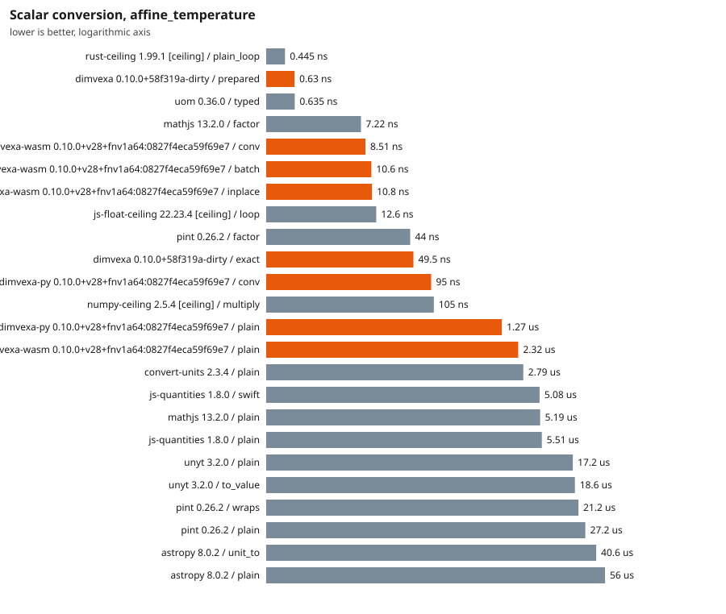
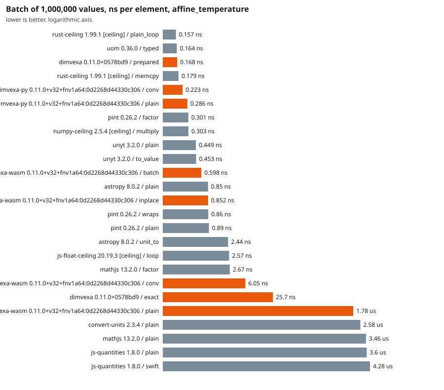
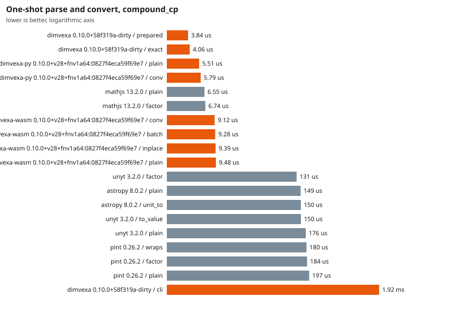
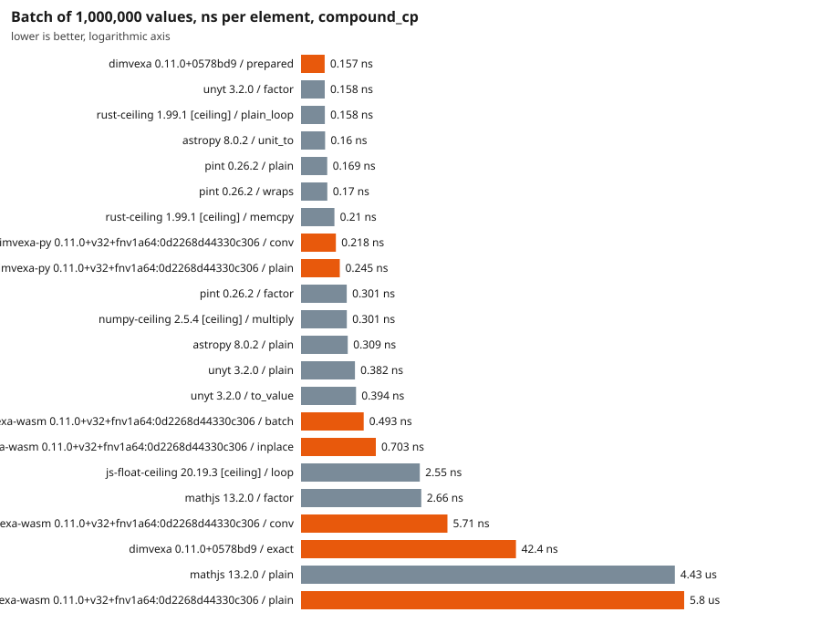
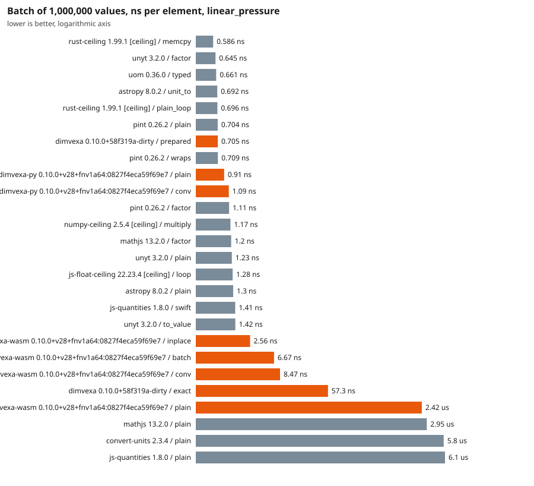
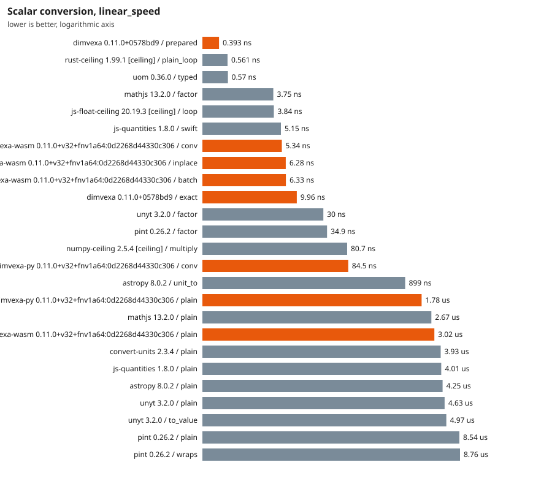
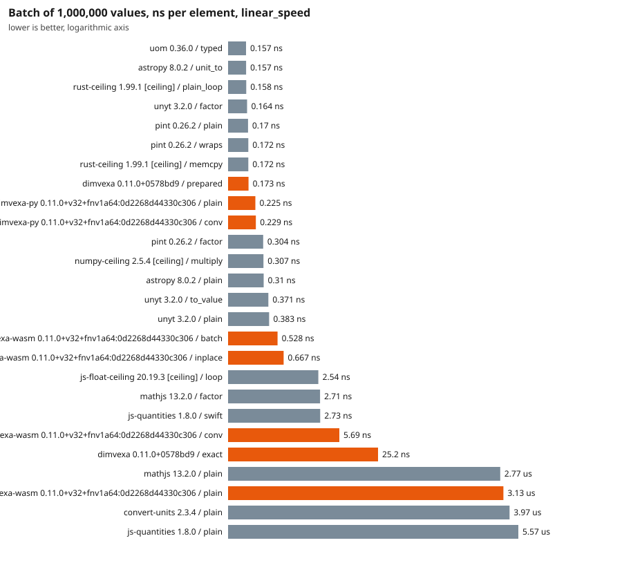
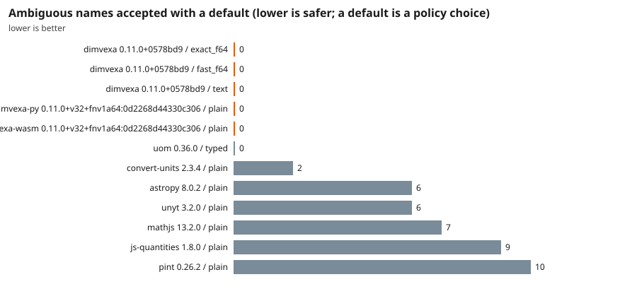
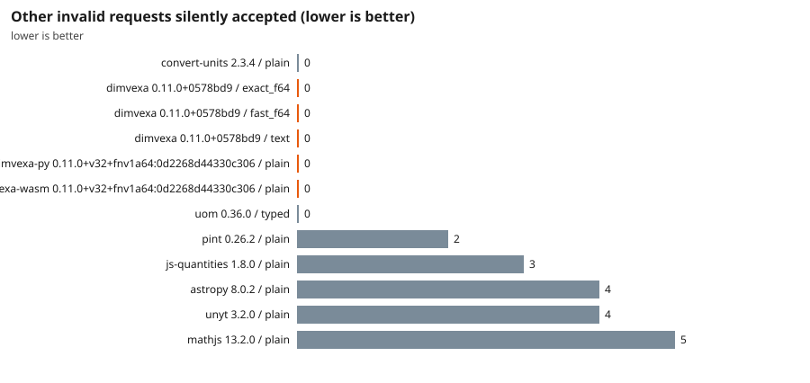

# Comparison with other unit libraries

Generated by `benchmarks/tools/report.py` from the raw files in `benchmarks/results/`. Do not edit by hand. Method and rules: [`docs/benchmarking.md`](../../benchmarking.md).

## Runs included

| Library | Kind | Runtime | OS / CPU | Date (UTC) | Lockfile | Corpus |
|---|---|---|---|---|---|---|
| astropy 8.0.2 | library | CPython 3.13.18 | Darwin 25.5.0; Apple M2; 8 cores; governor unknown | 2026-11-18T17:11:14Z | pinned | 69bf1471279e6d39 |
| convert-units 2.3.4 | library | node v20.19.3 | Darwin 25.5.0; Apple M2; 8 cores; governor unknown | 2026-11-18T17:18:24Z | pinned | 69bf1471279e6d39 |
| dimvexa 0.11.0+0578bd9 | library | rustc rustc 1.99.1 (58cf8f9c3 2026-10-13) | Darwin 25.5.0; Apple M2; 8 cores; governor unknown | 2026-11-18T17:06:50Z | pinned | 69bf1471279e6d39 |
| dimvexa-py 0.11.0+v32+fnv1a64:0d2268d44330c306 | library | CPython 3.13.18 | Darwin 25.5.0; Apple M2; 8 cores; governor unknown | 2026-11-18T17:08:27Z | pinned | 69bf1471279e6d39 |
| dimvexa-wasm 0.11.0+v32+fnv1a64:0d2268d44330c306 | library | node v20.19.3 | Darwin 25.5.0; Apple M2; 8 cores; governor unknown | 2026-11-18T17:20:15Z | pinned | 69bf1471279e6d39 |
| js-float-ceiling 20.19.3 [ceiling] | ceiling | node v20.19.3 | Darwin 25.5.0; Apple M2; 8 cores; governor unknown | 2026-11-18T17:11:56Z | pinned | 69bf1471279e6d39 |
| js-quantities 1.8.0 | library | node v20.19.3 | Darwin 25.5.0; Apple M2; 8 cores; governor unknown | 2026-11-18T17:15:00Z | pinned | 69bf1471279e6d39 |
| mathjs 13.2.0 | library | node v20.19.3 | Darwin 25.5.0; Apple M2; 8 cores; governor unknown | 2026-11-18T17:12:14Z | pinned | 69bf1471279e6d39 |
| numpy-ceiling 2.5.4 [ceiling] | ceiling | CPython 3.13.18 | Darwin 25.5.0; Apple M2; 8 cores; governor unknown | 2026-11-18T17:08:11Z | pinned | 69bf1471279e6d39 |
| pint 0.26.2 | library | CPython 3.13.18 | Darwin 25.5.0; Apple M2; 8 cores; governor unknown | 2026-11-18T17:09:07Z | pinned | 69bf1471279e6d39 |
| rust-ceiling 1.99.1 [ceiling] | ceiling | rustc rustc 1.99.1 (58cf8f9c3 2026-10-13) | Darwin 25.5.0; Apple M2; 8 cores; governor unknown | 2026-11-18T17:07:39Z | pinned | 69bf1471279e6d39 |
| unyt 3.2.0 | library | CPython 3.13.18 | Darwin 25.5.0; Apple M2; 8 cores; governor unknown | 2026-11-18T17:10:14Z | pinned | 69bf1471279e6d39 |
| uom 0.36.0 | library | rustc rustc 1.99.1 (58cf8f9c3 2026-10-13) | Darwin 25.5.0; Apple M2; 8 cores; governor unknown | 2026-11-18T17:08:11Z | pinned | 69bf1471279e6d39 |

GitHub-hosted runners are noisy. Python and JavaScript wall-clock figures are indicative; read the MAD (median absolute deviation) next to each median, and the raw samples in the JSON.

## Speed

Median ns per conversion (MAD in brackets). **Scalar**: prepared conversion applied to one value, including the loop iteration of the host language (see the loop overhead rows). **One-shot**: parse a string such as `10 m/s` and convert it. **Batch**: ns per element for N values. Rows marked [ceiling] do no unit handling; they show what the language itself costs. `n/a` means the library has no such API or the runner could not run it (see the JSON `errors`).

### affine_temperature

| Library / mode | Scalar | Loop overhead | One-shot parse+convert | Batch 1,000 | Batch 100,000 | Batch 1,000,000 |
|---|---|---|---|---|---|---|
| astropy 8.0.2 / plain | 30.6 us (MAD 53.2 ns) | 20.8 ns (MAD 0.0818 ns) | 36.8 us (MAD 44.9 ns) | 33.7 ns (MAD 0.209 ns) | 1.02 ns (MAD 0.0025 ns) | 0.85 ns (MAD 0.0148 ns) |
| astropy 8.0.2 / unit_to | 26.5 us (MAD 37.7 ns) | 21.7 ns (MAD 0.507 ns) | 36.8 us (MAD 185 ns) | 29.3 ns (MAD 0.082 ns) | 0.883 ns (MAD 0.00125 ns) | 2.44 ns (MAD 1.09 ns) |
| convert-units 2.3.4 / plain | 2.48 us (MAD 95.8 ns) | 3.77 ns (MAD 0.0257 ns) | n/a | 2.47 us (MAD 80.8 ns) | 2.43 us (MAD 25.6 ns) | 2.58 us (MAD 51.5 ns) |
| dimvexa 0.11.0+0578bd9 / cli | n/a | n/a | 2.2 ms (MAD 41.4 us) | n/a | n/a | n/a |
| dimvexa 0.11.0+0578bd9 / exact | 22.2 ns (MAD 0.0665 ns) | 0.296 ns (MAD 0.000527 ns) | 1.02 us (MAD 6.72 ns) | 24.2 ns (MAD 0.042 ns) | 24.6 ns (MAD 0.187 ns) | 25.7 ns (MAD 0.325 ns) |
| dimvexa 0.11.0+0578bd9 / prepared | 0.411 ns (MAD 0.00234 ns) | 0.297 ns (MAD 0.000487 ns) | 837 ns (MAD 1.95 ns) | 0.125 ns (MAD 0 ns) | 0.168 ns (MAD 0.00167 ns) | 0.168 ns (MAD 0.0005 ns) |
| dimvexa-py 0.11.0+v32+fnv1a64:0d2268d44330c306 / conv | 81.9 ns (MAD 0.157 ns) | 20.7 ns (MAD 0.0736 ns) | 1.34 us (MAD 3.52 ns) | 0.75 ns (MAD 0.041 ns) | 0.21 ns (MAD 0.00041 ns) | 0.223 ns (MAD 0.00529 ns) |
| dimvexa-py 0.11.0+v32+fnv1a64:0d2268d44330c306 / plain | 1.01 us (MAD 2.97 ns) | 20.6 ns (MAD 0.0861 ns) | 1.36 us (MAD 27.1 ns) | 1.83 ns (MAD 0.041 ns) | 0.281 ns (MAD 0.0112 ns) | 0.286 ns (MAD 0.00875 ns) |
| dimvexa-wasm 0.11.0+v32+fnv1a64:0d2268d44330c306 / batch | 7.58 ns (MAD 0.153 ns) | 3.77 ns (MAD 0.0172 ns) | 2.5 us (MAD 7.58 ns) | 0.958 ns (MAD 0.042 ns) | 0.592 ns (MAD 0.00708 ns) | 0.598 ns (MAD 0.0143 ns) |
| dimvexa-wasm 0.11.0+v32+fnv1a64:0d2268d44330c306 / conv | 7.27 ns (MAD 0.0262 ns) | 3.76 ns (MAD 0.0241 ns) | 2.54 us (MAD 30.1 ns) | 5.88 ns (MAD 0 ns) | 5.97 ns (MAD 0.00458 ns) | 6.05 ns (MAD 0.0138 ns) |
| dimvexa-wasm 0.11.0+v32+fnv1a64:0d2268d44330c306 / inplace | 7.5 ns (MAD 0.027 ns) | 3.76 ns (MAD 0.00985 ns) | 2.5 us (MAD 6.32 ns) | 0.792 ns (MAD 0.042 ns) | 0.682 ns (MAD 0.00666 ns) | 0.852 ns (MAD 0.0243 ns) |
| dimvexa-wasm 0.11.0+v32+fnv1a64:0d2268d44330c306 / plain | 1.74 us (MAD 14.3 ns) | 3.79 ns (MAD 0.0464 ns) | 2.62 us (MAD 45.9 ns) | 1.76 us (MAD 54.8 ns) | 1.77 us (MAD 16.7 ns) | 1.78 us (MAD 3.87 ns) |
| js-float-ceiling 20.19.3 [ceiling] / loop | 8.39 ns (MAD 0.138 ns) | 3.77 ns (MAD 0.00871 ns) | n/a | 2.58 ns (MAD 0 ns) | 2.55 ns (MAD 0.0479 ns) | 2.57 ns (MAD 0.0161 ns) |
| js-quantities 1.8.0 / plain | 3.49 us (MAD 9.59 ns) | 3.75 ns (MAD 0.00773 ns) | 3.57 us (MAD 11.3 ns) | 3.5 us (MAD 22.3 ns) | 3.52 us (MAD 54.6 ns) | 3.6 us (MAD 26.3 ns) |
| js-quantities 1.8.0 / swift | 3.38 us (MAD 27 ns) | 3.79 ns (MAD 0.0442 ns) | 3.57 us (MAD 13.8 ns) | 4.51 us (MAD 113 ns) | 4.25 us (MAD 102 ns) | 4.28 us (MAD 51 ns) |
| mathjs 13.2.0 / factor | 5.34 ns (MAD 0.0359 ns) | 3.75 ns (MAD 0.00728 ns) | 3.86 us (MAD 235 ns) | 2.71 ns (MAD 0 ns) | 2.64 ns (MAD 0.00084 ns) | 2.67 ns (MAD 0.0104 ns) |
| mathjs 13.2.0 / plain | 3.41 us (MAD 7.83 ns) | 3.79 ns (MAD 0.0094 ns) | 3.61 us (MAD 29.3 ns) | 3.55 us (MAD 117 ns) | 3.4 us (MAD 23.4 ns) | 3.46 us (MAD 24.3 ns) |
| numpy-ceiling 2.5.4 [ceiling] / multiply | 82.9 ns (MAD 1.6 ns) | 20.9 ns (MAD 0.088 ns) | n/a | 1.25 ns (MAD 0.041 ns) | 0.305 ns (MAD 0.00124 ns) | 0.303 ns (MAD 0.000583 ns) |
| pint 0.26.2 / factor | 34.9 ns (MAD 0.403 ns) | 21.7 ns (MAD 0.38 ns) | 31.9 us (MAD 76.7 ns) | 1.29 ns (MAD 0.001 ns) | 0.304 ns (MAD 0.00082 ns) | 0.301 ns (MAD 0.00113 ns) |
| pint 0.26.2 / plain | 12.7 us (MAD 31.3 ns) | 21.8 ns (MAD 0.113 ns) | 32.2 us (MAD 140 ns) | 17.1 ns (MAD 0.166 ns) | 0.947 ns (MAD 0.00916 ns) | 0.89 ns (MAD 0.024 ns) |
| pint 0.26.2 / wraps | 12.8 us (MAD 51.2 ns) | 21.1 ns (MAD 0.259 ns) | 31.7 us (MAD 71.2 ns) | 16.9 ns (MAD 0.083 ns) | 0.938 ns (MAD 0.00584 ns) | 0.86 ns (MAD 0.00446 ns) |
| rust-ceiling 1.99.1 [ceiling] / memcpy | n/a | 0.296 ns (MAD 0.00112 ns) | n/a | 0.125 ns (MAD 0 ns) | 0.138 ns (MAD 0.00208 ns) | 0.179 ns (MAD 0.00429 ns) |
| rust-ceiling 1.99.1 [ceiling] / plain_loop | 0.545 ns (MAD 0.0701 ns) | 0.297 ns (MAD 0.00178 ns) | n/a | 0.125 ns (MAD 0 ns) | 0.158 ns (MAD 0.00209 ns) | 0.157 ns (MAD 8.4e-05 ns) |
| unyt 3.2.0 / factor | unsupported |  |  |  |  |  |
| unyt 3.2.0 / plain | 11.6 us (MAD 32.4 ns) | 20.4 ns (MAD 0.0359 ns) | 38.2 us (MAD 158 ns) | 11.4 ns (MAD 0.041 ns) | 0.532 ns (MAD 0.00083 ns) | 0.449 ns (MAD 0.0015 ns) |
| unyt 3.2.0 / to_value | 11.9 us (MAD 23.1 ns) | 20.6 ns (MAD 0.0494 ns) | 38.3 us (MAD 82.7 ns) | 11.5 ns (MAD 0.042 ns) | 0.538 ns (MAD 0.005 ns) | 0.453 ns (MAD 0.00333 ns) |
| uom 0.36.0 / typed | 0.458 ns (MAD 0.00098 ns) | 0.295 ns (MAD 0.000443 ns) | n/a | 0.125 ns (MAD 0 ns) | 0.157 ns (MAD 0 ns) | 0.164 ns (MAD 0.000833 ns) |

### compound_cp

| Library / mode | Scalar | Loop overhead | One-shot parse+convert | Batch 1,000 | Batch 100,000 | Batch 1,000,000 |
|---|---|---|---|---|---|---|
| astropy 8.0.2 / plain | 4.31 us (MAD 11 ns) | 21.1 ns (MAD 0.0373 ns) | 78.3 us (MAD 3.12 us) | 4.67 ns (MAD 0.043 ns) | 0.339 ns (MAD 0.00417 ns) | 0.309 ns (MAD 0.00567 ns) |
| astropy 8.0.2 / unit_to | 926 ns (MAD 5.5 ns) | 21.2 ns (MAD 0.0333 ns) | 76.3 us (MAD 507 ns) | 1.62 ns (MAD 0.042 ns) | 0.175 ns (MAD 0.00042 ns) | 0.16 ns (MAD 0.00075 ns) |
| convert-units 2.3.4 / plain | unsupported |  |  |  |  |  |
| dimvexa 0.11.0+0578bd9 / cli | n/a | n/a | 2.22 ms (MAD 48.3 us) | n/a | n/a | n/a |
| dimvexa 0.11.0+0578bd9 / exact | 23.9 ns (MAD 0.647 ns) | 0.297 ns (MAD 0.00124 ns) | 3.71 us (MAD 13.2 ns) | 38.9 ns (MAD 0.042 ns) | 40.5 ns (MAD 0.137 ns) | 42.4 ns (MAD 1.01 ns) |
| dimvexa 0.11.0+0578bd9 / prepared | 0.384 ns (MAD 0.000474 ns) | 0.295 ns (MAD 0.0014 ns) | 3.43 us (MAD 7.6 ns) | 0.125 ns (MAD 0 ns) | 0.157 ns (MAD 1e-05 ns) | 0.157 ns (MAD 0.000124 ns) |
| dimvexa-py 0.11.0+v32+fnv1a64:0d2268d44330c306 / conv | 81.5 ns (MAD 0.186 ns) | 20.5 ns (MAD 0.0373 ns) | 4.04 us (MAD 10.6 ns) | 0.833 ns (MAD 0 ns) | 0.208 ns (MAD 0.00083 ns) | 0.218 ns (MAD 0.00204 ns) |
| dimvexa-py 0.11.0+v32+fnv1a64:0d2268d44330c306 / plain | 3.58 us (MAD 12.9 ns) | 20.6 ns (MAD 0.0627 ns) | 4.19 us (MAD 125 ns) | 4.33 ns (MAD 0.042 ns) | 0.248 ns (MAD 0.00124 ns) | 0.245 ns (MAD 0.0106 ns) |
| dimvexa-wasm 0.11.0+v32+fnv1a64:0d2268d44330c306 / batch | 7.02 ns (MAD 0.0104 ns) | 3.75 ns (MAD 0.00464 ns) | 6.8 us (MAD 8.66 ns) | 1.79 ns (MAD 0.125 ns) | 0.482 ns (MAD 0.00209 ns) | 0.493 ns (MAD 0.00333 ns) |
| dimvexa-wasm 0.11.0+v32+fnv1a64:0d2268d44330c306 / conv | 6.95 ns (MAD 0.0265 ns) | 3.74 ns (MAD 0.00382 ns) | 6.81 us (MAD 49.5 ns) | 5.54 ns (MAD 0.001 ns) | 5.71 ns (MAD 0.0275 ns) | 5.71 ns (MAD 0.00917 ns) |
| dimvexa-wasm 0.11.0+v32+fnv1a64:0d2268d44330c306 / inplace | 7.35 ns (MAD 0.0134 ns) | 3.78 ns (MAD 0.0339 ns) | 6.83 us (MAD 23 ns) | 0.667 ns (MAD 0 ns) | 2.02 ns (MAD 0.329 ns) | 0.703 ns (MAD 0.0238 ns) |
| dimvexa-wasm 0.11.0+v32+fnv1a64:0d2268d44330c306 / plain | 5.78 us (MAD 92.7 ns) | 3.78 ns (MAD 0.0364 ns) | 7.2 us (MAD 87.7 ns) | 5.94 us (MAD 262 ns) | 5.93 us (MAD 139 ns) | 5.8 us (MAD 10.1 ns) |
| js-float-ceiling 20.19.3 [ceiling] / loop | 8.26 ns (MAD 0.0463 ns) | 3.89 ns (MAD 0.144 ns) | n/a | 2.58 ns (MAD 0.041 ns) | 2.54 ns (MAD 0.015 ns) | 2.55 ns (MAD 0.0216 ns) |
| js-quantities 1.8.0 / plain | unsupported |  |  |  |  |  |
| js-quantities 1.8.0 / swift | unsupported |  |  |  |  |  |
| mathjs 13.2.0 / factor | 5.21 ns (MAD 0.0157 ns) | 3.73 ns (MAD 0.00563 ns) | 4.45 us (MAD 12.1 ns) | 2.79 ns (MAD 0.041 ns) | 2.65 ns (MAD 0.00209 ns) | 2.66 ns (MAD 0.00942 ns) |
| mathjs 13.2.0 / plain | 4.28 us (MAD 38.9 ns) | 3.91 ns (MAD 0.144 ns) | 4.45 us (MAD 20 ns) | 4.22 us (MAD 33 ns) | 4.32 us (MAD 52.9 ns) | 4.43 us (MAD 43.6 ns) |
| numpy-ceiling 2.5.4 [ceiling] / multiply | 79.6 ns (MAD 0.0859 ns) | 21 ns (MAD 0.137 ns) | n/a | 1.25 ns (MAD 0.041 ns) | 0.303 ns (MAD 0.00083 ns) | 0.301 ns (MAD 0.000291 ns) |
| pint 0.26.2 / factor | 35.9 ns (MAD 0.525 ns) | 21.6 ns (MAD 0.352 ns) | 95.5 us (MAD 158 ns) | 1.25 ns (MAD 0 ns) | 0.305 ns (MAD 0.00167 ns) | 0.301 ns (MAD 0.000458 ns) |
| pint 0.26.2 / plain | 9.69 us (MAD 41.5 ns) | 21.1 ns (MAD 0.367 ns) | 95.9 us (MAD 318 ns) | 10.8 ns (MAD 0.083 ns) | 0.271 ns (MAD 0.00126 ns) | 0.169 ns (MAD 0.000126 ns) |
| pint 0.26.2 / wraps | 9.92 us (MAD 98.3 ns) | 21.2 ns (MAD 0.125 ns) | 99.6 us (MAD 3.53 us) | 11.8 ns (MAD 0.208 ns) | 0.277 ns (MAD 0.0025 ns) | 0.17 ns (MAD 0.000584 ns) |
| rust-ceiling 1.99.1 [ceiling] / memcpy | n/a | 0.296 ns (MAD 0.000959 ns) | n/a | 0.125 ns (MAD 0 ns) | 0.123 ns (MAD 0.00084 ns) | 0.21 ns (MAD 0.00338 ns) |
| rust-ceiling 1.99.1 [ceiling] / plain_loop | 0.559 ns (MAD 0.128 ns) | 0.296 ns (MAD 0.0008 ns) | n/a | 0.125 ns (MAD 0 ns) | 0.156 ns (MAD 0.00041 ns) | 0.158 ns (MAD 0.00183 ns) |
| unyt 3.2.0 / factor | 30 ns (MAD 0.0437 ns) | 20.5 ns (MAD 0.078 ns) | 72 us (MAD 201 ns) | 0.666 ns (MAD 0.001 ns) | 0.175 ns (MAD 0.0075 ns) | 0.158 ns (MAD 0.00133 ns) |
| unyt 3.2.0 / plain | 4.62 us (MAD 8.48 ns) | 20.6 ns (MAD 0.037 ns) | 72.7 us (MAD 201 ns) | 4.46 ns (MAD 0.041 ns) | 0.331 ns (MAD 0.00084 ns) | 0.382 ns (MAD 0.00758 ns) |
| unyt 3.2.0 / to_value | 4.89 us (MAD 11.4 ns) | 21.3 ns (MAD 0.102 ns) | 71.9 us (MAD 79.7 ns) | 4.62 ns (MAD 0.042 ns) | 0.361 ns (MAD 0.00375 ns) | 0.394 ns (MAD 0.0136 ns) |
| uom 0.36.0 / typed | unsupported |  |  |  |  |  |

### linear_pressure

| Library / mode | Scalar | Loop overhead | One-shot parse+convert | Batch 1,000 | Batch 100,000 | Batch 1,000,000 |
|---|---|---|---|---|---|---|
| astropy 8.0.2 / plain | 4.37 us (MAD 7.58 ns) | 21.7 ns (MAD 0.0297 ns) | 10.3 us (MAD 20 ns) | 4.67 ns (MAD 0.042 ns) | 0.311 ns (MAD 0.00042 ns) | 0.303 ns (MAD 0.00296 ns) |
| astropy 8.0.2 / unit_to | 1 us (MAD 3.24 ns) | 22.6 ns (MAD 1.03 ns) | 10.4 us (MAD 69.7 ns) | 1.92 ns (MAD 0.083 ns) | 0.133 ns (MAD 0.00041 ns) | 0.18 ns (MAD 0.00171 ns) |
| convert-units 2.3.4 / plain | 4.39 us (MAD 86.7 ns) | 3.77 ns (MAD 0.0216 ns) | n/a | 4.64 us (MAD 190 ns) | 4.59 us (MAD 140 ns) | 4.63 us (MAD 26.6 ns) |
| dimvexa 0.11.0+0578bd9 / cli | n/a | n/a | 2.2 ms (MAD 34.5 us) | n/a | n/a | n/a |
| dimvexa 0.11.0+0578bd9 / exact | 32.6 ns (MAD 1.05 ns) | 0.304 ns (MAD 0.00554 ns) | 1.14 us (MAD 37.5 ns) | 55.2 ns (MAD 2.88 ns) | 44.2 ns (MAD 0.785 ns) | 42.5 ns (MAD 0.0699 ns) |
| dimvexa 0.11.0+0578bd9 / prepared | 0.393 ns (MAD 0.00344 ns) | 0.296 ns (MAD 0.00505 ns) | 933 ns (MAD 13.1 ns) | 0.084 ns (MAD 0.001 ns) | 0.153 ns (MAD 0.00166 ns) | 0.174 ns (MAD 0.00271 ns) |
| dimvexa-py 0.11.0+v32+fnv1a64:0d2268d44330c306 / conv | 84.6 ns (MAD 2.29 ns) | 21.3 ns (MAD 0.587 ns) | 1.44 us (MAD 5.24 ns) | 0.75 ns (MAD 0 ns) | 0.215 ns (MAD 1e-05 ns) | 0.219 ns (MAD 0.000126 ns) |
| dimvexa-py 0.11.0+v32+fnv1a64:0d2268d44330c306 / plain | 1.12 us (MAD 5.15 ns) | 21.1 ns (MAD 0.277 ns) | 1.43 us (MAD 4.22 ns) | 1.79 ns (MAD 0.041 ns) | 0.239 ns (MAD 0.00167 ns) | 0.224 ns (MAD 0.00192 ns) |
| dimvexa-wasm 0.11.0+v32+fnv1a64:0d2268d44330c306 / batch | 7.05 ns (MAD 0.0188 ns) | 3.76 ns (MAD 0.00507 ns) | 2.85 us (MAD 9.21 ns) | 0.833 ns (MAD 0.041 ns) | 0.496 ns (MAD 0.00708 ns) | 0.485 ns (MAD 0.00454 ns) |
| dimvexa-wasm 0.11.0+v32+fnv1a64:0d2268d44330c306 / conv | 7.11 ns (MAD 0.058 ns) | 3.8 ns (MAD 0.0398 ns) | 2.87 us (MAD 9.72 ns) | 5.71 ns (MAD 0.041 ns) | 5.81 ns (MAD 0.0342 ns) | 5.81 ns (MAD 0.0377 ns) |
| dimvexa-wasm 0.11.0+v32+fnv1a64:0d2268d44330c306 / inplace | 7.08 ns (MAD 0.00799 ns) | 3.75 ns (MAD 0.00382 ns) | 2.86 us (MAD 4.34 ns) | 0.667 ns (MAD 0.001 ns) | 0.632 ns (MAD 0.0025 ns) | 0.658 ns (MAD 0.00233 ns) |
| dimvexa-wasm 0.11.0+v32+fnv1a64:0d2268d44330c306 / plain | 1.78 us (MAD 12.9 ns) | 3.76 ns (MAD 0.0156 ns) | 2.92 us (MAD 5.79 ns) | 1.77 us (MAD 17.7 ns) | 1.82 us (MAD 30.4 ns) | 1.86 us (MAD 18.8 ns) |
| js-float-ceiling 20.19.3 [ceiling] / loop | 8.33 ns (MAD 0.112 ns) | 3.77 ns (MAD 0.00816 ns) | n/a | 2.58 ns (MAD 0.001 ns) | 8.75 ns (MAD 3.03 ns) | 2.55 ns (MAD 0.0309 ns) |
| js-quantities 1.8.0 / plain | 3.68 us (MAD 39.3 ns) | 3.77 ns (MAD 0.0139 ns) | 4.11 us (MAD 7.17 ns) | 5.61 us (MAD 36.4 ns) | 5.61 us (MAD 29.5 ns) | 5.72 us (MAD 8.25 ns) |
| js-quantities 1.8.0 / swift | 8.52 ns (MAD 0.0667 ns) | 3.77 ns (MAD 0.0153 ns) | 4.05 us (MAD 6.31 ns) | 3.96 ns (MAD 0.042 ns) | 3.92 ns (MAD 0.0162 ns) | 3.9 ns (MAD 0.00625 ns) |
| mathjs 13.2.0 / factor | 5.24 ns (MAD 0.0187 ns) | 3.77 ns (MAD 0.0122 ns) | 2.87 us (MAD 611 ns) | 5.62 ns (MAD 0.042 ns) | 2.88 ns (MAD 0.0608 ns) | 2.85 ns (MAD 0.0559 ns) |
| mathjs 13.2.0 / plain | 1.8 us (MAD 22.9 ns) | 3.98 ns (MAD 0.201 ns) | 1.93 us (MAD 12.3 ns) | 1.75 us (MAD 13.6 ns) | 1.8 us (MAD 19.4 ns) | 1.86 us (MAD 12.3 ns) |
| numpy-ceiling 2.5.4 [ceiling] / multiply | 79.7 ns (MAD 0.197 ns) | 21.4 ns (MAD 0.359 ns) | n/a | 1.25 ns (MAD 0 ns) | 0.303 ns (MAD 0.00083 ns) | 0.301 ns (MAD 0.00025 ns) |
| pint 0.26.2 / factor | 35.1 ns (MAD 0.0631 ns) | 21.7 ns (MAD 0.0404 ns) | 26.4 us (MAD 66.8 ns) | 1.29 ns (MAD 0.041 ns) | 0.372 ns (MAD 0.0196 ns) | 0.307 ns (MAD 0.00325 ns) |
| pint 0.26.2 / plain | 7.67 us (MAD 7.1 ns) | 21.1 ns (MAD 0.0676 ns) | 26.2 us (MAD 79.8 ns) | 8.67 ns (MAD 0.082 ns) | 0.252 ns (MAD 0.00167 ns) | 0.179 ns (MAD 0.00617 ns) |
| pint 0.26.2 / wraps | 7.89 us (MAD 33.8 ns) | 22.3 ns (MAD 0.646 ns) | 26.7 us (MAD 257 ns) | 29 ns (MAD 0.583 ns) | 0.228 ns (MAD 0.00083 ns) | 0.18 ns (MAD 0.00538 ns) |
| rust-ceiling 1.99.1 [ceiling] / memcpy | n/a | 0.295 ns (MAD 0.000591 ns) | n/a | 0.125 ns (MAD 0 ns) | 0.118 ns (MAD 0.00083 ns) | 0.193 ns (MAD 0.000917 ns) |
| rust-ceiling 1.99.1 [ceiling] / plain_loop | 0.883 ns (MAD 0.186 ns) | 0.3 ns (MAD 0.00448 ns) | n/a | 0.125 ns (MAD 0 ns) | 0.159 ns (MAD 0.00125 ns) | 0.312 ns (MAD 0.0645 ns) |
| unyt 3.2.0 / factor | 29.8 ns (MAD 0.0575 ns) | 20.5 ns (MAD 0.0611 ns) | 30.4 us (MAD 160 ns) | 0.667 ns (MAD 0.001 ns) | 0.441 ns (MAD 0.227 ns) | 0.161 ns (MAD 0.00146 ns) |
| unyt 3.2.0 / plain | 4.62 us (MAD 10.9 ns) | 20.4 ns (MAD 0.0248 ns) | 30.4 us (MAD 159 ns) | 4.42 ns (MAD 0.042 ns) | 0.363 ns (MAD 0.00791 ns) | 0.361 ns (MAD 0.000708 ns) |
| unyt 3.2.0 / to_value | 4.87 us (MAD 14.9 ns) | 20.5 ns (MAD 0.0673 ns) | 30.4 us (MAD 43.6 ns) | 4.67 ns (MAD 0.042 ns) | 0.339 ns (MAD 0.00042 ns) | 0.365 ns (MAD 0.00312 ns) |
| uom 0.36.0 / typed | 0.965 ns (MAD 0.231 ns) | 0.296 ns (MAD 0.000739 ns) | n/a | 0.125 ns (MAD 0 ns) | 0.18 ns (MAD 0.00291 ns) | 0.172 ns (MAD 0.00075 ns) |

### linear_speed

| Library / mode | Scalar | Loop overhead | One-shot parse+convert | Batch 1,000 | Batch 100,000 | Batch 1,000,000 |
|---|---|---|---|---|---|---|
| astropy 8.0.2 / plain | 4.25 us (MAD 12.5 ns) | 21.7 ns (MAD 0.0878 ns) | 45.9 us (MAD 185 ns) | 4.62 ns (MAD 0.042 ns) | 0.312 ns (MAD 0.00083 ns) | 0.31 ns (MAD 0.00546 ns) |
| astropy 8.0.2 / unit_to | 899 ns (MAD 2.35 ns) | 21.2 ns (MAD 0.0746 ns) | 46.1 us (MAD 208 ns) | 1.54 ns (MAD 0.042 ns) | 0.175 ns (MAD 0.00042 ns) | 0.157 ns (MAD 0.000334 ns) |
| convert-units 2.3.4 / plain | 3.93 us (MAD 66.2 ns) | 3.78 ns (MAD 0.0307 ns) | n/a | 4.02 us (MAD 138 ns) | 3.94 us (MAD 74.9 ns) | 3.97 us (MAD 28.2 ns) |
| dimvexa 0.11.0+0578bd9 / cli | n/a | n/a | 2.3 ms (MAD 86 us) | n/a | n/a | n/a |
| dimvexa 0.11.0+0578bd9 / exact | 9.96 ns (MAD 0.0506 ns) | 0.296 ns (MAD 0.00319 ns) | 2.12 us (MAD 288 ns) | 24.3 ns (MAD 0.166 ns) | 41.7 ns (MAD 10 ns) | 25.2 ns (MAD 0.487 ns) |
| dimvexa 0.11.0+0578bd9 / prepared | 0.393 ns (MAD 0.00477 ns) | 0.291 ns (MAD 0.00114 ns) | 1.68 us (MAD 28.7 ns) | 0.125 ns (MAD 0 ns) | 0.158 ns (MAD 0.00542 ns) | 0.173 ns (MAD 0.00433 ns) |
| dimvexa-py 0.11.0+v32+fnv1a64:0d2268d44330c306 / conv | 84.5 ns (MAD 2.32 ns) | 21.3 ns (MAD 0.302 ns) | 2.17 us (MAD 4.14 ns) | 0.75 ns (MAD 0 ns) | 0.219 ns (MAD 0.00126 ns) | 0.229 ns (MAD 0.00246 ns) |
| dimvexa-py 0.11.0+v32+fnv1a64:0d2268d44330c306 / plain | 1.78 us (MAD 3.39 ns) | 20.5 ns (MAD 0.0196 ns) | 2.18 us (MAD 8.2 ns) | 2.5 ns (MAD 0.042 ns) | 0.23 ns (MAD 0.00125 ns) | 0.225 ns (MAD 0.0025 ns) |
| dimvexa-wasm 0.11.0+v32+fnv1a64:0d2268d44330c306 / batch | 6.33 ns (MAD 0.013 ns) | 3.81 ns (MAD 0.00601 ns) | 3.73 us (MAD 9.29 ns) | 0.834 ns (MAD 0.042 ns) | 0.508 ns (MAD 0.00501 ns) | 0.528 ns (MAD 0.0346 ns) |
| dimvexa-wasm 0.11.0+v32+fnv1a64:0d2268d44330c306 / conv | 5.34 ns (MAD 0.00651 ns) | 3.77 ns (MAD 0.0118 ns) | 3.73 us (MAD 6.69 ns) | 3.21 ns (MAD 0 ns) | 5.67 ns (MAD 0.00292 ns) | 5.69 ns (MAD 0.0125 ns) |
| dimvexa-wasm 0.11.0+v32+fnv1a64:0d2268d44330c306 / inplace | 6.28 ns (MAD 0.0165 ns) | 3.79 ns (MAD 0.00704 ns) | 3.73 us (MAD 5.7 ns) | 0.667 ns (MAD 0 ns) | 0.605 ns (MAD 0.00625 ns) | 0.667 ns (MAD 0.0106 ns) |
| dimvexa-wasm 0.11.0+v32+fnv1a64:0d2268d44330c306 / plain | 3.02 us (MAD 33.9 ns) | 3.76 ns (MAD 0.027 ns) | 3.98 us (MAD 84.8 ns) | 2.98 us (MAD 28.2 ns) | 3.07 us (MAD 41.4 ns) | 3.13 us (MAD 44 ns) |
| js-float-ceiling 20.19.3 [ceiling] / loop | 3.84 ns (MAD 0.03 ns) | 3.8 ns (MAD 0.0349 ns) | n/a | 0.708 ns (MAD 0 ns) | 2.5 ns (MAD 0.005 ns) | 2.54 ns (MAD 0.0293 ns) |
| js-quantities 1.8.0 / plain | 4.01 us (MAD 12.4 ns) | 3.77 ns (MAD 0.0163 ns) | 4.09 us (MAD 12.2 ns) | 5.47 us (MAD 31.6 ns) | 5.51 us (MAD 45.2 ns) | 5.57 us (MAD 41.8 ns) |
| js-quantities 1.8.0 / swift | 5.15 ns (MAD 0.0413 ns) | 3.97 ns (MAD 0.218 ns) | 4.19 us (MAD 38.6 ns) | 1.58 ns (MAD 0.001 ns) | 3.02 ns (MAD 0.0808 ns) | 2.73 ns (MAD 0.0226 ns) |
| mathjs 13.2.0 / factor | 3.75 ns (MAD 0.0104 ns) | 3.77 ns (MAD 0.00628 ns) | 2.93 us (MAD 12.2 ns) | 0.5 ns (MAD 0 ns) | 2.65 ns (MAD 0.00666 ns) | 2.71 ns (MAD 0.0384 ns) |
| mathjs 13.2.0 / plain | 2.67 us (MAD 5.25 ns) | 3.81 ns (MAD 0.0131 ns) | 2.92 us (MAD 23 ns) | 2.77 us (MAD 140 ns) | 2.71 us (MAD 14.2 ns) | 2.77 us (MAD 0.394 ns) |
| numpy-ceiling 2.5.4 [ceiling] / multiply | 80.7 ns (MAD 0.963 ns) | 21 ns (MAD 0.111 ns) | n/a | 1.25 ns (MAD 0 ns) | 0.304 ns (MAD 0.00125 ns) | 0.307 ns (MAD 0.00121 ns) |
| pint 0.26.2 / factor | 34.9 ns (MAD 0.304 ns) | 21.5 ns (MAD 0.0688 ns) | 41.1 us (MAD 431 ns) | 1.29 ns (MAD 0.041 ns) | 0.316 ns (MAD 0.00084 ns) | 0.304 ns (MAD 0.000666 ns) |
| pint 0.26.2 / plain | 8.54 us (MAD 21.4 ns) | 21.1 ns (MAD 0.0729 ns) | 42.4 us (MAD 1.1 us) | 9.54 ns (MAD 0.042 ns) | 0.258 ns (MAD 0.00083 ns) | 0.17 ns (MAD 0.00171 ns) |
| pint 0.26.2 / wraps | 8.76 us (MAD 20.2 ns) | 22.5 ns (MAD 0.076 ns) | 40.7 us (MAD 333 ns) | 9.83 ns (MAD 0.082 ns) | 0.259 ns (MAD 0.00166 ns) | 0.172 ns (MAD 0.000501 ns) |
| rust-ceiling 1.99.1 [ceiling] / memcpy | n/a | 0.296 ns (MAD 0.0005 ns) | n/a | 0.125 ns (MAD 0 ns) | 0.12 ns (MAD 0.00125 ns) | 0.172 ns (MAD 0.00471 ns) |
| rust-ceiling 1.99.1 [ceiling] / plain_loop | 0.561 ns (MAD 0.112 ns) | 0.311 ns (MAD 0.0069 ns) | n/a | 0.125 ns (MAD 0 ns) | 0.156 ns (MAD 0.00042 ns) | 0.158 ns (MAD 0.000875 ns) |
| unyt 3.2.0 / factor | 30 ns (MAD 0.123 ns) | 20.4 ns (MAD 0.0271 ns) | 52.2 us (MAD 129 ns) | 0.708 ns (MAD 0.041 ns) | 0.165 ns (MAD 0.00042 ns) | 0.164 ns (MAD 0.00446 ns) |
| unyt 3.2.0 / plain | 4.63 us (MAD 14.3 ns) | 20.6 ns (MAD 0.0463 ns) | 52.1 us (MAD 146 ns) | 12.2 ns (MAD 6.79 ns) | 0.343 ns (MAD 0.0025 ns) | 0.383 ns (MAD 0.00204 ns) |
| unyt 3.2.0 / to_value | 4.97 us (MAD 93.5 ns) | 20.8 ns (MAD 0.059 ns) | 52 us (MAD 113 ns) | 4.67 ns (MAD 0.042 ns) | 0.34 ns (MAD 0.00291 ns) | 0.371 ns (MAD 0.00404 ns) |
| uom 0.36.0 / typed | 0.57 ns (MAD 0.155 ns) | 0.296 ns (MAD 0.00068 ns) | n/a | 0.125 ns (MAD 0 ns) | 0.156 ns (MAD 0.00042 ns) | 0.157 ns (MAD 0.000625 ns) |

### Charts

## Prepare, startup and size

| Library | Import (extra over empty interpreter) | Cold prepare (median over conversions) | Peak RSS of the runner process | Installed size |
|---|---|---|---|---|
| astropy 8.0.2 | 130 ms | 40.3 us | 112 MiB | 43.04 MB |
| convert-units 2.3.4 | 6.82 ms | 5.75 us | 87 MiB | 0.11 MB |
| dimvexa 0.11.0+0578bd9 | 0.103 ms | 1.83 us | n/a | 0.99 MB |
| dimvexa-py 0.11.0+v32+fnv1a64:0d2268d44330c306 | 1.03 ms | 1.92 us | 85 MiB | 0.04 MB |
| dimvexa-wasm 0.11.0+v32+fnv1a64:0d2268d44330c306 | n/a | 3.33 us | 258 MiB | 0.69 MB |
| js-float-ceiling 20.19.3 [ceiling] | n/a | 125 ns | 57 MiB | n/a |
| js-quantities 1.8.0 | 4.39 ms | 12.4 us | 79 MiB | 0.59 MB |
| mathjs 13.2.0 | 305 ms | 7.4 ms | 144 MiB | 9.36 MB |
| numpy-ceiling 2.5.4 [ceiling] | 41.2 ms | 125 ns | 78 MiB | n/a |
| pint 0.26.2 | 103 ms | 135 us | 136 MiB | 3.14 MB |
| rust-ceiling 1.99.1 [ceiling] | n/a | n/a | n/a | 0.99 MB |
| unyt 3.2.0 | 283 ms | 74.2 us | 139 MiB | 1.55 MB |
| uom 0.36.0 | n/a | n/a | n/a | 0.70 MB |

Peak RSS covers the whole runner process including the corpus and all batch arrays, so compare it only between runs of the same language. For Rust, 'import' is the time to build the registry and 'installed size' is the runner executable.

## Accuracy (against the exact rational truth)

Every must-convert case has an exact rational expected result from an independent oracle. The error is the distance in ulp (steps between representable doubles) from the correctly rounded exact value. A result more than the tolerance away is counted as **wrong**. Cases a library cannot express are counted as **unsupported** and left out of the ulp statistics, so a library that answers few cases can look accurate: read the columns together.

| Library / semantic mode | Cases | Answered | Unsupported | Max ulp | Median ulp | Bit-identical | > 1 ulp | Wrong (> 4 ulp) |
|---|---|---|---|---|---|---|---|---|
| astropy 8.0.2 / plain | 302 | 182 | 120 | 124146008 | 0.0 | 131 | 30 | 28 |
| convert-units 2.3.4 / plain | 302 | 83 | 219 | 4409024035195715600 | 0 | 56 | 27 | 27 |
| dimvexa 0.11.0+0578bd9 / exact_f64 | 302 | 298 | 4 | 1 | 0 | 296 | 0 | 0 |
| dimvexa 0.11.0+0578bd9 / fast_f64 | 302 | 298 | 4 | 1 | 0 | 292 | 0 | 0 |
| dimvexa 0.11.0+0578bd9 / text | 302 | 298 | 4 | 0 | 0 | 298 | 0 | 0 |
| dimvexa-py 0.11.0+v32+fnv1a64:0d2268d44330c306 / plain | 302 | 298 | 4 | 1 | 0.0 | 292 | 0 | 0 |
| dimvexa-wasm 0.11.0+v32+fnv1a64:0d2268d44330c306 / plain | 302 | 298 | 4 | 1 | 0 | 292 | 0 | 0 |
| js-quantities 1.8.0 / plain | 302 | 169 | 133 | 3535240928 | 0 | 115 | 46 | 37 |
| mathjs 13.2.0 / plain | 302 | 171 | 131 | 1839852893016390 | 0 | 125 | 24 | 22 |
| pint 0.26.2 / plain | 302 | 231 | 71 | 4409024035195715584 | 0 | 154 | 36 | 10 |
| unyt 3.2.0 / plain | 302 | 160 | 142 | 4405646335475187712 | 0.0 | 113 | 27 | 24 |
| uom 0.36.0 / typed | 302 | 33 | 269 | 4409024035195715600 | 4 | 14 | 18 | 15 |

Largest errors (up to 3 per library):

| Library / mode | Case | ulp | Got | Correctly rounded truth |
|---|---|---|---|---|
| astropy 8.0.2 / plain | hw-037 | 124146008 | 0.999739821292388 | 0.9997398075094124 |
| astropy 8.0.2 / plain | hw-038 | 112565889 | 14.503773573063734 | 14.50377377302092 |
| astropy 8.0.2 / plain | dv-common-008 | 104514083 | 6894.757388223366 | 6894.757293168362 |
| convert-units 2.3.4 / plain | hw-068 | 4409024035195715600 | 5.684341886080802e-14 | 0.0 |
| convert-units 2.3.4 / plain | ind-006 | 6665327449 | 0.453592 | 0.45359237 |
| convert-units 2.3.4 / plain | dv-common-023 | 6509108837 | 453.592 | 453.59237 |
| dimvexa 0.11.0+0578bd9 / exact_f64 | dv-common-036 | 1 | 273.15000000000003 | 273.15 |
| dimvexa 0.11.0+0578bd9 / exact_f64 | hw-067 | 1 | 273.15000000000003 | 273.15 |
| dimvexa 0.11.0+0578bd9 / fast_f64 | dv-common-036 | 1 | 273.15000000000003 | 273.15 |
| dimvexa 0.11.0+0578bd9 / fast_f64 | hw-037 | 1 | 0.9997398075094125 | 0.9997398075094124 |
| dimvexa 0.11.0+0578bd9 / fast_f64 | hw-065 | 1 | 98.60000000000001 | 98.6 |
| dimvexa-py 0.11.0+v32+fnv1a64:0d2268d44330c306 / plain | dv-common-036 | 1 | 273.15000000000003 | 273.15 |
| dimvexa-py 0.11.0+v32+fnv1a64:0d2268d44330c306 / plain | hw-037 | 1 | 0.9997398075094125 | 0.9997398075094124 |
| dimvexa-py 0.11.0+v32+fnv1a64:0d2268d44330c306 / plain | hw-065 | 1 | 98.60000000000001 | 98.6 |
| dimvexa-wasm 0.11.0+v32+fnv1a64:0d2268d44330c306 / plain | dv-common-036 | 1 | 273.15000000000003 | 273.15 |
| dimvexa-wasm 0.11.0+v32+fnv1a64:0d2268d44330c306 / plain | hw-037 | 1 | 0.9997398075094125 | 0.9997398075094124 |
| dimvexa-wasm 0.11.0+v32+fnv1a64:0d2268d44330c306 / plain | hw-065 | 1 | 98.60000000000001 | 98.6 |
| js-quantities 1.8.0 / plain | hw-037 | 3535240928 | 0.9997402 | 0.9997398075094124 |
| js-quantities 1.8.0 / plain | hw-042 | 3247951291 | 14.695943005992959 | 14.695948775513449 |
| js-quantities 1.8.0 / plain | hw-038 | 3205478699 | 14.50376807894691 | 14.50377377302092 |
| mathjs 13.2.0 / plain | dv-common-065 | 1839852893016390 | 117.34776530399999 | 158.987294928 |
| mathjs 13.2.0 / plain | hw-059 | 1839852893016390 | 117.34776530399999 | 158.987294928 |
| mathjs 13.2.0 / plain | hw-060 | 1839852893016390 | 117.34776530399999 | 158.987294928 |
| pint 0.26.2 / plain | dv-common-034 | 4409024035195715584 | 5.684341886080802e-14 | 0.0 |
| pint 0.26.2 / plain | hw-064 | 4409024035195715584 | 5.684341886080802e-14 | 0.0 |
| pint 0.26.2 / plain | ind-021 | 4409024035195715584 | 5.684341886080802e-14 | 0.0 |
| unyt 3.2.0 / plain | dv-common-034 | 4405646335475187712 | 3.552713678800501e-14 | 0.0 |
| unyt 3.2.0 / plain | hw-064 | 4405646335475187712 | 3.552713678800501e-14 | 0.0 |
| unyt 3.2.0 / plain | ind-021 | 4405646335475187712 | 3.552713678800501e-14 | 0.0 |

## Coverage and safety matrix

**Must convert** (correct / wrong value / error because unsupported) and **must refuse** (refused / accepted / not applicable). A request is *accepted* when the library returned a number for it. Any error counts as a refusal: the reason is not compared, except for Dimvexa (see below).

The refuse cases are scored in two groups, because they are not the same kind of failure. **Ambiguous name**: the name has several accepted meanings (`ton`, `gal`, `oz`, `pt`, `cal`, `Btu`, `hp`, `mile`, `foot`, bare `ppm`). A library that applies a documented default (for example pint reading `ton` as the short ton) made a policy choice; it is reported as *accepted with a default* and is not a bug, but Dimvexa's design goal is to refuse, so it is still counted and shown. **Other**: missing context, temperature-kind errors, dimension mismatches. Accepting one of these is a defect or a missing check. The corpus does not record whether a library documents its default, so the ambiguous column is not a judgement of the library.

| Library / mode | Convert cases | Correct | Wrong value | Unsupported | Ambiguous: cases | refused | accepted with default | n/a | Other: cases | refused | silently accepted | n/a |
|---|---|---|---|---|---|---|---|---|---|---|---|---|
| astropy 8.0.2 / plain | 302 | 154 | 28 | 120 | 10 | 4 | 6 | 0 | 20 | 16 | **4** | 0 |
| convert-units 2.3.4 / plain | 302 | 56 | 27 | 219 | 10 | 8 | 2 | 0 | 20 | 17 | 0 | 3 |
| dimvexa 0.11.0+0578bd9 / exact_f64 | 302 | 298 | 0 | 4 | 10 | 10 | 0 | 0 | 20 | 17 | 0 | 3 |
| dimvexa 0.11.0+0578bd9 / fast_f64 | 302 | 298 | 0 | 4 | 10 | 10 | 0 | 0 | 20 | 17 | 0 | 3 |
| dimvexa 0.11.0+0578bd9 / text | 302 | 298 | 0 | 4 | 10 | 10 | 0 | 0 | 20 | 17 | 0 | 3 |
| dimvexa-py 0.11.0+v32+fnv1a64:0d2268d44330c306 / plain | 302 | 298 | 0 | 4 | 10 | 10 | 0 | 0 | 20 | 17 | 0 | 3 |
| dimvexa-wasm 0.11.0+v32+fnv1a64:0d2268d44330c306 / plain | 302 | 298 | 0 | 4 | 10 | 10 | 0 | 0 | 20 | 17 | 0 | 3 |
| js-quantities 1.8.0 / plain | 302 | 132 | 37 | 133 | 10 | 1 | 9 | 0 | 20 | 17 | **3** | 0 |
| mathjs 13.2.0 / plain | 302 | 149 | 22 | 131 | 10 | 3 | 7 | 0 | 20 | 15 | **5** | 0 |
| pint 0.26.2 / plain | 302 | 221 | 10 | 71 | 10 | 0 | 10 | 0 | 20 | 18 | **2** | 0 |
| unyt 3.2.0 / plain | 302 | 136 | 24 | 142 | 10 | 4 | 6 | 0 | 20 | 16 | **4** | 0 |
| uom 0.36.0 / typed | 302 | 18 | 15 | 269 | 10 | 0 | 0 | 10 | 20 | 0 | 0 | 20 |

### Must-convert results by origin of the case

The corpus mixes cases taken from Dimvexa's own golden vectors, hand-written cases whose truth comes from the oracle in `corpus-src/truth.toml`, and *independent* cases whose expected value is the number published in a cited source (NIST, BIPM) and only cross-checked by the oracle. A library that does much better on the first group than on the independent one would show corpus bias. Cells are correct/total; a dash means the result file predates that group (its corpus is older).

| Origin | astropy 8.0.2 / plain | convert-units 2.3.4 / plain | dimvexa 0.11.0+0578bd9 / exact_f64 | dimvexa 0.11.0+0578bd9 / fast_f64 | dimvexa 0.11.0+0578bd9 / text | dimvexa-py 0.11.0+v32+fnv1a64:0d2268d44330c306 / plain | dimvexa-wasm 0.11.0+v32+fnv1a64:0d2268d44330c306 / plain | js-quantities 1.8.0 / plain | mathjs 13.2.0 / plain | pint 0.26.2 / plain | unyt 3.2.0 / plain | uom 0.36.0 / typed |
|---|---|---|---|---|---|---|---|---|---|---|---|---|
| Dimvexa golden vectors | 81/179 | 25/179 | 179/179 | 179/179 | 179/179 | 179/179 | 179/179 | 68/179 | 69/179 | 112/179 | 66/179 | 4/179 |
| Hand-written (oracle truth) | 44/83 | 14/83 | 79/83 | 79/83 | 79/83 | 79/83 | 79/83 | 38/83 | 48/83 | 74/83 | 45/83 | 6/83 |
| Independent (published values) | 29/40 | 17/40 | 40/40 | 40/40 | 40/40 | 40/40 | 40/40 | 26/40 | 32/40 | 35/40 | 25/40 | 8/40 |

### Per-request outcome for the must-refuse cases

`ok` refused, `ACCEPTED` accepted (the number is shown), `-` not applicable. The group column is `ambiguous name` (an accepted number may be a documented default) or `other` (accepting it is a defect).

| Case | Category | Group | astropy 8.0.2 / plain | convert-units 2.3.4 / plain | dimvexa 0.11.0+0578bd9 / exact_f64 | dimvexa 0.11.0+0578bd9 / fast_f64 | dimvexa 0.11.0+0578bd9 / text | dimvexa-py 0.11.0+v32+fnv1a64:0d2268d44330c306 / plain | dimvexa-wasm 0.11.0+v32+fnv1a64:0d2268d44330c306 / plain | js-quantities 1.8.0 / plain | mathjs 13.2.0 / plain | pint 0.26.2 / plain | unyt 3.2.0 / plain | uom 0.36.0 / typed |
|---|---|---|---|---|---|---|---|---|---|---|---|---|---|---|
| ref-001 | ambiguous_name | ambiguous name | ACCEPTED (np.float64(907) | ok | ok | ok | ok | ok | ok | ACCEPTED (907.18474) | ACCEPTED (907.18474) | ACCEPTED (907.1847400000) | ACCEPTED (array(907.1847) | - |
| ref-002 | ambiguous_name | ambiguous name | ok | ACCEPTED (3.785411795401) | ok | ok | ok | ok | ok | ACCEPTED (3.7854118) | ACCEPTED (3.785411784) | ACCEPTED (3.785411783999) | ok | - |
| ref-003 | ambiguous_name | ambiguous name | ACCEPTED (np.float64(28.) | ACCEPTED (28.3495) | ok | ok | ok | ok | ok | ACCEPTED (28.3495231) | ACCEPTED (28.349523125) | ACCEPTED (28.34952312500) | ACCEPTED (array(28.34952) | - |
| ref-004 | ambiguous_name | ambiguous name | ok | ok | ok | ok | ok | ok | ok | ACCEPTED (0.473176475) | ACCEPTED (0.473176473) | ACCEPTED (0.473176472999) | ok | - |
| ref-005 | ambiguous_name | ambiguous name | ACCEPTED (np.float64(4.1) | ok | ok | ok | ok | ok | ok | ACCEPTED (4.184) | ok | ACCEPTED (4.184) | ACCEPTED (array(4.184)) | - |
| ref-006 | ambiguous_name | ambiguous name | ok | ok | ok | ok | ok | ok | ok | ok | ok | ACCEPTED (1055.056) | ok | - |
| ref-007 | ambiguous_name | ambiguous name | ACCEPTED (np.float64(745) | ok | ok | ok | ok | ok | ok | ACCEPTED (745.699872) | ACCEPTED (745.6998715386) | ACCEPTED (745.6998715822) | ACCEPTED (array(745.6998) | - |
| ref-008 | ambiguous_name | ambiguous name | ACCEPTED (np.float64(1.6) | ok | ok | ok | ok | ok | ok | ACCEPTED (1.609344) | ACCEPTED (1.609344) | ACCEPTED (1.609344) | ACCEPTED (array(1.609344) | - |
| ref-009 | ambiguous_name | ambiguous name | ACCEPTED (np.float64(0.3) | ok | ok | ok | ok | ok | ok | ACCEPTED (0.3048) | ACCEPTED (0.3048) | ACCEPTED (0.304799999999) | ACCEPTED (array(0.3048)) | - |
| ref-010 | ambiguous_name | ambiguous name | ok | ok | ok | ok | ok | ok | ok | ACCEPTED (0.0001) | ok | ACCEPTED (9.999999999999) | ok | - |
| ref-011 | missing_context | other | ok | ok | ok | ok | ok | ok | ok | ok | ok | ok | ok | - |
| ref-012 | missing_context | other | ok | ok | ok | ok | ok | ok | ok | ok | ok | ok | ok | - |
| ref-013 | missing_context | other | ok | ok | ok | ok | ok | ok | ok | ok | ok | ok | ok | - |
| ref-014 | missing_context | other | ok | ok | ok | ok | ok | ok | ok | ok | ok | ok | ok | - |
| ref-015 | missing_context | other | ok | ok | ok | ok | ok | ok | ok | ok | ok | ok | ok | - |
| ref-016 | missing_context | other | ok | ok | ok | ok | ok | ok | ok | ok | ok | ok | ok | - |
| ref-017 | missing_context | other | ok | ok | ok | ok | ok | ok | ok | ok | ok | ok | ok | - |
| ref-018 | missing_context | other | ok | ok | ok | ok | ok | ok | ok | ok | ok | ok | ok | - |
| ref-019 | missing_context | other | ok | ok | ok | ok | ok | ok | ok | ok | ok | ok | ok | - |
| ref-020 | missing_context | other | ok | ok | ok | ok | ok | ok | ok | ok | ok | ACCEPTED (0.980665) | ok | - |
| ref-021 | kind | other | ACCEPTED (np.float64(50.) | - | - | - | - | - | - | ok | ACCEPTED (50 degC) | ok | ACCEPTED (array(50.)) | - |
| ref-022 | kind | other | ok | - | - | - | - | - | - | ACCEPTED (25 tempC) | ACCEPTED (25 degC) | ok | ACCEPTED (array(25.)) | - |
| ref-023 | kind | other | ACCEPTED (np.float64(30.) | - | - | - | - | - | - | ok | ACCEPTED (29.99999999999) | ok | ACCEPTED (array(30.)) | - |
| ref-024 | kind | other | ACCEPTED (np.float64(283) | ok | ok | ok | ok | ok | ok | ACCEPTED (10) | ACCEPTED (283.15) | ACCEPTED (283.15) | ACCEPTED (array(283.15)) | - |
| ref-025 | kind | other | ACCEPTED (np.float64(-26) | ok | ok | ok | ok | ok | ok | ACCEPTED (-263.15) | ACCEPTED (-263.15) | ok | ok | - |
| ref-026 | dimension | other | ok | ok | ok | ok | ok | ok | ok | ok | ok | ok | ok | - |
| ref-027 | dimension | other | ok | ok | ok | ok | ok | ok | ok | ok | ok | ok | ok | - |
| ref-028 | dimension | other | ok | ok | ok | ok | ok | ok | ok | ok | ok | ok | ok | - |
| ref-029 | dimension | other | ok | ok | ok | ok | ok | ok | ok | ok | ok | ok | ok | - |
| ref-030 | dimension | other | ok | ok | ok | ok | ok | ok | ok | ok | ok | ok | ok | - |

### Unit coverage

Units a library can parse, out of the coverage lists in the corpus (Dimvexa spellings, translated per library; see `benchmarks/translations/`). Parsing a unit does not prove its factor is right; the accuracy section checks values.

| List | astropy 8.0.2 / plain | convert-units 2.3.4 / plain | dimvexa 0.11.0+0578bd9 / exact_f64 | dimvexa 0.11.0+0578bd9 / fast_f64 | dimvexa 0.11.0+0578bd9 / text | dimvexa-py 0.11.0+v32+fnv1a64:0d2268d44330c306 / plain | dimvexa-wasm 0.11.0+v32+fnv1a64:0d2268d44330c306 / plain | js-quantities 1.8.0 / plain | mathjs 13.2.0 / plain | pint 0.26.2 / plain | unyt 3.2.0 / plain | uom 0.36.0 / typed |
|---|---|---|---|---|---|---|---|---|---|---|---|---|
| compound | 11/11 | 2/11 | 11/11 | 11/11 | 11/11 | 11/11 | 11/11 | 7/11 | 11/11 | 11/11 | 11/11 | 2/11 |
| dimvexa_seed_table | 75/165 | 40/165 | 165/165 | 165/165 | 165/165 | 165/165 | 165/165 | 79/165 | 65/165 | 100/165 | 66/165 | 10/165 |
| imperial_us | 14/24 | 8/24 | 24/24 | 24/24 | 24/24 | 24/24 | 24/24 | 14/24 | 13/24 | 24/24 | 12/24 | 4/24 |
| pressure | 3/10 | 3/10 | 7/10 | 7/10 | 7/10 | 7/10 | 7/10 | 6/10 | 6/10 | 8/10 | 3/10 | 1/10 |
| process | 13/19 | 1/19 | 15/19 | 15/19 | 15/19 | 15/19 | 15/19 | 9/19 | 11/19 | 14/19 | 10/19 | 0/19 |
| si | 25/25 | 17/25 | 25/25 | 25/25 | 25/25 | 25/25 | 25/25 | 25/25 | 24/25 | 25/25 | 24/25 | 4/25 |
| si_prefixed | 16/17 | 9/17 | 17/17 | 17/17 | 17/17 | 17/17 | 17/17 | 17/17 | 17/17 | 17/17 | 17/17 | 2/17 |
| temperature | 8/8 | 4/8 | 8/8 | 8/8 | 8/8 | 8/8 | 8/8 | 8/8 | 8/8 | 7/8 | 8/8 | 3/8 |

Dimvexa (exact_f64): 25 of 27 refusals carried the intended error code.

