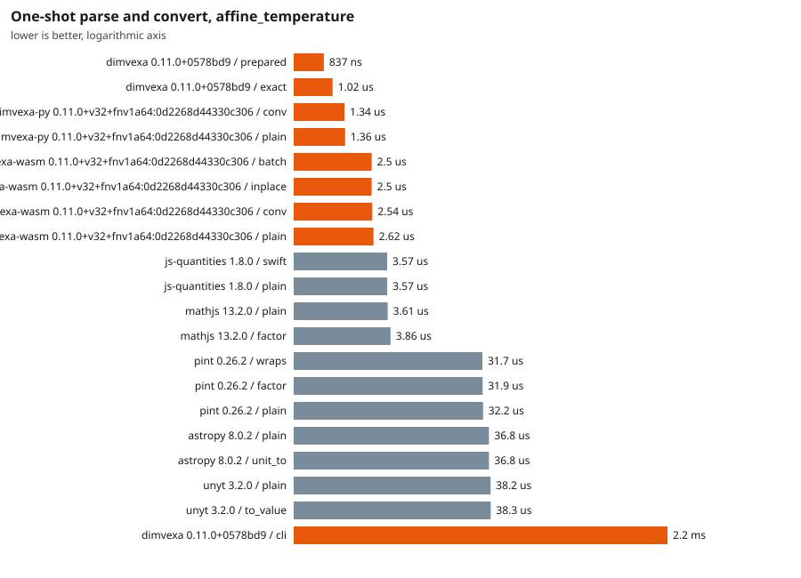
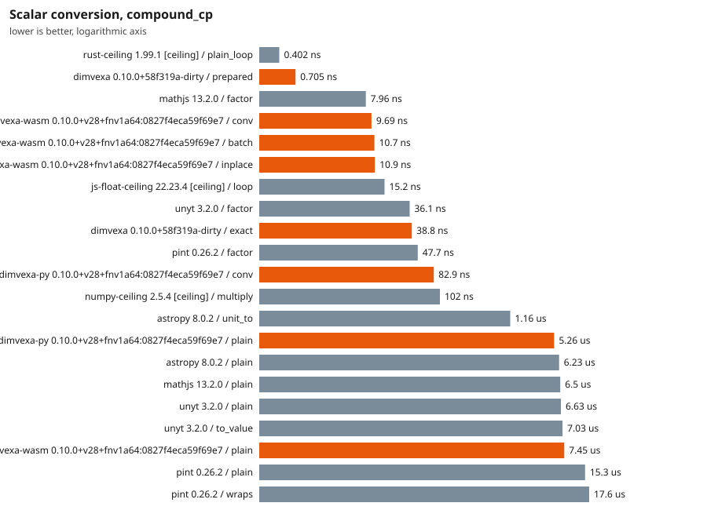
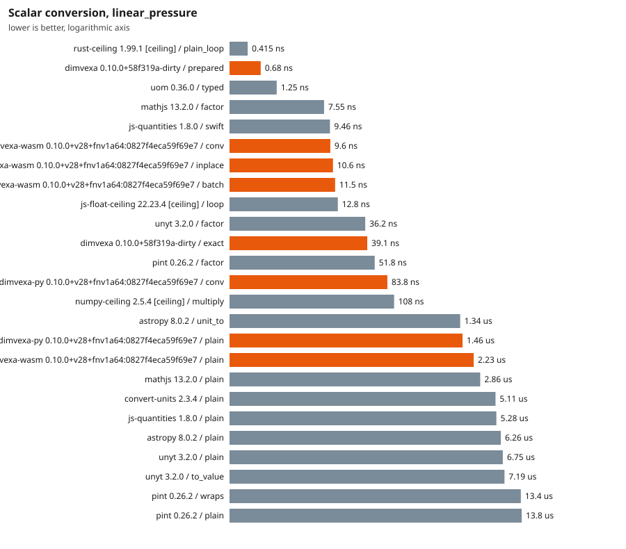
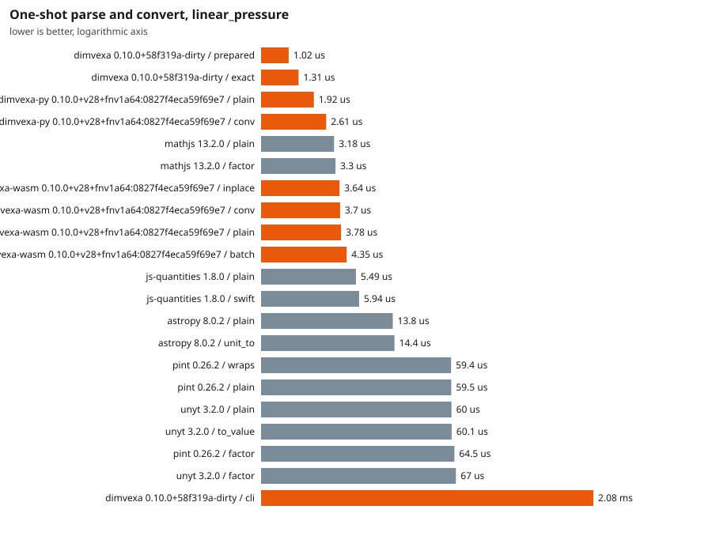
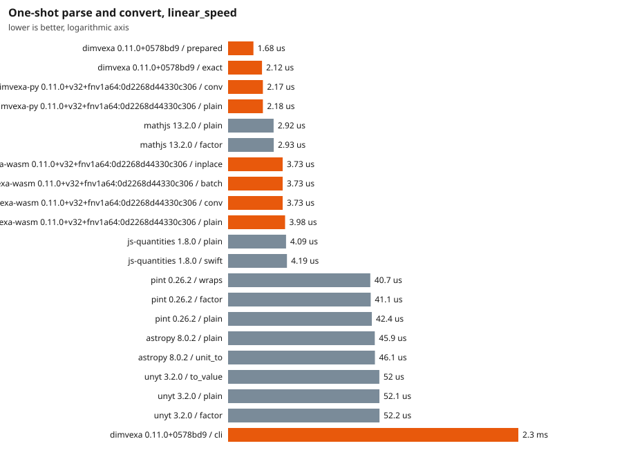
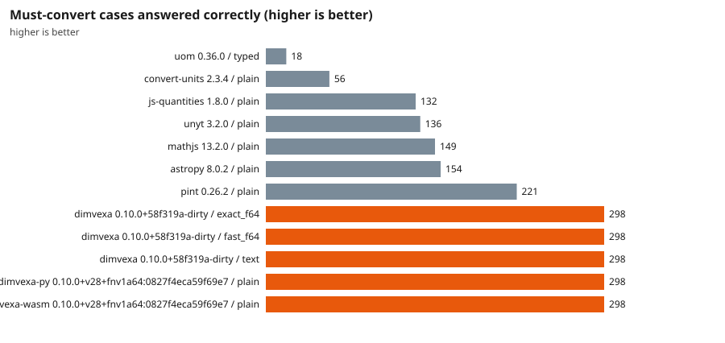

# Comparison with other unit libraries

Generated by `benchmarks/tools/report.py` from the raw files in `benchmarks/results/`. Do not edit by hand. Method and rules: [`docs/benchmarking.md`](../../benchmarking.md).

## Runs included

| Library | Kind | Runtime | OS / CPU | Date (UTC) | Lockfile | Corpus |
|---|---|---|---|---|---|---|
| astropy 8.0.2 | library | CPython 3.13.18 | Linux 6.18.44-fc-v470; Intel(R) Xeon(R) Processor @ 2.10GHz; 4 cores; governor unknown | 2026-11-15T20:11:42Z | pinned | 69bf1471279e6d39 |
| convert-units 2.3.4 | library | node v22.23.4 | Linux 6.18.44-fc-v470; Intel(R) Xeon(R) Processor @ 2.10GHz; 4 cores; governor unknown | 2026-11-15T20:20:21Z | pinned | 69bf1471279e6d39 |
| dimvexa 0.10.0+58f319a-dirty | library | rustc rustc 1.99.1 (58cf8f9c3 2026-10-13) | Linux 6.18.44-fc-v470; Intel(R) Xeon(R) Processor @ 2.10GHz; 4 cores; governor unknown | 2026-11-15T20:07:01Z | pinned | 69bf1471279e6d39 |
| dimvexa-py 0.10.0+v28+fnv1a64:0827f4eca59f69e7 | library | CPython 3.13.18 | Linux 6.18.44-fc-v470; Intel(R) Xeon(R) Processor @ 2.10GHz; 4 cores; governor unknown | 2026-11-15T20:08:42Z | pinned | 69bf1471279e6d39 |
| dimvexa-wasm 0.10.0+v28+fnv1a64:0827f4eca59f69e7 | library | node v22.23.4 | Linux 6.18.44-fc-v470; Intel(R) Xeon(R) Processor @ 2.10GHz; 4 cores; governor unknown | 2026-11-15T20:22:34Z | pinned | 69bf1471279e6d39 |
| js-float-ceiling 22.23.4 [ceiling] | ceiling | node v22.23.4 | Linux 6.18.44-fc-v470; Intel(R) Xeon(R) Processor @ 2.10GHz; 4 cores; governor unknown | 2026-11-15T20:12:25Z | pinned | 69bf1471279e6d39 |
| js-quantities 1.8.0 | library | node v22.23.4 | Linux 6.18.44-fc-v470; Intel(R) Xeon(R) Processor @ 2.10GHz; 4 cores; governor unknown | 2026-11-15T20:16:27Z | pinned | 69bf1471279e6d39 |
| mathjs 13.2.0 | library | node v22.23.4 | Linux 6.18.44-fc-v470; Intel(R) Xeon(R) Processor @ 2.10GHz; 4 cores; governor unknown | 2026-11-15T20:12:43Z | pinned | 69bf1471279e6d39 |
| numpy-ceiling 2.5.4 [ceiling] | ceiling | CPython 3.13.18 | Linux 6.18.44-fc-v470; Intel(R) Xeon(R) Processor @ 2.10GHz; 4 cores; governor unknown | 2026-11-15T20:08:25Z | pinned | 69bf1471279e6d39 |
| pint 0.26.2 | library | CPython 3.13.18 | Linux 6.18.44-fc-v470; Intel(R) Xeon(R) Processor @ 2.10GHz; 4 cores; governor unknown | 2026-11-15T20:09:24Z | pinned | 69bf1471279e6d39 |
| rust-ceiling 1.99.1 [ceiling] | ceiling | rustc rustc 1.99.1 (58cf8f9c3 2026-10-13) | Linux 6.18.44-fc-v470; Intel(R) Xeon(R) Processor @ 2.10GHz; 4 cores; governor unknown | 2026-11-15T20:07:56Z | pinned | 69bf1471279e6d39 |
| unyt 3.2.0 | library | CPython 3.13.18 | Linux 6.18.44-fc-v470; Intel(R) Xeon(R) Processor @ 2.10GHz; 4 cores; governor unknown | 2026-11-15T20:10:38Z | pinned | 69bf1471279e6d39 |
| uom 0.36.0 | library | rustc rustc 1.99.1 (58cf8f9c3 2026-10-13) | Linux 6.18.44-fc-v470; Intel(R) Xeon(R) Processor @ 2.10GHz; 4 cores; governor unknown | 2026-11-15T20:08:25Z | pinned | 69bf1471279e6d39 |

GitHub-hosted runners are noisy. Python and JavaScript wall-clock figures are indicative; read the MAD (median absolute deviation) next to each median, and the raw samples in the JSON.

## Speed

Median ns per conversion (MAD in brackets). **Scalar**: prepared conversion applied to one value, including the loop iteration of the host language (see the loop overhead rows). **One-shot**: parse a string such as `10 m/s` and convert it. **Batch**: ns per element for N values. Rows marked [ceiling] do no unit handling; they show what the language itself costs. `n/a` means the library has no such API or the runner could not run it (see the JSON `errors`).

### affine_temperature

| Library / mode | Scalar | Loop overhead | One-shot parse+convert | Batch 1,000 | Batch 100,000 | Batch 1,000,000 |
|---|---|---|---|---|---|---|
| astropy 8.0.2 / plain | 56 us (MAD 7.98 us) | 24.9 ns (MAD 0.36 ns) | 68.7 us (MAD 5.56 us) | 51.9 ns (MAD 4.1 ns) | 3.36 ns (MAD 0.247 ns) | 4.41 ns (MAD 0.0448 ns) |
| astropy 8.0.2 / unit_to | 40.6 us (MAD 150 ns) | 24.2 ns (MAD 0.191 ns) | 60.4 us (MAD 179 ns) | 43.1 ns (MAD 0.851 ns) | 2.03 ns (MAD 0.0863 ns) | 2.17 ns (MAD 0.0131 ns) |
| convert-units 2.3.4 / plain | 2.79 us (MAD 79 ns) | 2.8 ns (MAD 0.285 ns) | n/a | 3.48 us (MAD 235 ns) | 2.85 us (MAD 77.6 ns) | 3.11 us (MAD 158 ns) |
| dimvexa 0.10.0+58f319a-dirty / cli | n/a | n/a | 1.94 ms (MAD 86 us) | n/a | n/a | n/a |
| dimvexa 0.10.0+58f319a-dirty / exact | 49.5 ns (MAD 1.5 ns) | 0.319 ns (MAD 0.00656 ns) | 1.33 us (MAD 58.6 ns) | 46 ns (MAD 0.087 ns) | 73.2 ns (MAD 1.61 ns) | 62.9 ns (MAD 0.327 ns) |
| dimvexa 0.10.0+58f319a-dirty / prepared | 0.63 ns (MAD 0.00482 ns) | 0.323 ns (MAD 0.00681 ns) | 978 ns (MAD 10.1 ns) | 0.196 ns (MAD 0.002 ns) | 0.252 ns (MAD 0.00135 ns) | 0.685 ns (MAD 0.0179 ns) |
| dimvexa-py 0.10.0+v28+fnv1a64:0827f4eca59f69e7 / conv | 95 ns (MAD 12.7 ns) | 23.6 ns (MAD 0.0947 ns) | 1.77 us (MAD 4.91 ns) | 0.883 ns (MAD 0.083 ns) | 0.418 ns (MAD 0.00487 ns) | 1.09 ns (MAD 0.0215 ns) |
| dimvexa-py 0.10.0+v28+fnv1a64:0827f4eca59f69e7 / plain | 1.27 us (MAD 11.7 ns) | 30 ns (MAD 5.61 ns) | 2.21 us (MAD 167 ns) | 3.3 ns (MAD 0.227 ns) | 0.695 ns (MAD 0.028 ns) | 0.971 ns (MAD 0.013 ns) |
| dimvexa-wasm 0.10.0+v28+fnv1a64:0827f4eca59f69e7 / batch | 10.6 ns (MAD 0.326 ns) | 2.68 ns (MAD 0.0122 ns) | 3.71 us (MAD 478 ns) | 2.61 ns (MAD 0.734 ns) | 1.77 ns (MAD 0.117 ns) | 6.19 ns (MAD 0.225 ns) |
| dimvexa-wasm 0.10.0+v28+fnv1a64:0827f4eca59f69e7 / conv | 8.51 ns (MAD 0.0884 ns) | 2.66 ns (MAD 0.0114 ns) | 3.52 us (MAD 280 ns) | 5.83 ns (MAD 0.112 ns) | 9.81 ns (MAD 0.364 ns) | 6.28 ns (MAD 0.0768 ns) |
| dimvexa-wasm 0.10.0+v28+fnv1a64:0827f4eca59f69e7 / inplace | 10.8 ns (MAD 0.259 ns) | 2.81 ns (MAD 0.0808 ns) | 3.26 us (MAD 74.1 ns) | 0.77 ns (MAD 0.003 ns) | 1.2 ns (MAD 0.025 ns) | 2.33 ns (MAD 0.0349 ns) |
| dimvexa-wasm 0.10.0+v28+fnv1a64:0827f4eca59f69e7 / plain | 2.32 us (MAD 81.5 ns) | 2.7 ns (MAD 0.0998 ns) | 3.23 us (MAD 90.2 ns) | 2.06 us (MAD 49.4 ns) | 2.26 us (MAD 40.9 ns) | 2.25 us (MAD 10.3 ns) |
| js-float-ceiling 22.23.4 [ceiling] / loop | 12.6 ns (MAD 0.469 ns) | 2.7 ns (MAD 0.0343 ns) | n/a | 0.985 ns (MAD 0.002 ns) | 0.928 ns (MAD 0.0056 ns) | 1.11 ns (MAD 0.0243 ns) |
| js-quantities 1.8.0 / plain | 5.51 us (MAD 209 ns) | 2.82 ns (MAD 0.0992 ns) | 5.7 us (MAD 227 ns) | 5.44 us (MAD 55.3 ns) | 5.42 us (MAD 163 ns) | 5.7 us (MAD 126 ns) |
| js-quantities 1.8.0 / swift | 5.08 us (MAD 26.8 ns) | 2.66 ns (MAD 0.00733 ns) | 5.44 us (MAD 21.2 ns) | 5.27 us (MAD 37.5 ns) | 5.5 us (MAD 219 ns) | 5.63 us (MAD 212 ns) |
| mathjs 13.2.0 / factor | 7.22 ns (MAD 0.101 ns) | 2.7 ns (MAD 0.0462 ns) | 5.89 us (MAD 143 ns) | 0.987 ns (MAD 0.001 ns) | 0.931 ns (MAD 0.0148 ns) | 1.12 ns (MAD 0.0424 ns) |
| mathjs 13.2.0 / plain | 5.19 us (MAD 43.4 ns) | 2.64 ns (MAD 0.0328 ns) | 5.7 us (MAD 52.2 ns) | 5.14 us (MAD 101 ns) | 5.35 us (MAD 114 ns) | 5.48 us (MAD 13.4 ns) |
| numpy-ceiling 2.5.4 [ceiling] / multiply | 105 ns (MAD 0.454 ns) | 24.7 ns (MAD 0.0358 ns) | n/a | 1.62 ns (MAD 0.018 ns) | 0.673 ns (MAD 0.0237 ns) | 1.05 ns (MAD 0.0186 ns) |
| pint 0.26.2 / factor | 44 ns (MAD 1.7 ns) | 24.9 ns (MAD 0.375 ns) | 77 us (MAD 3.75 us) | 1.6 ns (MAD 0.035 ns) | 0.433 ns (MAD 0.00329 ns) | 1.1 ns (MAD 0.00857 ns) |
| pint 0.26.2 / plain | 27.2 us (MAD 1.11 us) | 24.3 ns (MAD 0.171 ns) | 73.9 us (MAD 1.78 us) | 26.9 ns (MAD 1.59 ns) | 2.43 ns (MAD 0.113 ns) | 2.88 ns (MAD 0.0178 ns) |
| pint 0.26.2 / wraps | 21.2 us (MAD 773 ns) | 23.9 ns (MAD 0.0757 ns) | 66.1 us (MAD 1.46 us) | 27.3 ns (MAD 0.636 ns) | 2.69 ns (MAD 0.127 ns) | 2.95 ns (MAD 0.0222 ns) |
| rust-ceiling 1.99.1 [ceiling] / memcpy | n/a | 0.314 ns (MAD 0.00131 ns) | n/a | 0.078 ns (MAD 0 ns) | 0.241 ns (MAD 0.00552 ns) | 0.588 ns (MAD 0.0112 ns) |
| rust-ceiling 1.99.1 [ceiling] / plain_loop | 0.445 ns (MAD 0.0308 ns) | 0.312 ns (MAD 0.00173 ns) | n/a | 0.16 ns (MAD 0 ns) | 0.283 ns (MAD 0.0016 ns) | 0.688 ns (MAD 0.00483 ns) |
| unyt 3.2.0 / factor | unsupported |  |  |  |  |  |
| unyt 3.2.0 / plain | 17.2 us (MAD 84.4 ns) | 35 ns (MAD 6.19 ns) | 88.4 us (MAD 6.69 us) | 17.2 ns (MAD 1.47 ns) | 1.59 ns (MAD 0.254 ns) | 1.79 ns (MAD 0.0218 ns) |
| unyt 3.2.0 / to_value | 18.6 us (MAD 789 ns) | 23.9 ns (MAD 0.438 ns) | 77.6 us (MAD 543 ns) | 15.8 ns (MAD 0.397 ns) | 1.45 ns (MAD 0.166 ns) | 1.58 ns (MAD 0.0376 ns) |
| uom 0.36.0 / typed | 0.635 ns (MAD 0.076 ns) | 0.315 ns (MAD 0.00121 ns) | n/a | 0.199 ns (MAD 0.001 ns) | 0.244 ns (MAD 0.00235 ns) | 0.61 ns (MAD 0.0247 ns) |

### compound_cp

| Library / mode | Scalar | Loop overhead | One-shot parse+convert | Batch 1,000 | Batch 100,000 | Batch 1,000,000 |
|---|---|---|---|---|---|---|
| astropy 8.0.2 / plain | 6.23 us (MAD 203 ns) | 24.2 ns (MAD 0.107 ns) | 149 us (MAD 1.05 us) | 7 ns (MAD 0.399 ns) | 0.94 ns (MAD 0.164 ns) | 1.21 ns (MAD 0.00694 ns) |
| astropy 8.0.2 / unit_to | 1.16 us (MAD 37.9 ns) | 24.7 ns (MAD 0.483 ns) | 150 us (MAD 2.05 us) | 2.16 ns (MAD 0.102 ns) | 0.286 ns (MAD 0.00514 ns) | 0.69 ns (MAD 0.00731 ns) |
| convert-units 2.3.4 / plain | unsupported |  |  |  |  |  |
| dimvexa 0.10.0+58f319a-dirty / cli | n/a | n/a | 1.92 ms (MAD 110 us) | n/a | n/a | n/a |
| dimvexa 0.10.0+58f319a-dirty / exact | 38.8 ns (MAD 0.362 ns) | 0.33 ns (MAD 0.00674 ns) | 4.06 us (MAD 35.3 ns) | 42.5 ns (MAD 0.254 ns) | 46.1 ns (MAD 0.157 ns) | 47.1 ns (MAD 0.248 ns) |
| dimvexa 0.10.0+58f319a-dirty / prepared | 0.705 ns (MAD 0.0327 ns) | 0.322 ns (MAD 0.00581 ns) | 3.84 us (MAD 110 ns) | 0.137 ns (MAD 0.001 ns) | 0.249 ns (MAD 0.0098 ns) | 0.653 ns (MAD 0.00924 ns) |
| dimvexa-py 0.10.0+v28+fnv1a64:0827f4eca59f69e7 / conv | 82.9 ns (MAD 1.35 ns) | 26.9 ns (MAD 1.92 ns) | 5.79 us (MAD 339 ns) | 0.764 ns (MAD 0.03 ns) | 0.632 ns (MAD 0.0151 ns) | 1.1 ns (MAD 0.0588 ns) |
| dimvexa-py 0.10.0+v28+fnv1a64:0827f4eca59f69e7 / plain | 5.26 us (MAD 401 ns) | 25.9 ns (MAD 1.23 ns) | 5.51 us (MAD 37 ns) | 5.82 ns (MAD 0.074 ns) | 0.475 ns (MAD 0.00626 ns) | 0.94 ns (MAD 0.0005 ns) |
| dimvexa-wasm 0.10.0+v28+fnv1a64:0827f4eca59f69e7 / batch | 10.7 ns (MAD 0.284 ns) | 4.13 ns (MAD 0.855 ns) | 9.28 us (MAD 225 ns) | 1.7 ns (MAD 0.132 ns) | 1.82 ns (MAD 0.149 ns) | 6.18 ns (MAD 0.341 ns) |
| dimvexa-wasm 0.10.0+v28+fnv1a64:0827f4eca59f69e7 / conv | 9.69 ns (MAD 0.403 ns) | 3.11 ns (MAD 0.445 ns) | 9.12 us (MAD 187 ns) | 5.56 ns (MAD 0.014 ns) | 5.64 ns (MAD 0.212 ns) | 5.81 ns (MAD 0.0209 ns) |
| dimvexa-wasm 0.10.0+v28+fnv1a64:0827f4eca59f69e7 / inplace | 10.9 ns (MAD 0.228 ns) | 2.69 ns (MAD 0.0146 ns) | 9.39 us (MAD 447 ns) | 1 ns (MAD 0.026 ns) | 1.27 ns (MAD 0.0845 ns) | 2.27 ns (MAD 0.0176 ns) |
| dimvexa-wasm 0.10.0+v28+fnv1a64:0827f4eca59f69e7 / plain | 7.45 us (MAD 190 ns) | 2.66 ns (MAD 0.0225 ns) | 9.48 us (MAD 280 ns) | 7.17 us (MAD 69.5 ns) | 7.44 us (MAD 201 ns) | 7.71 us (MAD 73.3 ns) |
| js-float-ceiling 22.23.4 [ceiling] / loop | 15.2 ns (MAD 2.67 ns) | 2.75 ns (MAD 0.0736 ns) | n/a | 1.02 ns (MAD 0.036 ns) | 1.46 ns (MAD 0.0836 ns) | 1.16 ns (MAD 0.0504 ns) |
| js-quantities 1.8.0 / plain | unsupported |  |  |  |  |  |
| js-quantities 1.8.0 / swift | unsupported |  |  |  |  |  |
| mathjs 13.2.0 / factor | 7.96 ns (MAD 0.363 ns) | 2.74 ns (MAD 0.0176 ns) | 6.74 us (MAD 53.6 ns) | 0.988 ns (MAD 0.002 ns) | 0.932 ns (MAD 0.0143 ns) | 1.14 ns (MAD 0.0144 ns) |
| mathjs 13.2.0 / plain | 6.5 us (MAD 98.7 ns) | 2.79 ns (MAD 0.0571 ns) | 6.55 us (MAD 19.2 ns) | 6.44 us (MAD 126 ns) | 6.56 us (MAD 110 ns) | 6.79 us (MAD 59.5 ns) |
| numpy-ceiling 2.5.4 [ceiling] / multiply | 102 ns (MAD 0.455 ns) | 26.5 ns (MAD 1.91 ns) | n/a | 2.62 ns (MAD 0.065 ns) | 0.6 ns (MAD 0.0423 ns) | 1.16 ns (MAD 0.00324 ns) |
| pint 0.26.2 / factor | 47.7 ns (MAD 6.23 ns) | 28.4 ns (MAD 2.97 ns) | 184 us (MAD 10.5 us) | 1.7 ns (MAD 0.08 ns) | 0.433 ns (MAD 0.0217 ns) | 1.17 ns (MAD 0.0834 ns) |
| pint 0.26.2 / plain | 15.3 us (MAD 427 ns) | 25.9 ns (MAD 1.96 ns) | 197 us (MAD 19.5 us) | 16.6 ns (MAD 0.603 ns) | 0.519 ns (MAD 0.0327 ns) | 0.67 ns (MAD 0.0243 ns) |
| pint 0.26.2 / wraps | 17.6 us (MAD 461 ns) | 24.3 ns (MAD 0.443 ns) | 180 us (MAD 3.38 us) | 21.3 ns (MAD 2.71 ns) | 0.625 ns (MAD 0.075 ns) | 0.773 ns (MAD 0.00361 ns) |
| rust-ceiling 1.99.1 [ceiling] / memcpy | n/a | 0.326 ns (MAD 0.0096 ns) | n/a | 0.074 ns (MAD 0.001 ns) | 0.206 ns (MAD 0.00167 ns) | 0.658 ns (MAD 0.0293 ns) |
| rust-ceiling 1.99.1 [ceiling] / plain_loop | 0.402 ns (MAD 0.00896 ns) | 0.314 ns (MAD 0.00179 ns) | n/a | 0.16 ns (MAD 0 ns) | 0.272 ns (MAD 0.00268 ns) | 0.65 ns (MAD 0.0289 ns) |
| unyt 3.2.0 / factor | 36.1 ns (MAD 0.85 ns) | 23.4 ns (MAD 0.34 ns) | 131 us (MAD 8.37 us) | 0.84 ns (MAD 0.022 ns) | 0.245 ns (MAD 0.00271 ns) | 0.715 ns (MAD 0.00507 ns) |
| unyt 3.2.0 / plain | 6.63 us (MAD 79.2 ns) | 24.4 ns (MAD 0.323 ns) | 176 us (MAD 5.72 us) | 6.26 ns (MAD 0.186 ns) | 0.929 ns (MAD 0.0706 ns) | 1.38 ns (MAD 0.00823 ns) |
| unyt 3.2.0 / to_value | 7.03 us (MAD 59.5 ns) | 24.5 ns (MAD 0.773 ns) | 150 us (MAD 10.3 us) | 6.27 ns (MAD 0.198 ns) | 1.17 ns (MAD 0.22 ns) | 1.32 ns (MAD 0.0648 ns) |
| uom 0.36.0 / typed | unsupported |  |  |  |  |  |

### linear_pressure

| Library / mode | Scalar | Loop overhead | One-shot parse+convert | Batch 1,000 | Batch 100,000 | Batch 1,000,000 |
|---|---|---|---|---|---|---|
| astropy 8.0.2 / plain | 6.26 us (MAD 51.5 ns) | 24.5 ns (MAD 0.363 ns) | 13.8 us (MAD 254 ns) | 7.15 ns (MAD 0.368 ns) | 0.811 ns (MAD 0.0214 ns) | 1.3 ns (MAD 0.0195 ns) |
| astropy 8.0.2 / unit_to | 1.34 us (MAD 119 ns) | 25 ns (MAD 0.299 ns) | 14.4 us (MAD 237 ns) | 2.36 ns (MAD 0.153 ns) | 0.286 ns (MAD 0.00335 ns) | 0.692 ns (MAD 0.00478 ns) |
| convert-units 2.3.4 / plain | 5.11 us (MAD 43.9 ns) | 2.67 ns (MAD 0.0211 ns) | n/a | 5.59 us (MAD 110 ns) | 5.59 us (MAD 194 ns) | 5.8 us (MAD 42.7 ns) |
| dimvexa 0.10.0+58f319a-dirty / cli | n/a | n/a | 2.08 ms (MAD 84.3 us) | n/a | n/a | n/a |
| dimvexa 0.10.0+58f319a-dirty / exact | 39.1 ns (MAD 0.501 ns) | 0.31 ns (MAD 0.000311 ns) | 1.31 us (MAD 18.2 ns) | 52.2 ns (MAD 2.41 ns) | 55.7 ns (MAD 0.518 ns) | 57.3 ns (MAD 0.669 ns) |
| dimvexa 0.10.0+58f319a-dirty / prepared | 0.68 ns (MAD 0.0476 ns) | 0.312 ns (MAD 0.00396 ns) | 1.02 us (MAD 13.9 ns) | 0.132 ns (MAD 0.001 ns) | 0.241 ns (MAD 0.0013 ns) | 0.705 ns (MAD 0.0471 ns) |
| dimvexa-py 0.10.0+v28+fnv1a64:0827f4eca59f69e7 / conv | 83.8 ns (MAD 2.21 ns) | 29.2 ns (MAD 3.96 ns) | 2.61 us (MAD 258 ns) | 1.34 ns (MAD 0.127 ns) | 0.679 ns (MAD 0.0444 ns) | 1.09 ns (MAD 0.0141 ns) |
| dimvexa-py 0.10.0+v28+fnv1a64:0827f4eca59f69e7 / plain | 1.46 us (MAD 86.2 ns) | 24.9 ns (MAD 0.809 ns) | 1.92 us (MAD 88.4 ns) | 3.2 ns (MAD 0.1 ns) | 0.627 ns (MAD 0.0105 ns) | 0.91 ns (MAD 0.00298 ns) |
| dimvexa-wasm 0.10.0+v28+fnv1a64:0827f4eca59f69e7 / batch | 11.5 ns (MAD 1.78 ns) | 3.02 ns (MAD 0.216 ns) | 4.35 us (MAD 555 ns) | 2.71 ns (MAD 0.202 ns) | 1.61 ns (MAD 0.0888 ns) | 6.67 ns (MAD 0.407 ns) |
| dimvexa-wasm 0.10.0+v28+fnv1a64:0827f4eca59f69e7 / conv | 9.6 ns (MAD 0.23 ns) | 2.75 ns (MAD 0.056 ns) | 3.7 us (MAD 44.2 ns) | 8.33 ns (MAD 0.433 ns) | 5.71 ns (MAD 0.254 ns) | 8.47 ns (MAD 0.345 ns) |
| dimvexa-wasm 0.10.0+v28+fnv1a64:0827f4eca59f69e7 / inplace | 10.6 ns (MAD 0.163 ns) | 2.8 ns (MAD 0.151 ns) | 3.64 us (MAD 80.9 ns) | 0.963 ns (MAD 0.042 ns) | 1.15 ns (MAD 0.0217 ns) | 2.56 ns (MAD 0.11 ns) |
| dimvexa-wasm 0.10.0+v28+fnv1a64:0827f4eca59f69e7 / plain | 2.23 us (MAD 19.4 ns) | 2.66 ns (MAD 0.00258 ns) | 3.78 us (MAD 65.5 ns) | 2.26 us (MAD 41.1 ns) | 2.43 us (MAD 157 ns) | 2.42 us (MAD 29.5 ns) |
| js-float-ceiling 22.23.4 [ceiling] / loop | 12.8 ns (MAD 0.762 ns) | 2.72 ns (MAD 0.0351 ns) | n/a | 0.985 ns (MAD 0.001 ns) | 0.93 ns (MAD 0.00795 ns) | 1.28 ns (MAD 0.0207 ns) |
| js-quantities 1.8.0 / plain | 5.28 us (MAD 46.6 ns) | 2.67 ns (MAD 0.0212 ns) | 5.49 us (MAD 31.8 ns) | 5.53 us (MAD 82.8 ns) | 6.05 us (MAD 240 ns) | 6.1 us (MAD 152 ns) |
| js-quantities 1.8.0 / swift | 9.46 ns (MAD 0.107 ns) | 2.68 ns (MAD 0.0282 ns) | 5.94 us (MAD 204 ns) | 1.29 ns (MAD 0.003 ns) | 1.31 ns (MAD 0.0793 ns) | 1.41 ns (MAD 0.015 ns) |
| mathjs 13.2.0 / factor | 7.55 ns (MAD 0.218 ns) | 2.6 ns (MAD 0.0508 ns) | 3.3 us (MAD 180 ns) | 0.988 ns (MAD 0.001 ns) | 0.961 ns (MAD 0.0397 ns) | 1.2 ns (MAD 0.0173 ns) |
| mathjs 13.2.0 / plain | 2.86 us (MAD 33.4 ns) | 2.65 ns (MAD 0.0124 ns) | 3.18 us (MAD 133 ns) | 4.76 us (MAD 80.3 ns) | 2.86 us (MAD 80.5 ns) | 2.95 us (MAD 48.5 ns) |
| numpy-ceiling 2.5.4 [ceiling] / multiply | 108 ns (MAD 4.94 ns) | 23.7 ns (MAD 0.091 ns) | n/a | 2.31 ns (MAD 0.152 ns) | 0.657 ns (MAD 0.0534 ns) | 1.17 ns (MAD 0.04 ns) |
| pint 0.26.2 / factor | 51.8 ns (MAD 5.41 ns) | 26.8 ns (MAD 2.08 ns) | 64.5 us (MAD 6.8 us) | 1.76 ns (MAD 0.052 ns) | 0.442 ns (MAD 0.00331 ns) | 1.11 ns (MAD 0.0546 ns) |
| pint 0.26.2 / plain | 13.8 us (MAD 1.7 us) | 25.1 ns (MAD 1.36 ns) | 59.5 us (MAD 785 ns) | 13.7 ns (MAD 0.876 ns) | 0.501 ns (MAD 0.0485 ns) | 0.704 ns (MAD 0.00679 ns) |
| pint 0.26.2 / wraps | 13.4 us (MAD 257 ns) | 35.9 ns (MAD 8.41 ns) | 59.4 us (MAD 1.04 us) | 17.8 ns (MAD 0.544 ns) | 0.651 ns (MAD 0.0339 ns) | 0.709 ns (MAD 0.0347 ns) |
| rust-ceiling 1.99.1 [ceiling] / memcpy | n/a | 0.312 ns (MAD 0.00341 ns) | n/a | 0.086 ns (MAD 0.001 ns) | 0.201 ns (MAD 0.00048 ns) | 0.586 ns (MAD 0.0111 ns) |
| rust-ceiling 1.99.1 [ceiling] / plain_loop | 0.415 ns (MAD 0.00135 ns) | 0.313 ns (MAD 0.00329 ns) | n/a | 0.16 ns (MAD 0 ns) | 0.28 ns (MAD 0.00449 ns) | 0.696 ns (MAD 0.0165 ns) |
| unyt 3.2.0 / factor | 36.2 ns (MAD 0.418 ns) | 27.6 ns (MAD 2.48 ns) | 67 us (MAD 3.08 us) | 0.978 ns (MAD 0.167 ns) | 0.263 ns (MAD 0.00303 ns) | 0.645 ns (MAD 0.018 ns) |
| unyt 3.2.0 / plain | 6.75 us (MAD 122 ns) | 25.2 ns (MAD 0.785 ns) | 60 us (MAD 309 ns) | 6.43 ns (MAD 0.146 ns) | 0.832 ns (MAD 0.0819 ns) | 1.23 ns (MAD 0.004 ns) |
| unyt 3.2.0 / to_value | 7.19 us (MAD 66.1 ns) | 25.2 ns (MAD 0.769 ns) | 60.1 us (MAD 990 ns) | 9.53 ns (MAD 0.326 ns) | 1.36 ns (MAD 0.0993 ns) | 1.42 ns (MAD 0.04 ns) |
| uom 0.36.0 / typed | 1.25 ns (MAD 0.00413 ns) | 0.32 ns (MAD 0.00398 ns) | n/a | 0.643 ns (MAD 0.005 ns) | 0.607 ns (MAD 2e-05 ns) | 0.661 ns (MAD 0.0126 ns) |

### linear_speed

| Library / mode | Scalar | Loop overhead | One-shot parse+convert | Batch 1,000 | Batch 100,000 | Batch 1,000,000 |
|---|---|---|---|---|---|---|
| astropy 8.0.2 / plain | 6.11 us (MAD 74.2 ns) | 23.9 ns (MAD 0.217 ns) | 94.1 us (MAD 777 ns) | 6.49 ns (MAD 0.252 ns) | 5.6 ns (MAD 0.208 ns) | 2.77 ns (MAD 0.0101 ns) |
| astropy 8.0.2 / unit_to | 1.09 us (MAD 33.9 ns) | 22.8 ns (MAD 0.211 ns) | 97.5 us (MAD 1.05 us) | 2.21 ns (MAD 0.121 ns) | 0.278 ns (MAD 0.00701 ns) | 0.638 ns (MAD 0.00992 ns) |
| convert-units 2.3.4 / plain | 5.08 us (MAD 126 ns) | 2.83 ns (MAD 0.0263 ns) | n/a | 4.77 us (MAD 73.6 ns) | 4.58 us (MAD 114 ns) | 4.86 us (MAD 105 ns) |
| dimvexa 0.10.0+58f319a-dirty / cli | n/a | n/a | 1.97 ms (MAD 50.2 us) | n/a | n/a | n/a |
| dimvexa 0.10.0+58f319a-dirty / exact | 21.3 ns (MAD 1.12 ns) | 0.313 ns (MAD 0.00346 ns) | 2.09 us (MAD 28.2 ns) | 36.9 ns (MAD 0.299 ns) | 38.1 ns (MAD 0.329 ns) | 39.8 ns (MAD 0.221 ns) |
| dimvexa 0.10.0+58f319a-dirty / prepared | 0.624 ns (MAD 0.0181 ns) | 0.316 ns (MAD 0.00323 ns) | 1.92 us (MAD 120 ns) | 0.146 ns (MAD 0.005 ns) | 0.239 ns (MAD 0.00192 ns) | 0.609 ns (MAD 0.00554 ns) |
| dimvexa-py 0.10.0+v28+fnv1a64:0827f4eca59f69e7 / conv | 85.9 ns (MAD 1.59 ns) | 24.4 ns (MAD 0.466 ns) | 2.85 us (MAD 8.16 ns) | 0.766 ns (MAD 0.028 ns) | 0.411 ns (MAD 0.00979 ns) | 0.993 ns (MAD 0.0161 ns) |
| dimvexa-py 0.10.0+v28+fnv1a64:0827f4eca59f69e7 / plain | 2.03 us (MAD 39.3 ns) | 25 ns (MAD 0.487 ns) | 2.65 us (MAD 60.5 ns) | 4.67 ns (MAD 0.348 ns) | 0.441 ns (MAD 0.0173 ns) | 0.966 ns (MAD 0.014 ns) |
| dimvexa-wasm 0.10.0+v28+fnv1a64:0827f4eca59f69e7 / batch | 9.17 ns (MAD 0.103 ns) | 2.75 ns (MAD 0.141 ns) | 4.62 us (MAD 142 ns) | 2.42 ns (MAD 0.566 ns) | 1.56 ns (MAD 0.12 ns) | 5.35 ns (MAD 0.429 ns) |
| dimvexa-wasm 0.10.0+v28+fnv1a64:0827f4eca59f69e7 / conv | 7.45 ns (MAD 0.0453 ns) | 2.96 ns (MAD 0.246 ns) | 4.88 us (MAD 207 ns) | 3.51 ns (MAD 0.094 ns) | 8.43 ns (MAD 1.83 ns) | 7.3 ns (MAD 0.315 ns) |
| dimvexa-wasm 0.10.0+v28+fnv1a64:0827f4eca59f69e7 / inplace | 9.64 ns (MAD 0.653 ns) | 2.71 ns (MAD 0.0438 ns) | 4.94 us (MAD 165 ns) | 0.627 ns (MAD 0.017 ns) | 1.1 ns (MAD 0.0115 ns) | 2.52 ns (MAD 0.0885 ns) |
| dimvexa-wasm 0.10.0+v28+fnv1a64:0827f4eca59f69e7 / plain | 4.31 us (MAD 371 ns) | 2.81 ns (MAD 0.00824 ns) | 4.88 us (MAD 133 ns) | 5.02 us (MAD 241 ns) | 5.27 us (MAD 193 ns) | 3.86 us (MAD 82.4 ns) |
| js-float-ceiling 22.23.4 [ceiling] / loop | 3 ns (MAD 0.0107 ns) | 2.69 ns (MAD 0.0247 ns) | n/a | 0.679 ns (MAD 0.001 ns) | 0.929 ns (MAD 0.00247 ns) | 1.57 ns (MAD 0.0329 ns) |
| js-quantities 1.8.0 / plain | 4.59 us (MAD 186 ns) | 2.95 ns (MAD 0.083 ns) | 4.97 us (MAD 66.9 ns) | 5.02 us (MAD 90.9 ns) | 5.02 us (MAD 115 ns) | 5.05 us (MAD 62 ns) |
| js-quantities 1.8.0 / swift | 6.77 ns (MAD 0.403 ns) | 2.75 ns (MAD 0.0809 ns) | 5.8 us (MAD 476 ns) | 1.27 ns (MAD 0 ns) | 1.27 ns (MAD 0.0529 ns) | 1.42 ns (MAD 0.0381 ns) |
| mathjs 13.2.0 / factor | 2.55 ns (MAD 0.0336 ns) | 2.68 ns (MAD 0.0103 ns) | 5.04 us (MAD 871 ns) | 0.676 ns (MAD 0.001 ns) | 1.44 ns (MAD 0.143 ns) | 1.11 ns (MAD 0.0407 ns) |
| mathjs 13.2.0 / plain | 4.08 us (MAD 70.2 ns) | 2.88 ns (MAD 0.0842 ns) | 4.47 us (MAD 99.7 ns) | 3.95 us (MAD 34.5 ns) | 4.28 us (MAD 228 ns) | 4.38 us (MAD 129 ns) |
| numpy-ceiling 2.5.4 [ceiling] / multiply | 107 ns (MAD 5.38 ns) | 25.8 ns (MAD 1.06 ns) | n/a | 1.6 ns (MAD 0.047 ns) | 0.408 ns (MAD 0.00325 ns) | 1.07 ns (MAD 0.0429 ns) |
| pint 0.26.2 / factor | 42.4 ns (MAD 0.983 ns) | 24.4 ns (MAD 0.132 ns) | 87.4 us (MAD 2.29 us) | 1.69 ns (MAD 0.069 ns) | 0.424 ns (MAD 0.0258 ns) | 1.05 ns (MAD 0.0142 ns) |
| pint 0.26.2 / plain | 13.7 us (MAD 170 ns) | 26 ns (MAD 1.76 ns) | 94.8 us (MAD 7.72 us) | 19.6 ns (MAD 1.32 ns) | 1.01 ns (MAD 0.0664 ns) | 0.66 ns (MAD 0.0249 ns) |
| pint 0.26.2 / wraps | 16.8 us (MAD 813 ns) | 26 ns (MAD 0.565 ns) | 89 us (MAD 4.81 us) | 16 ns (MAD 0.901 ns) | 0.499 ns (MAD 0.023 ns) | 0.681 ns (MAD 0.0125 ns) |
| rust-ceiling 1.99.1 [ceiling] / memcpy | n/a | 0.315 ns (MAD 0.00423 ns) | n/a | 0.087 ns (MAD 0.003 ns) | 0.219 ns (MAD 0.0038 ns) | 0.723 ns (MAD 0.0134 ns) |
| rust-ceiling 1.99.1 [ceiling] / plain_loop | 0.51 ns (MAD 0.056 ns) | 0.317 ns (MAD 0.00344 ns) | n/a | 0.16 ns (MAD 0 ns) | 0.238 ns (MAD 0.00708 ns) | 0.599 ns (MAD 0.0234 ns) |
| unyt 3.2.0 / factor | 41.2 ns (MAD 5.35 ns) | 27.7 ns (MAD 3.68 ns) | 109 us (MAD 8.55 us) | 0.914 ns (MAD 0.057 ns) | 0.233 ns (MAD 0.00112 ns) | 0.625 ns (MAD 0.0177 ns) |
| unyt 3.2.0 / plain | 6.57 us (MAD 18 ns) | 26.7 ns (MAD 2.73 ns) | 101 us (MAD 1.93 us) | 6.17 ns (MAD 0.163 ns) | 0.74 ns (MAD 0.00641 ns) | 2.52 ns (MAD 0.028 ns) |
| unyt 3.2.0 / to_value | 7.14 us (MAD 24.2 ns) | 24.2 ns (MAD 0.844 ns) | 106 us (MAD 3.69 us) | 6.9 ns (MAD 0.296 ns) | 1.16 ns (MAD 0.215 ns) | 1.41 ns (MAD 0.0344 ns) |
| uom 0.36.0 / typed | 0.39 ns (MAD 0.0244 ns) | 0.319 ns (MAD 0.0048 ns) | n/a | 0.138 ns (MAD 0.001 ns) | 0.243 ns (MAD 0.00124 ns) | 0.582 ns (MAD 0.0165 ns) |

### Charts

## Prepare, startup and size

| Library | Import (extra over empty interpreter) | Cold prepare (median over conversions) | Peak RSS of the runner process | Installed size |
|---|---|---|---|---|
| astropy 8.0.2 | 238 ms | 83.6 us | 126 MiB | 55.77 MB |
| convert-units 2.3.4 | 9.12 ms | 6.33 us | 122 MiB | 0.11 MB |
| dimvexa 0.10.0+58f319a-dirty | 0.258 ms | 3.8 us | 19 MiB | 4.79 MB |
| dimvexa-py 0.10.0+v28+fnv1a64:0827f4eca59f69e7 | 0 ms | 2.83 us | 92 MiB | 0.04 MB |
| dimvexa-wasm 0.10.0+v28+fnv1a64:0827f4eca59f69e7 | n/a | 4.35 us | 437 MiB | 0.44 MB |
| js-float-ceiling 22.23.4 [ceiling] | n/a | 446 ns | 74 MiB | n/a |
| js-quantities 1.8.0 | 5.03 ms | 16.9 us | 129 MiB | 0.59 MB |
| mathjs 13.2.0 | 394 ms | 14.1 ms | 213 MiB | 9.36 MB |
| numpy-ceiling 2.5.4 [ceiling] | 80.9 ms | 198 ns | 93 MiB | n/a |
| pint 0.26.2 | 197 ms | 339 us | 148 MiB | 3.14 MB |
| rust-ceiling 1.99.1 [ceiling] | n/a | n/a | 19 MiB | 4.79 MB |
| unyt 3.2.0 | 585 ms | 133 us | 141 MiB | 1.55 MB |
| uom 0.36.0 | n/a | n/a | 19 MiB | 3.83 MB |

Peak RSS covers the whole runner process including the corpus and all batch arrays, so compare it only between runs of the same language. For Rust, 'import' is the time to build the registry and 'installed size' is the runner executable.

## Accuracy (against the exact rational truth)

Every must-convert case has an exact rational expected result from an independent oracle. The error is the distance in ulp (steps between representable doubles) from the correctly rounded exact value. A result more than the tolerance away is counted as **wrong**. Cases a library cannot express are counted as **unsupported** and left out of the ulp statistics, so a library that answers few cases can look accurate: read the columns together.

| Library / semantic mode | Cases | Answered | Unsupported | Max ulp | Median ulp | Bit-identical | > 1 ulp | Wrong (> 4 ulp) |
|---|---|---|---|---|---|---|---|---|
| astropy 8.0.2 / plain | 302 | 182 | 120 | 124146008 | 0.0 | 131 | 30 | 28 |
| convert-units 2.3.4 / plain | 302 | 83 | 219 | 4409024035195715600 | 0 | 56 | 27 | 27 |
| dimvexa 0.10.0+58f319a-dirty / exact_f64 | 302 | 298 | 4 | 1 | 0 | 296 | 0 | 0 |
| dimvexa 0.10.0+58f319a-dirty / fast_f64 | 302 | 298 | 4 | 1 | 0 | 292 | 0 | 0 |
| dimvexa 0.10.0+58f319a-dirty / text | 302 | 298 | 4 | 0 | 0 | 298 | 0 | 0 |
| dimvexa-py 0.10.0+v28+fnv1a64:0827f4eca59f69e7 / plain | 302 | 298 | 4 | 1 | 0.0 | 292 | 0 | 0 |
| dimvexa-wasm 0.10.0+v28+fnv1a64:0827f4eca59f69e7 / plain | 302 | 298 | 4 | 1 | 0 | 292 | 0 | 0 |
| js-quantities 1.8.0 / plain | 302 | 169 | 133 | 3535240928 | 0 | 115 | 46 | 37 |
| mathjs 13.2.0 / plain | 302 | 171 | 131 | 1839852893016390 | 0 | 125 | 24 | 22 |
| pint 0.26.2 / plain | 302 | 231 | 71 | 4409024035195715584 | 0 | 154 | 36 | 10 |
| unyt 3.2.0 / plain | 302 | 160 | 142 | 4405646335475187712 | 0.0 | 113 | 27 | 24 |
| uom 0.36.0 / typed | 302 | 33 | 269 | 4409024035195715600 | 4 | 14 | 18 | 15 |

Largest errors (up to 3 per library):

| Library / mode | Case | ulp | Got | Correctly rounded truth |
|---|---|---|---|---|
| astropy 8.0.2 / plain | hw-037 | 124146008 | 0.999739821292388 | 0.9997398075094124 |
| astropy 8.0.2 / plain | hw-038 | 112565889 | 14.503773573063734 | 14.50377377302092 |
| astropy 8.0.2 / plain | dv-common-008 | 104514083 | 6894.757388223366 | 6894.757293168362 |
| convert-units 2.3.4 / plain | hw-068 | 4409024035195715600 | 5.684341886080802e-14 | 0.0 |
| convert-units 2.3.4 / plain | ind-006 | 6665327449 | 0.453592 | 0.45359237 |
| convert-units 2.3.4 / plain | dv-common-023 | 6509108837 | 453.592 | 453.59237 |
| dimvexa 0.10.0+58f319a-dirty / exact_f64 | dv-common-036 | 1 | 273.15000000000003 | 273.15 |
| dimvexa 0.10.0+58f319a-dirty / exact_f64 | hw-067 | 1 | 273.15000000000003 | 273.15 |
| dimvexa 0.10.0+58f319a-dirty / fast_f64 | dv-common-036 | 1 | 273.15000000000003 | 273.15 |
| dimvexa 0.10.0+58f319a-dirty / fast_f64 | hw-037 | 1 | 0.9997398075094125 | 0.9997398075094124 |
| dimvexa 0.10.0+58f319a-dirty / fast_f64 | hw-065 | 1 | 98.60000000000001 | 98.6 |
| dimvexa-py 0.10.0+v28+fnv1a64:0827f4eca59f69e7 / plain | dv-common-036 | 1 | 273.15000000000003 | 273.15 |
| dimvexa-py 0.10.0+v28+fnv1a64:0827f4eca59f69e7 / plain | hw-037 | 1 | 0.9997398075094125 | 0.9997398075094124 |
| dimvexa-py 0.10.0+v28+fnv1a64:0827f4eca59f69e7 / plain | hw-065 | 1 | 98.60000000000001 | 98.6 |
| dimvexa-wasm 0.10.0+v28+fnv1a64:0827f4eca59f69e7 / plain | dv-common-036 | 1 | 273.15000000000003 | 273.15 |
| dimvexa-wasm 0.10.0+v28+fnv1a64:0827f4eca59f69e7 / plain | hw-037 | 1 | 0.9997398075094125 | 0.9997398075094124 |
| dimvexa-wasm 0.10.0+v28+fnv1a64:0827f4eca59f69e7 / plain | hw-065 | 1 | 98.60000000000001 | 98.6 |
| js-quantities 1.8.0 / plain | hw-037 | 3535240928 | 0.9997402 | 0.9997398075094124 |
| js-quantities 1.8.0 / plain | hw-042 | 3247951291 | 14.695943005992959 | 14.695948775513449 |
| js-quantities 1.8.0 / plain | hw-038 | 3205478699 | 14.50376807894691 | 14.50377377302092 |
| mathjs 13.2.0 / plain | dv-common-065 | 1839852893016390 | 117.34776530399999 | 158.987294928 |
| mathjs 13.2.0 / plain | hw-059 | 1839852893016390 | 117.34776530399999 | 158.987294928 |
| mathjs 13.2.0 / plain | hw-060 | 1839852893016390 | 117.34776530399999 | 158.987294928 |
| pint 0.26.2 / plain | dv-common-034 | 4409024035195715584 | 5.684341886080802e-14 | 0.0 |
| pint 0.26.2 / plain | hw-064 | 4409024035195715584 | 5.684341886080802e-14 | 0.0 |
| pint 0.26.2 / plain | ind-021 | 4409024035195715584 | 5.684341886080802e-14 | 0.0 |
| unyt 3.2.0 / plain | dv-common-034 | 4405646335475187712 | 3.552713678800501e-14 | 0.0 |
| unyt 3.2.0 / plain | hw-064 | 4405646335475187712 | 3.552713678800501e-14 | 0.0 |
| unyt 3.2.0 / plain | ind-021 | 4405646335475187712 | 3.552713678800501e-14 | 0.0 |

## Coverage and safety matrix

**Must convert** (correct / wrong value / error because unsupported) and **must refuse** (refused / accepted / not applicable). A request is *accepted* when the library returned a number for it. Any error counts as a refusal: the reason is not compared, except for Dimvexa (see below).

The refuse cases are scored in two groups, because they are not the same kind of failure. **Ambiguous name**: the name has several accepted meanings (`ton`, `gal`, `oz`, `pt`, `cal`, `Btu`, `hp`, `mile`, `foot`, bare `ppm`). A library that applies a documented default (for example pint reading `ton` as the short ton) made a policy choice; it is reported as *accepted with a default* and is not a bug, but Dimvexa's design goal is to refuse, so it is still counted and shown. **Other**: missing context, temperature-kind errors, dimension mismatches. Accepting one of these is a defect or a missing check. The corpus does not record whether a library documents its default, so the ambiguous column is not a judgement of the library.

| Library / mode | Convert cases | Correct | Wrong value | Unsupported | Ambiguous: cases | refused | accepted with default | n/a | Other: cases | refused | silently accepted | n/a |
|---|---|---|---|---|---|---|---|---|---|---|---|---|
| astropy 8.0.2 / plain | 302 | 154 | 28 | 120 | 10 | 4 | 6 | 0 | 20 | 16 | **4** | 0 |
| convert-units 2.3.4 / plain | 302 | 56 | 27 | 219 | 10 | 8 | 2 | 0 | 20 | 17 | 0 | 3 |
| dimvexa 0.10.0+58f319a-dirty / exact_f64 | 302 | 298 | 0 | 4 | 10 | 10 | 0 | 0 | 20 | 17 | 0 | 3 |
| dimvexa 0.10.0+58f319a-dirty / fast_f64 | 302 | 298 | 0 | 4 | 10 | 10 | 0 | 0 | 20 | 17 | 0 | 3 |
| dimvexa 0.10.0+58f319a-dirty / text | 302 | 298 | 0 | 4 | 10 | 10 | 0 | 0 | 20 | 17 | 0 | 3 |
| dimvexa-py 0.10.0+v28+fnv1a64:0827f4eca59f69e7 / plain | 302 | 298 | 0 | 4 | 10 | 10 | 0 | 0 | 20 | 17 | 0 | 3 |
| dimvexa-wasm 0.10.0+v28+fnv1a64:0827f4eca59f69e7 / plain | 302 | 298 | 0 | 4 | 10 | 10 | 0 | 0 | 20 | 17 | 0 | 3 |
| js-quantities 1.8.0 / plain | 302 | 132 | 37 | 133 | 10 | 1 | 9 | 0 | 20 | 17 | **3** | 0 |
| mathjs 13.2.0 / plain | 302 | 149 | 22 | 131 | 10 | 3 | 7 | 0 | 20 | 15 | **5** | 0 |
| pint 0.26.2 / plain | 302 | 221 | 10 | 71 | 10 | 0 | 10 | 0 | 20 | 18 | **2** | 0 |
| unyt 3.2.0 / plain | 302 | 136 | 24 | 142 | 10 | 4 | 6 | 0 | 20 | 16 | **4** | 0 |
| uom 0.36.0 / typed | 302 | 18 | 15 | 269 | 10 | 0 | 0 | 10 | 20 | 0 | 0 | 20 |

### Must-convert results by origin of the case

The corpus mixes cases taken from Dimvexa's own golden vectors, hand-written cases whose truth comes from the oracle in `corpus-src/truth.toml`, and *independent* cases whose expected value is the number published in a cited source (NIST, BIPM) and only cross-checked by the oracle. A library that does much better on the first group than on the independent one would show corpus bias. Cells are correct/total; a dash means the result file predates that group (its corpus is older).

| Origin | astropy 8.0.2 / plain | convert-units 2.3.4 / plain | dimvexa 0.10.0+58f319a-dirty / exact_f64 | dimvexa 0.10.0+58f319a-dirty / fast_f64 | dimvexa 0.10.0+58f319a-dirty / text | dimvexa-py 0.10.0+v28+fnv1a64:0827f4eca59f69e7 / plain | dimvexa-wasm 0.10.0+v28+fnv1a64:0827f4eca59f69e7 / plain | js-quantities 1.8.0 / plain | mathjs 13.2.0 / plain | pint 0.26.2 / plain | unyt 3.2.0 / plain | uom 0.36.0 / typed |
|---|---|---|---|---|---|---|---|---|---|---|---|---|
| Dimvexa golden vectors | 81/179 | 25/179 | 179/179 | 179/179 | 179/179 | 179/179 | 179/179 | 68/179 | 69/179 | 112/179 | 66/179 | 4/179 |
| Hand-written (oracle truth) | 44/83 | 14/83 | 79/83 | 79/83 | 79/83 | 79/83 | 79/83 | 38/83 | 48/83 | 74/83 | 45/83 | 6/83 |
| Independent (published values) | 29/40 | 17/40 | 40/40 | 40/40 | 40/40 | 40/40 | 40/40 | 26/40 | 32/40 | 35/40 | 25/40 | 8/40 |

### Per-request outcome for the must-refuse cases

`ok` refused, `ACCEPTED` accepted (the number is shown), `-` not applicable. The group column is `ambiguous name` (an accepted number may be a documented default) or `other` (accepting it is a defect).

| Case | Category | Group | astropy 8.0.2 / plain | convert-units 2.3.4 / plain | dimvexa 0.10.0+58f319a-dirty / exact_f64 | dimvexa 0.10.0+58f319a-dirty / fast_f64 | dimvexa 0.10.0+58f319a-dirty / text | dimvexa-py 0.10.0+v28+fnv1a64:0827f4eca59f69e7 / plain | dimvexa-wasm 0.10.0+v28+fnv1a64:0827f4eca59f69e7 / plain | js-quantities 1.8.0 / plain | mathjs 13.2.0 / plain | pint 0.26.2 / plain | unyt 3.2.0 / plain | uom 0.36.0 / typed |
|---|---|---|---|---|---|---|---|---|---|---|---|---|---|---|
| ref-001 | ambiguous_name | ambiguous name | ACCEPTED (np.float64(907) | ok | ok | ok | ok | ok | ok | ACCEPTED (907.18474) | ACCEPTED (907.18474) | ACCEPTED (907.1847400000) | ACCEPTED (array(907.1847) | - |
| ref-002 | ambiguous_name | ambiguous name | ok | ACCEPTED (3.785411795401) | ok | ok | ok | ok | ok | ACCEPTED (3.7854118) | ACCEPTED (3.785411784) | ACCEPTED (3.785411783999) | ok | - |
| ref-003 | ambiguous_name | ambiguous name | ACCEPTED (np.float64(28.) | ACCEPTED (28.3495) | ok | ok | ok | ok | ok | ACCEPTED (28.3495231) | ACCEPTED (28.349523125) | ACCEPTED (28.34952312500) | ACCEPTED (array(28.34952) | - |
| ref-004 | ambiguous_name | ambiguous name | ok | ok | ok | ok | ok | ok | ok | ACCEPTED (0.473176475) | ACCEPTED (0.473176473) | ACCEPTED (0.473176472999) | ok | - |
| ref-005 | ambiguous_name | ambiguous name | ACCEPTED (np.float64(4.1) | ok | ok | ok | ok | ok | ok | ACCEPTED (4.184) | ok | ACCEPTED (4.184) | ACCEPTED (array(4.184)) | - |
| ref-006 | ambiguous_name | ambiguous name | ok | ok | ok | ok | ok | ok | ok | ok | ok | ACCEPTED (1055.056) | ok | - |
| ref-007 | ambiguous_name | ambiguous name | ACCEPTED (np.float64(745) | ok | ok | ok | ok | ok | ok | ACCEPTED (745.699872) | ACCEPTED (745.6998715386) | ACCEPTED (745.6998715822) | ACCEPTED (array(745.6998) | - |
| ref-008 | ambiguous_name | ambiguous name | ACCEPTED (np.float64(1.6) | ok | ok | ok | ok | ok | ok | ACCEPTED (1.609344) | ACCEPTED (1.609344) | ACCEPTED (1.609344) | ACCEPTED (array(1.609344) | - |
| ref-009 | ambiguous_name | ambiguous name | ACCEPTED (np.float64(0.3) | ok | ok | ok | ok | ok | ok | ACCEPTED (0.3048) | ACCEPTED (0.3048) | ACCEPTED (0.304799999999) | ACCEPTED (array(0.3048)) | - |
| ref-010 | ambiguous_name | ambiguous name | ok | ok | ok | ok | ok | ok | ok | ACCEPTED (0.0001) | ok | ACCEPTED (9.999999999999) | ok | - |
| ref-011 | missing_context | other | ok | ok | ok | ok | ok | ok | ok | ok | ok | ok | ok | - |
| ref-012 | missing_context | other | ok | ok | ok | ok | ok | ok | ok | ok | ok | ok | ok | - |
| ref-013 | missing_context | other | ok | ok | ok | ok | ok | ok | ok | ok | ok | ok | ok | - |
| ref-014 | missing_context | other | ok | ok | ok | ok | ok | ok | ok | ok | ok | ok | ok | - |
| ref-015 | missing_context | other | ok | ok | ok | ok | ok | ok | ok | ok | ok | ok | ok | - |
| ref-016 | missing_context | other | ok | ok | ok | ok | ok | ok | ok | ok | ok | ok | ok | - |
| ref-017 | missing_context | other | ok | ok | ok | ok | ok | ok | ok | ok | ok | ok | ok | - |
| ref-018 | missing_context | other | ok | ok | ok | ok | ok | ok | ok | ok | ok | ok | ok | - |
| ref-019 | missing_context | other | ok | ok | ok | ok | ok | ok | ok | ok | ok | ok | ok | - |
| ref-020 | missing_context | other | ok | ok | ok | ok | ok | ok | ok | ok | ok | ACCEPTED (0.980665) | ok | - |
| ref-021 | kind | other | ACCEPTED (np.float64(50.) | - | - | - | - | - | - | ok | ACCEPTED (50 degC) | ok | ACCEPTED (array(50.)) | - |
| ref-022 | kind | other | ok | - | - | - | - | - | - | ACCEPTED (25 tempC) | ACCEPTED (25 degC) | ok | ACCEPTED (array(25.)) | - |
| ref-023 | kind | other | ACCEPTED (np.float64(30.) | - | - | - | - | - | - | ok | ACCEPTED (29.99999999999) | ok | ACCEPTED (array(30.)) | - |
| ref-024 | kind | other | ACCEPTED (np.float64(283) | ok | ok | ok | ok | ok | ok | ACCEPTED (10) | ACCEPTED (283.15) | ACCEPTED (283.15) | ACCEPTED (array(283.15)) | - |
| ref-025 | kind | other | ACCEPTED (np.float64(-26) | ok | ok | ok | ok | ok | ok | ACCEPTED (-263.15) | ACCEPTED (-263.15) | ok | ok | - |
| ref-026 | dimension | other | ok | ok | ok | ok | ok | ok | ok | ok | ok | ok | ok | - |
| ref-027 | dimension | other | ok | ok | ok | ok | ok | ok | ok | ok | ok | ok | ok | - |
| ref-028 | dimension | other | ok | ok | ok | ok | ok | ok | ok | ok | ok | ok | ok | - |
| ref-029 | dimension | other | ok | ok | ok | ok | ok | ok | ok | ok | ok | ok | ok | - |
| ref-030 | dimension | other | ok | ok | ok | ok | ok | ok | ok | ok | ok | ok | ok | - |

### Unit coverage

Units a library can parse, out of the coverage lists in the corpus (Dimvexa spellings, translated per library; see `benchmarks/translations/`). Parsing a unit does not prove its factor is right; the accuracy section checks values.

| List | astropy 8.0.2 / plain | convert-units 2.3.4 / plain | dimvexa 0.10.0+58f319a-dirty / exact_f64 | dimvexa 0.10.0+58f319a-dirty / fast_f64 | dimvexa 0.10.0+58f319a-dirty / text | dimvexa-py 0.10.0+v28+fnv1a64:0827f4eca59f69e7 / plain | dimvexa-wasm 0.10.0+v28+fnv1a64:0827f4eca59f69e7 / plain | js-quantities 1.8.0 / plain | mathjs 13.2.0 / plain | pint 0.26.2 / plain | unyt 3.2.0 / plain | uom 0.36.0 / typed |
|---|---|---|---|---|---|---|---|---|---|---|---|---|
| compound | 11/11 | 2/11 | 11/11 | 11/11 | 11/11 | 11/11 | 11/11 | 7/11 | 11/11 | 11/11 | 11/11 | 2/11 |
| dimvexa_seed_table | 75/165 | 40/165 | 165/165 | 165/165 | 165/165 | 165/165 | 165/165 | 79/165 | 65/165 | 100/165 | 66/165 | 10/165 |
| imperial_us | 14/24 | 8/24 | 24/24 | 24/24 | 24/24 | 24/24 | 24/24 | 14/24 | 13/24 | 24/24 | 12/24 | 4/24 |
| pressure | 3/10 | 3/10 | 7/10 | 7/10 | 7/10 | 7/10 | 7/10 | 6/10 | 6/10 | 8/10 | 3/10 | 1/10 |
| process | 13/19 | 1/19 | 15/19 | 15/19 | 15/19 | 15/19 | 15/19 | 9/19 | 11/19 | 14/19 | 10/19 | 0/19 |
| si | 25/25 | 17/25 | 25/25 | 25/25 | 25/25 | 25/25 | 25/25 | 25/25 | 24/25 | 25/25 | 24/25 | 4/25 |
| si_prefixed | 16/17 | 9/17 | 17/17 | 17/17 | 17/17 | 17/17 | 17/17 | 17/17 | 17/17 | 17/17 | 17/17 | 2/17 |
| temperature | 8/8 | 4/8 | 8/8 | 8/8 | 8/8 | 8/8 | 8/8 | 8/8 | 8/8 | 7/8 | 8/8 | 3/8 |

Dimvexa (exact_f64): 25 of 27 refusals carried the intended error code.

